# Research Brief: Beyond Hallownest
## Civilization, Memory, Divinity, Ecology, and Identity in *Hollow Knight* and *Hollow Knight: Silksong*

- **Principal Investigators:** Lead Game Studies Researcher & Antigravity Collaborative Academic Team
- **Disciplinary Anchors:** Game Studies, Environmental Humanities, Ecocriticism, Philosophy, Religious Studies, Comparative Mythology, Arthropod Biology
- **Target Manuscript Length:** 10,000–13,000 words
- **Methodology:** Comparative Qualitative Case Study, Spatial Narratology, Ludonarrative Analysis, Hermeneutic Close Reading
- **Reference Standard:** APA 7th Edition

---

## 1. Title Formulations

### Primary Academic Title:
**Beyond Hallownest: Civilization, Memory, Divinity, Ecology, and Identity in *Hollow Knight* and *Hollow Knight: Silksong***

### Alternative Formulations:
1. *The Kingdoms Beneath and Beyond: Mythology, Identity, Ecological Collapse, and the Philosophy of Exploration in Team Cherry's Ludic Worlds*
2. *From Hallownest to Pharloom: The Evolution of Insect Civilization, Mythology, and Interactive World-Building in Team Cherry's Games*
3. *The Lives of Forgotten Kingdoms: Memory, Sacrifice, Religion, and the Ecology of Ruined Worlds in Hollow Knight and Silksong*
4. *Silk, Soul, and the Hollow World: A Comparative Study of Identity, Divinity, and the Nature of Civilization in Team Cherry's Metroidvanias*

---

## 2. Central Research Question & Sub-Questions

### Central Research Question (CRQ):
> **How do *Hollow Knight* (2017) and *Hollow Knight: Silksong* (2025) deploy interconnected spatial world-building, character development, insect-inspired civilizational structures, mythological systems, environmental storytelling, and interactive mechanics to investigate the rise and collapse of societies, the nature of individual identity, historical memory, political-theological power, sacrifice, and the tension between individual agency and systemic order?**

### Supporting Research Questions (RQs):

- **RQ1 — World-Building & Spatial Architecture:** How do Hallownest and Pharloom establish distinct civilizational topologies through geography, architecture, cultural remnants, and environmental decay, contrasting Hallownest's subterranean descent with Pharloom's upward pilgrimage?
- **RQ2 — Narrative Delivery & Epistemological Fragmentation:** In what ways do both games distribute historical and lore knowledge across fragmented environmental relics, NPC monologues, boss encounters, dream narratives, and musical motifs?
- **RQ3 — Character Development & Protagonist Ontologies:** How do the Knight (an anonymous, hollow vessel constructed as a sacrificial instrument) and Hornet (a named, agile protector endowed with lineage, dialogue, and personal will) function as distinct entry points for player embodiment and agency?
- **RQ4 — Civilization, Ideology, and Collapse:** What systemic contradictions precipitate the catastrophic declines of Hallownest and Pharloom? To what extent do their autocracies collapse due to an ontological refusal of transience and the exploitation of higher forces?
- **RQ5 — Religion, Mythology, and Divinity:** How do higher beings (the Pale King, the Radiance, Grand Mother Silk), cultic worship, dreams, songs, and sacrificial rites construct and legitimate institutional authority?
- **RQ6 — Consciousness, Free Will, and the Void:** What constitutes selfhood, memory, and agency in minds fashioned from void or silk? Does the Knight develop genuine will, or does it execute an assigned telos?
- **RQ7 — Biology, Entomology, and Symbiosis:** How do real-world arthropod behaviors (eusociality, silk tensile chemistry, parasitism, metamorphosis, molting) inform the societies, movement mechanics, and ecological conflicts of both titles?
- **RQ8 — Mechanics, Traversal, and Ludic Discovery:** How do ability gating, nail/needle combat, resource loops (Soul vs. Silk), and death mechanics transform the player from an external observer into an active co-constructor of historical meaning?
- **RQ9 — Affect, Atmosphere, and Difficulty:** How do Christopher Larkin's musical scores, soundscapes, punishing combat loops, and the psychological weight of failure cultivate affects of melancholy, dread, tenacity, and reverence?
- **RQ10 — Comparative Sequels & Iterative Design:** How does *Silksong* reframe, complicate, or subvert the narrative paradigms and mechanical axioms established in *Hollow Knight*?
- **RQ11 — Creative Intentions:** How do Team Cherry's documented creative methodologies—from game jam prototypes (*Hungry Knight*) to traditional 2D animation and minimalist design—reflect a conscious rejection of conventional exposition?
- **RQ12 — The Player's Moral Agency:** Does the player merely excavate inert historical ruins, or do player choices in navigating multiple endings implicate them in the perpetuation or dismantling of civilizational violence?

---

## 3. Central Working Hypothesis

Hollow Knight and Silksong construct fictional insect civilizations whose scale, cultural memory, and socio-biological institutions transcend the individual quests of their protagonists. Neither game relies on conventional exposition or direct moralization; rather, player comprehension is hermeneutically assembled through iterative traversal, mechanical mastery, environmental archaeological observation, and affective immersion.

While *Hollow Knight* presents the tragedy of **Hallownest**—a civilization ruined by an autocratic Wyrm's obsessive pursuit of permanence, order, and containment through the brutal instrumentalization and mass sacrifice of hollow offspring—*Silksong* shifts to **Pharloom**, an active, ascending theocracy structured around silk, choral harmony, labor, and spiritual pilgrimage to the Citadel. 

Together, the two works advance a unified critique:
> **Civilizations succumb not merely to external biological blight or ecological scarcity, but to internal ideological pathologies: the sanctification of sacrifice, the monopolization of divine forces, the violent suppression of organic transience, and the systematic reduction of sentient beings into sacrificial tools.**

---

## 4. Theoretical Architecture

```mermaid
graph TD
    A["Theoretical Framework"] --> B["Game Studies & Spatial Narratology"]
    A --> C["Environmental Humanities & Ecocriticism"]
    A --> D["Philosophy & Political Ethics"]
    A --> E["Religious Studies & Mythology"]
    A --> F["Biological Sciences & Entomology"]

    B --> B1["Jenkins (2004): Narrative Architecture"]
    B --> B2["Aarseth (1997): Ergodic Traversal"]
    B --> B3["Andriano & Caracciolo (2025): Metroidvania Ecologies"]
    B --> B4["Zhang (2026): Backtracking Narrative Mechanics"]

    C --> C1["Morton (2016): Dark Ecology"]
    C --> C2["Bennett (2010): Vital Materialism"]
    C --> C3["Haraway (2016): Chthulucene & Sympoiesis"]

    D --> D1["Grunberg (2024): The Omelas Dilemma & Radical Agency"]
    D --> D2["Agamben (1998): Homo Sacer & Bare Life"]
    D --> D3["Camus (1942): Absurdism & Sisyphus"]

    E --> E1["Eliade (1959): Sacred Space & Axis Mundi"]
    E --> E2["Wysocki (2026): The Sacred, Song, and Pilgrimage"]
    E --> E3["Otto (1917): The Numinous & Mysterium Tremendum"]

    F --> F1["Morales-Primo (2026): Silk Biopolymers & Arachnid Mechanics"]
    F --> F2["Wilson & Hölldobler (1990): Eusociality & Superorganisms"]
```

---

## 5. Methodological Blueprint

1. **Textual and Ludic Close Reading:** Comprehensive examination of all in-game journal entries (Hunter's Journal), item descriptions, NPC dialogues, dream nail dialogues, tablet inscriptions, and musical themes.
2. **Spatial and Topological Mapping:** Spatial analysis of level architecture, comparing the subterranean, descending excavation of Hallownest with the ascending vertical pilgrimage of Pharloom.
3. **Comparative Ludic Analysis:** Formal comparison of core systems (Nail vs. Needle; Soul casting/focus vs. Silk weaving/binding; Charms vs. Crests/Tools).
4. **Literature Synthesis:** Triangulation of game phenomena against peer-reviewed academic game studies, ecocriticism, political philosophy, and biological scholarship.
5. **Canon Tiering & Falsification:** Strict adherence to a 3-tier certainty register to prevent fan speculation from distorting empirical claims.
