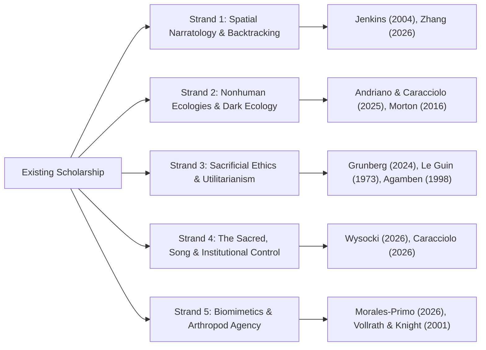

# Literature Synthesis & Research Gap Analysis
## Beyond Hallownest: Civilization, Memory, Divinity, Ecology, and Identity in *Hollow Knight* and *Hollow Knight: Silksong*

- **Disciplinary Context:** Comparative Game Studies, Environmental Humanities, Political Theology, Arthropod Biomimetics
- **Framework:** Thematic Cross-Synthesis & Hermeneutic Gap Identification
- **Citation Standard:** APA 7th Edition

---

## 1. Introduction & Thematic Landscape

Academic scholarship on Team Cherry’s ludic output has coalesced around several vibrant, interdisciplinary nodes: spatial narratology and Metroidvania architecture (Jenkins, 2004; Parish, 2018; Zhang, 2026), posthuman and non-anthropocentric ecocriticism (Andriano & Caracciolo, 2025; Chang, 2019; Morton, 2016), ethical utilitarianism and sacrificial politics (Grunberg, 2024; Agamben, 1998), theological aesthetics and ritual pilgrimage (Wysocki, 2026; Eliade, 1959), and biomimetic arthropod morphology (Morales-Primo, 2026).

However, because *Hollow Knight: Silksong* (2025) is a relatively recent addition to the digital humanities landscape, existing literature remains acutely bifurcated. The overwhelming majority of comprehensive game-studies publications focus exclusively on the 2017 title *Hollow Knight*, treating Hallownest as a closed, subterranean allegorical case study. The emerging scholarship on *Silksong*—while methodologically sound—is largely composed of preliminary game reviews (Wysocki, 2026), localized biomimetic evaluations (Morales-Primo, 2026), or broader world-building surveys that treat Pharloom as an illustrative example rather than an independently analyzed civilization (Caracciolo, 2026).

This synthesis systematically maps the existing literature, articulates its theoretical convergences and tensions, and delineates the critical research gaps that our comparative study addresses.

---

## 2. Key Thematic Strands in Existing Scholarship

### Strand 1: Spatial Narratology, Archaeological Excavation, and Backtracking
Game studies scholars have repeatedly identified *Hollow Knight* as an exemplar of what Clara Fernández-Vara (2011) terms "indexical storytelling" and Henry Jenkins (2004) defines as "spatial narrative architecture." In Hallownest, the past is not delivered via diegetic cutscenes; it is deposited in geological and architectural strata. The player acts as an archaeologist unearthing fossilized socio-political history through ergodic traversal (Aarseth, 1997).

Bohan Zhang (2026) extends this spatial inquiry by analyzing the "backtracking narrative mechanism." Zhang demonstrates that in Metroidvania topologies, revisiting previously completed regions with new movement mechanics is not mere mechanical repetition; it is a hermeneutic re-reading of the space. In *Hollow Knight*, returning to the Forgotten Crossroads after acquiring the Monarch Wings or awakening a Dreamer reveals the "Infected Crossroads"—a traumatic environmental mutation where orange pustules rupture the masonry and familiar enemies mutate into erratic, aggressive vectors of biological blight. Zhang contrasts this with *Silksong*, where backtracking is driven by the Wishes system and courier deliveries along the Bellways, shifting the player's spatial relationship from archaeological mourning to communal maintenance and repair.

### Strand 2: Metroidvania Ecologies and the De-Centering of the Human
In their landmark study *Metroidvania Ecologies*, Angelo Maria Andriano and Marco Caracciolo (2025) position *Hollow Knight* alongside *Rain World* (2017) to critique traditional ludic fantasies of anthropocentric mastery. In conventional action-adventure titles, game space exists to be mapped, subjugated, and cleared of hostile fauna. In contrast, Hallownest confronts the player with an autonomous, indifferent, more-than-human ecosystem (Chang, 2019). The ruined kingdom is not an empty stage awaiting human revitalization; it is a rotting chitinous biosphere where fungal networks, mosskin swarms, and territorial mantises pursue their own socio-biological imperatives regardless of the player's presence.

Andriano and Caracciolo draw heavily on Timothy Morton's (2016) concept of "dark ecology"—a logic of ecological coexistence that acknowledges entanglement, irony, melancholy, and the impossibility of clean separation between organism and environment. The Infection is analyzed not as an external disease invading an innocent kingdom, but as the violent, repressed return of an ancient solar deity (the Radiance) whose organic, dream-woven existence was violently paved over by the Pale King’s sterile, stone-monumental order.

### Strand 3: Sacrificial Utilitarianism and the Omelas Paradigm
The most influential ethical analysis of *Hollow Knight* is Alex Grunberg’s (2024) investigation of the Omelas dilemma in *Games and Culture*. Grounding his analysis in Ursula K. Le Guin's (1973) *The Ones Who Walk Away from Omelas*, Grunberg argues that Hallownest represents a literalized utilitarian contract: the prosperity, intelligence, and permanence of an entire civilization purchased through the torture and perpetual containment of a single sacrificial offspring—the Hollow Knight.

Crucially, Grunberg highlights how the interactive medium radically revises Le Guin’s ethical paradox. In Le Guin’s prose narrative, citizens are paralyzed by a binary choice: either remain complicit in the utopian bargain or silently walk away into the darkness, leaving the suffering child in its misery. In *Hollow Knight*, procedural agency enables the player to enact alternative responses:
1. **Complicity / Substitution (The Hollow Knight Ending):** The player defeats the corrupted Vessel and absorbs the infection into their own shell, renewing the sacrificial cycle and becoming the new tortured prisoner.
2. **Systemic Decapitation (Dream No More Ending):** Guided by the Void Heart, the player penetrates the Dream Realm, confronts the Radiance directly, and destroys the source of the infection, liberating Hallownest from the divine deadlock at the cost of the Knight’s own corporal dissolution.
3. **Cosmic Overthrow (Embrace the Void Ending):** The player ascends through Godhome, surrendering individuality to become the "Void Given Form," annihilating both the Radiance and the sacrificial pantheon in an apocalyptic wave of primordial non-being.

Grunberg’s ethical analysis directly intersects with Giorgio Agamben’s (1998) political theology of *homo sacer* and "bare life." The millions of discarded Vessel corpses piled in the Abyss represent life that the sovereign (the Pale King) stripped of kinship, voice, and political standing, reducing them to purely instrumental disposable biological matter.

### Strand 4: The Sacred, Song, and Theocratic Hegemony in *Silksong*
Emerging scholarship on *Silksong* shifts analytical focus from utilitarian mourning to theocratic surveillance and liturgical performance. Jan Wysocki (2026) in the *Journal for Religion, Film and Media* examines how Pharloom deploys religious aesthetics—specifically choral polyphony, liturgical vestments, ceremonial bells, and the mythology of the "Pilgrimage"—to manufacture consent among its insect populace.

Unlike Hallownest, where the sovereign has fled and the gods are remembered through fossilized monuments and dream-whispers, Pharloom’s theocratic apparatus is active and spectacle-driven. Wysocki notes that the Citadel functions as Mircea Eliade’s (1959) *Axis Mundi*, a sacred vertical center toward which pilgrims inexorably climb. However, this spiritual ascent is revealed to be a mechanism of systematic extraction: the pilgrims’ devotion, biological vitality, and physical silk are harvested to maintain the immortal looms of Grand Mother Silk and the high clergy.

Marco Caracciolo (2026) expands this critique in *Playing a Game of Worlds*, analyzing how *Silksong* uses environmental disruptions to puncture the theocratic illusion. As Hornet ascends through Pharloom, the pristine liturgical architecture of Songclave and the Choral Chambers is undermined by encounters with the Underworks and the Slab—industrial sweatshops where silk is mechanically processed by maimed workers, exposing the grotesque material base that sustains the sacred superstructure.

### Strand 5: Arthropod Biomimetics, Materiality, and Vital Matter
Abraham U. Morales-Primo (2026) provides an essential scientific perspective in the *Journal of Geek Studies*, analyzing the biomimetic translation of spider silk into Hornet’s mechanics. Morales-Primo demonstrates that Team Cherry’s depiction of silk is not generic fantasy magic, but a creative extrapolation of real-world biochemical properties: liquid-crystalline extrusion, high tensile strength, and structural hysteresis (Vollrath & Knight, 2001).

Morales-Primo highlights how Hornet's hybrid heritage—part Wyrm (higher being), part Spider (Weaver of Deepnest)—creates a unique physiological and ludic profile. Unlike the Knight, whose resources (Soul and Void) are ethereal and metaphysical, Hornet's resource (Silk) is corporeal, tactile, and biologically grounded. This scientific reading harmonizes with Jane Bennett’s (2010) "vital materialism" and Donna Haraway’s (2016) theories of "sympoiesis": silk is an active, agentic material that weaves together biology, combat, toolcraft, and social resistance.

---

## 3. Identification of Critical Research Gaps

| Research Gap | Current State of the Literature | Contribution of This Paper |
|---|---|---|
| **Gap 1: Comparative Civilizational Architecture** | Existing literature treats Hallownest and Pharloom in isolation; no sustained academic study compares both kingdoms side by side. | Provides the first unified comparative analysis of Hallownest and Pharloom as two distinct models of insect civilization: autocratic containment vs. theocratic extraction. |
| **Gap 2: Protagonist Ontologies & Player Agency** | Studies of the Knight focus on the "empty vessel" paradox (Grunberg, 2024); studies of Hornet focus on mobility (Morales-Primo, 2026). | Compares the contrasting subjectivities of the two protagonists: the silent, tabula-rasa Vessel constructed for sacrifice vs. the voiced, agile princess-protector navigating historical culpability and lineage. |
| **Gap 3: Topological Inversion (Descent vs. Ascent)** | Spatial analyses examine either Hallownest's subterranean descent or Metroidvania backtracking generally. | Theorizes the philosophical significance of the spatial inversion: Hallownest's downward archaeological excavation into forgotten guilt vs. Pharloom's upward pilgrimage confronting active institutional power. |
| **Gap 4: The Dialectic of Materials (Soul/Void vs. Silk/Song)** | Magical and resource systems are treated primarily as ludic balance mechanics rather than philosophical symbols. | Interrogates how Soul/Void (metaphysical consciousness and primordial negation) and Silk/Song (biological materiality and social communion) construct contrasting ontologies of power and community. |
| **Gap 5: Communal Agency & The Ethics of Repair** | Dominant analyses emphasize high-stakes deicide and apocalyptic endings (killing the Radiance or ascending in Godhome). | Analyzes the everyday sociality of both worlds—Myla, Quirrel, Elderbug, Cornifer, Sherma, Shakra, the Flea caravan—demonstrating that mutual aid and communal repair represent a vital counter-hegemonic ethic. |

---

## 4. Theoretical Synthesis: The Integrated Analytical Framework

To resolve these research gaps, this paper synthesizes five theoretical axes into an integrated qualitative framework:

$$\text{Comparative Civilizational Hermeneutics} = \mathcal{F}(\text{Spatial Topology}, \text{Ludonarrative Procedurality}, \text{Political Theology}, \text{Vital Ecology}, \text{Ergodic Complicity})$$

1. **Spatial Topology:** Juxtaposing the subterranean stratigraphy of Hallownest (archaeology of an autopsy) against the vertical hyper-stratification of Pharloom (anatomy of a living hierarchy).
2. **Ludonarrative Procedurality:** Examining how Nail/Soul mechanics procedurally simulate fragile, reactive survival against ancient gods, while Needle/Silk mechanics simulate acrobatic, self-directed intervention within an active social ecosystem.
3. **Political Theology & Bare Life:** Interrogating the ideological justifications for sacrifice (the Pale King's Omelas bargain vs. Grand Mother Silk's devotional extraction).
4. **Vital Ecology & Sympoiesis:** Grounding insect sociality in real entomological dynamics (eusocial superorganisms vs. solitary predation; fungal parasitism vs. silk weaving) to understand how nonhuman worlds negotiate coexistence.
5. **Ergodic Complicity & Agency:** Analyzing how the player’s embodied persistence through crushing difficulty, spatial disorientation, and multiple branching endings transforms passive aesthetic consumption into active ethical responsibility.
