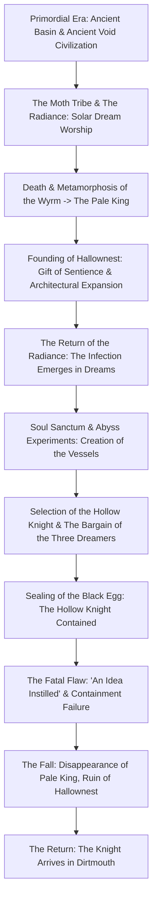
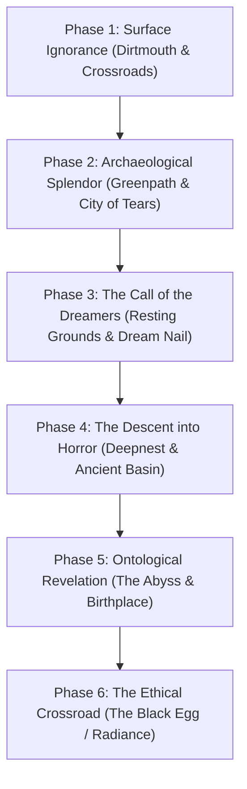

# The Fall of Hallownest: Chronological History, Epistemology, and Narrative Architecture in *Hollow Knight*

> **Historical Working Note:** This file contains preliminary exploratory notes drafted during kickoff. It is now formally superseded and verified by the deeper modular research files in `lore/hk_01_void_and_cosmic_layers.md through lore/hk_12_the_knights_journey_and_endings.md, timelines/hallownest_timeline.md, and data/claims.csv`. All claims are cataloged in `data/claims.csv`.

- **Object of Analysis:** *Hollow Knight* (Team Cherry, 2017)
- **Methodology:** Dual-Track Narrative Reconstruction (Diegetic Chronology vs. Experiential Player Discovery)
- **Epistemic Standards:** Tier 1 (Confirmed Canon), Tier 2 (Strongly Supported Interpretation), Tier 3 (Speculative Theory)

---

## 1. Diegetic Chronology: The History of Hallownest

The historical narrative of Hallownest is an account of imperial emergence, architectural hubris, metaphysical engineering, and catastrophic systemic collapse. Reconstructing the sequence of diegetic events reveals how an autocrat’s refusal of natural transience transformed a subterranean ecosystem into a mausoleum.

### 1.1 The Primordial Era, Ancient Civilizations, and the Primordial Void
Long before the founding of Hallownest, the vast subterranean expanse was inhabited by ancient, independent nonhuman cultures. In the deepest geological foundations of the world - the **Ancient Basin** and the **Abyss** - lie the monumental stone relics of an **Ancient Void Civilization** [Tier 1]. Architectural remnants, such as the primordial fountain bearing the inscription *"To the waters of our origin,"* massive stone statues holding stone bowls of liquid Void, and colossal carved totems, reveal that an ancient race lived in direct spiritual and material proximity to the **Void** [Tier 1]. Unlike the rigid, vertical imperial hierarchies later imposed by higher beings, this ancient civilization appears to have revered the dark ocean as a primal wellspring of existence rather than a weapon of war [Tier 2].

In the upper caverns, distinct tribal societies developed autonomous ecologies:
- In the humid aquifers of the Fungal Wastes, a semi-conscious fungal hive-mind established sprawling spore networks governed by primal biological cooperation [Tier 1].
- In the arid, jagged chasms of the Mantis Village, the proud **Mantis Tribe** forged an unbending martial culture rooted in strict honor, territorial sovereignty, and the mastery of chitinous lance combat [Tier 1].
- In the claustrophobic depths of **Deepnest**, predatory arachnid clans wove vast subterranean webs, governed by raw instinct, territorial ferocity, and ancestral matriarchs [Tier 1].
- In the high crystal caverns, the ancient **Moth Tribe** lived in organic, non-coercive communion with the **Radiance**, a primordial higher being of brilliant, searing solar light [Tier 1]. The Moths did not construct stone cities or carve monuments of subjugation; their devotion was psychic, fluid, and dream-based, celebrating memory, light, and the illumination of the mind without state coercion [Tier 2].

### 1.2 The Arrival of the Wyrm and the Metamorphosis into the Pale King
The civilizational genesis of Hallownest was triggered by the cosmic arrival of a **Wyrm** - a colossal, ancient higher being endowed with boundless foresight and biological transformative power [Tier 1]. Sensing the impending mortality of his colossal body, the Wyrm traveled to the eastern boundary of the caverns (Kingdom's Edge), died, and underwent a monumental ecdysis - a metamorphic molting [Tier 1]. From the mountainous, calcified shell of his former body (*the Cast-Off Shell*), he reincarnated into a diminutive, bipedal, crowned monarch: the **Pale King** [Tier 1].

The Pale King possessed the extraordinary aura of a "Pale Being": he expanded the minds of primal bugs, lifting them out of base insect instinct and gifting them intellect, reason, speech, and self-awareness [Tier 1]. In exchange for sentience, the King demanded absolute fealty and established a centralized, eternal empire:
> *"No blaze baffles the mind like the brilliant beacon of our King... He granted us thought, and in thought we found civilization."* - King's Pass Tablet [Tier 1].

### 1.3 The Golden Age: Expansion, Sentience, Caste Systems, and Exclusion
The Pale King and his consort, the vegetative higher being **The White Lady**, established the royal center of Hallownest [Tier 1]. A magnificent capital - the **City of Tears** - was erected beneath the cavern ceilings, sustained by water draining from the Blue Lake above [Tier 1]. The empire constructed sophisticated mass infrastructure:
- **The Stagways:** A subterranean mass-transit network powered by the domestic labor of giant Stags, connecting distant regional hubs [Tier 1].
- **The Tram System:** Mechanized transport cutting through deep rock strata, signaling industrial mastery [Tier 1].
- **The Great Knights:** A chivalric military elite comprising five legendary champions - Ogrim (Dung Defender), Isma, Dryya, Hegemol, and Ze'mer (the Grey Mourner) - who enforced sovereign order and defended borders [Tier 1].

However, this civilization was fundamentally stratified and exclusionary:
- **Caste Oppression:** An elite aristocracy flourished in the City of Tears, while the servant caste - particularly the frail, defenseless **Maggots** - were forced into brutal, dehumanizing domestic servitude, stripped of rights and abused [Tier 1].
- **The Moth Tribe's Apostasy:** Seduced by the Pale King's brilliant intellectual beacon, the Moth Tribe turned their worship away from the Radiance, abandoning her altars and adopting the King's law [Tier 1].
- **The Mantis Treaty & The Traitor Lord Schism:** The Mantis Tribe fiercely resisted royal subjugation [Tier 1]. Recognizing their martial prowess, the Pale King negotiated a border treaty: the Mantis Lords agreed to defend the border against the feral beasts of Deepnest in exchange for complete territorial independence [Tier 1]. However, this treaty fractured the Mantis ruling council: the fourth lord - the **Traitor Lord** - violently rejected the pact with Hallownest and envied his sisters' authority, eventually leading his loyalist faction into exile in the Queen's Gardens, where grief over his daughter's death drove him to willingly embrace the Infection for brute physical strength [Tier 1].
- **Deepnest's Hostility:** Ruled by **Herrah the Beast**, Deepnest completely rejected the King's authority, resulting in bloody border skirmishes and mutual estrangement [Tier 1].

### 1.4 The Return of the Radiance: The Emergence of the Infection
Because higher beings derive power and presence from memory, reverence, and worship, the betrayal and collective forgetting of the Radiance by the Moth Tribe pushed the solar entity to the brink of ontological erasure [Tier 1]. Stripped of physical shrines, the Radiance retreated into the collective unconscious - the **Dream Realm** [Tier 1].

From this metaphysical exile, the Radiance began clawing her way back into reality through the dreams of Hallownest's citizens [Tier 1]. Bugs began dreaming of a blinding orange light; upon waking, their intellects dissolved, their bodies mutated with glowing orange pustules, and their wills were subsumed into an aggressive hive-mind [Tier 1]. The Pale King’s gift of sentience became the exact vector of destruction: because the citizens possessed conscious minds, they were vulnerable to psychic invasion [Tier 2].

### 1.5 The Sacrificial Architecture: The Soul Sanctum Crisis vs. The Abyss Eugenics
Confronted with the breakdown of his eternal order, the Pale King rejected natural decline and pursued extreme metaphysical intervention [Tier 1].

A profound ideological split divided the King's court:
- **The Soul Sanctum Vivisections:** Scholars at the **Soul Sanctum**, led by the **Soul Master**, attempted to distill **Soul** - the vital animus of living bugs - through mass slaughter and vivisection of citizens, seeking to achieve physical immortality and resist the plague [Tier 1]. The Pale King condemned their experiments as profane and futile, recognizing that Soul alone could not stop a dream-god [Tier 1].
- **The Void Eugenics Program:** Instead, the Pale King turned to the primordial substance that sat in direct cosmic opposition to light: the **Void** [Tier 1]. His hypothesis was cold and utilitarian: to contain a light that infected minds and desires, he needed a being entirely devoid of mind, will, and emotional interiority [Tier 1]:
  > *"No mind to think. No will to break. No voice to cry suffering. Born of God and Void."* - The Pale King's Tablet [Tier 1].

In the deepest depths of the Abyss, the Pale King and the White Lady bred countless offspring, laying thousands of eggs within the darkness [Tier 1]. As the young hatched, they were infused with the Void, which extinguished their biological life and replaced their interiority with absolute emptiness [Tier 1]. Those who possessed even a trace of will or emotion were deemed failures and cast back into the chasm, creating a mountain of child skulls and chitinous shells [Tier 1].

### 1.6 The Hollow Knight and the Fatal Flaw
From the sea of aborted siblings, one Vessel climbed the precipice of the Abyss: the chosen **Hollow Knight** [Tier 1]. As the Pale King extended his hand to adopt the chosen vessel, a small, unchosen Vessel (the player-character, the Knight) reached the ledge just as the gates of the Abyss were sealed shut, casting the Knight back down into the dark [Tier 1].

The chosen Hollow Knight was raised in the White Palace, trained, and prepared to serve as a living sarcophagus [Tier 1]. To ensure absolute containment, the Pale King enlisted three powerful figures to serve as **Dreamers**, whose conscious slumber would seal the physical entrance of the **Temple of the Black Egg** within an impenetrable psychic lock [Tier 1]:
1. **Monomon the Teacher:** The scholarly archivist of Fog Canyon, who accepted the duty only on the condition that an external safeguard (the Quirrel mask protocol) be established [Tier 1].
2. **Lurien the Watcher:** The devoted aristocrat who watched over the City of Tears from his spire, accepting eternal sleep out of pure civic devotion [Tier 1].
3. **Herrah the Beast:** The queen of Deepnest, who agreed to become a Dreamer on one non-negotiable condition: that the Pale King bed her to produce a child of royal Wyrm and spider bloodline - giving birth to **Hornet** [Tier 1].

The Hollow Knight absorbed the Radiance into its body and was bound within chains in the Black Egg, sealed behind the masks of the Dreamers [Tier 1]. 

However, the containment was fatally compromised from the outset. The Hollow Knight was **not truly hollow** [Tier 1]. During its upbringing in the White Palace, a bond of mutual affection formed between the Pale King and the Vessel - what the White Lady mourns as *"an idea instilled, a thought focused"* [Tier 1]. In the memory cutscene at the Path of Pain's conclusion, father and child share a tender, non-verbal glance [Tier 1]. This microscopic drop of mutual love and paternal attachment became the crack through which the Radiance invaded its mind [Tier 1]. Over centuries, the Radiance tore through the Vessel’s psyche from within; the chains began to crack, orange infection leaked through the shell, and the infection returned to Hallownest with cataclysmic ferocity [Tier 1].

### 1.7 The Vanishing of the King and the Dissolution of Order
Realizing his grand sacrifice had failed and his kingdom was doomed, the Pale King committed a final act of self-preservation: he transported his grand residence, the **White Palace**, into the Dream Realm, vanishing from physical space entirely [Tier 1]. Within this dream sanctuary, the King eventually died upon his throne, leaving behind only an empty shell and royal retainers trapped in a mechanical loop of buzzsaws and thorns [Tier 1].

The White Lady, overwhelmed by guilt and complicity in the slaughter of her children, bound herself in roots in the Queen’s Gardens, blinding her senses and dampening her reproductive fertility [Tier 1]. The civilization of Hallownest collapsed into an undead ruin. Bugs lost their sapience, regressing to feral husks; the waterways flooded; the crossroads grew necrotic; and the Kingdom settled into quiet rot [Tier 1].

---

## 2. Experiential Discovery: How the Player Reconstructs the Narrative

Unlike a linear chronicle, *Hollow Knight* presents its story non-linearly. The player's understanding develops through physical exploration, environmental observation, and retroactive reinterpretation.

### Phase 1: Surface Ignorance (Dirtmouth & Forgotten Crossroads)
The player begins outside Hallownest, dropping into the desiccated town of **Dirtmouth**. The lonely resident, **Elderbug**, provides the initial lens: Hallownest was a legendary kingdom beneath the earth, now ruined by madness and disease, tempting travelers down into its depths [Tier 1]. The Knight enters the **Forgotten Crossroads**, encountering wandering, infected husks whose glowing orange eyes communicate a plague without a single explanatory line of text [Tier 1]. The initial impression is that of a standard heroic adventure: navigate a dungeon, slay monsters, and uncover treasure.

### Phase 2: Archaeological Splendor and Royal History (Greenpath & City of Tears)
Descending into **Greenpath**, the player encounters lush overgrowth, the hostile blade of **Hornet**, and the ancient stone tablets of the King. Upon reaching the **City of Tears**, the narrative expands drastically. Christopher Larkin’s melancholic piano and viola theme swells; rain pours perpetually from the ceiling; grand spires, ornate lampposts, and aristocratic husks in formal attire reveal that Hallownest was not a mere cave system, but an imperial metropolis of staggering beauty and wealth [Tier 1]. A memorial statue in the city square depicts the Hollow Knight, flanked by the three Dreamers, with the solemn inscription:
> *"In the Black Egg far above, through their sacrifice Hallownest lasts eternal."* [Tier 1].
At this stage, the player assumes the Hollow Knight was a revered hero and the sacrifice a noble, successful salvation.

### Phase 3: The Call of the Dreamers and the Dream Nail (Resting Grounds)
In the **Resting Grounds**, the player is confronted by the spectral projections of the Three Dreamers, who attempt to entomb the Knight within a dream illusion [Tier 1]. Rescued by the **Seer** - the last surviving moth of the Moth Tribe - the Knight acquires the **Dream Nail**, a relic capable of slicing through the veil between physical reality and psychic memory [Tier 1].

The Dream Nail fundamentally revolutionizes the player's epistemic relationship with the game. Every NPC, enemy, and corpse can now be struck to reveal their inner thoughts, unresolved traumas, and repressed memories [Tier 1]. The player discovers that the Dreamers are not deities, but slumbering anchors maintaining a prison. The map is marked with their three locations, providing an explicit mechanical objective: locate and slay the Dreamers to break the seals of the Black Egg [Tier 1].

### Phase 4: The Descent into Horror and Exploitation (Deepnest & Soul Sanctum)
As the player breaches the deeper regions, the romantic veneer of Hallownest shatters:
- In the **Soul Sanctum**, mounds of desiccated bug corpses reveal that the kingdom’s scholars engaged in horrific, vivisectionist experiments to extract Soul in a futile effort to resist the infection [Tier 1].
- In **Deepnest**, the architecture gives way to claustrophobic webs, skittering predators, and visceral body horror. Slaying **Herrah the Beast** feels deeply morally ambiguous: Herrah lies motionless and defenceless in her bed, offering no combat resistance. The player must strike down a sleeping mother whose only crime was loving her kingdom and demanding a child [Tier 2].
- In **Fog Canyon**, the player encounters **Monomon the Teacher**, whose loyal disciple **Quirrel** sacrifices his life-sustaining mask so the Knight can sever the seal. Monomon's final dream words reveal that she *wanted* the seal broken, recognizing that the eternal stasis of the Black Egg was an abomination that needed to end [Tier 1].

### Phase 5: Ontological Revelation and Self-Knowledge (Ancient Basin, Abyss & Birthplace)
Obtaining the **King's Brand** from the Wyrm's cast-off shell in Kingdom's Edge grants the Knight access to the lowest subterranean stratum: the sealed door of the **Abyss** [Tier 1].

Here, the narrative reaches its climactic ontological reversal. The player descends through pitch-black caverns filled with mountains of child skulls. By using the Dream Nail on an ancient, reflective egg in the depths of the Abyss, the player enters the **Birthplace memory sequence** [Tier 1]. 

The player witnesses their own origin: the Knight was one of millions of newborn Vessels climbing the Abyss. The player watches the Pale King depart with the chosen Hollow Knight, coldly allowing the player-character to fall back into the darkness [Tier 1]. The Knight is not a heroic savior arriving from outside; it is an aborted, discarded sibling, an escaped casualty of royal eugenics returning to the graveyard of its birth [Tier 1]. The acquisition of the **Void Heart** charm unifies the Void beneath the Knight’s will, transforming non-being from an erratic, hostile hazard into an integrated cosmic force [Tier 1].

### Phase 6: The Ethical Crossroads (The Temple of the Black Egg)
When the player finally enters the Temple of the Black Egg, they encounter the **Hollow Knight**. It is not a triumphant god, but a tragic, one-armed, violently infected cripple tethered by chains [Tier 1]. During combat, the boss engages in self-mutilation, stabbing its own chest with its nail in an agonizing effort to help the player kill it and end its perpetual torment [Tier 1].

The player is now confronted with the ultimate interpretive and ethical dilemma:
- **Execute the replacement:** Slay the Hollow Knight, absorb the infection, and be chained within the egg, repeating the Pale King’s failed sacrificial cycle [Tier 1].
- **Slay the god:** With Hornet’s intervention and the Void Heart, use the Dream Nail to enter the mind of the Hollow Knight, confront the **Radiance** directly in the dream realm, and unleash the united Void to annihilate the blinding light once and for all [Tier 1].
- **Ascend through worship (Godmaster):** Attune the mind through Godhome to become the apocalyptic Void Entity, consuming both Radiance and the higher realms [Tier 1].

Thus, the player’s journey mirrors a progression from naive fairy-tale exploration, through archaeological mourning, to the horrifying realization of systemic state terror, culminating in an active ethical judgment on how to dismantle an empire’s sacred lie.

