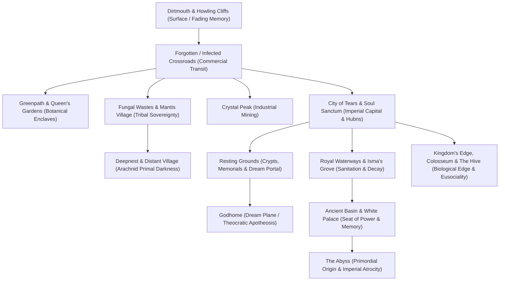

# Area-by-Area Spatial Analysis and Environmental Storytelling: Hallownest

> **Notice:** Working notes, drafted with AI, sources not yet checked line by line.

- **Object of Analysis:** The Complete Geography of Hallownest (23 Regions and Sub-Areas)
- **Methodology:** Spatial Narratology, Architectural Hermeneutics, Ecocritical Topology
- **Epistemic Standards:** Tier 1 (Confirmed Canon), Tier 2 (Strongly Supported Interpretation), Tier 3 (Speculative Theory)

---

## 1. Topological Structure and Spatial Philosophy of Hallownest

The kingdom of Hallownest is architecturally and geologically organized as a **vertical descent into systemic guilt**. Unlike open-world topographies that present horizontal frontiers of conquest, Hallownest forces the player downward through successive civilizational strata: from the fading domestic surface of Dirtmouth, through the gilded imperial metropolis of the City of Tears, past the industrial and commercial infrastructure of the Crossroads and Waterways, down into the primal tribal territories of the Mantis and Spider clans, and finally into the sealed, primordial graveyard of the Abyss.

---

## 2. Region-by-Region Analytical Matrix

| Region | Historical Identity (Pre-Collapse) | Present Condition | Inhabitants & Major NPCs | Key Bosses / Encounters | Traversal / Progression Gating | Music & Affective Atmosphere | Narrative & Symbolic Function |
|---|---|---|---|---|---|---|---|
| **Dirtmouth** | Welcoming surface gateway and resort town at the mouth of Hallownest | Desiccated, quiet, almost deserted ghost town | Elderbug, Sly, Cornifer, Iselda, Bretta, Zote, Grimm Troupe | None (Hub Area) | Starting location; elevator/well descent | Solitary music box, gentle piano, hollow wind; melancholy comfort | The threshold of safety; represents ordinary life lingering at the edge of the abyss |
| **Forgotten Crossroads** | Main thoroughfare and transit nexus connecting the upper kingdom | Decaying stone highways populated by mindless worker and guard husks | Quirrel (early), Myla, Salubra, Sly (rescued) | False Knight, Gruz Mother, Broodling Mawlek | Vengeful Spirit required to exit to Greenpath; Stag Station | Muted strings, rhythmic percussion; utilitarian desolation | Displays the functional anatomy of an empire now reduced to feral muscle memory |
| **Infected Crossroads** | Post-awakening state of the Crossroads | Mutated, rupturing with pulsating orange cysts; blockaded passages | Feral, bloated, exploding husks; aggressive mutated fauna | Gruz Mother (infected variant), Furious Vengefly | Passages blocked by fleshy tumorous growths | Distorted, pulsating ambient hum; grotesque violation | Procedural shock: proves the player's quest to unseal the Dreamers is actively unleashing the plague |
| **Greenpath** | Lush, moss-covered royal gardens and pilgrim route | Overgrown botanical wilderness; acid pools and territorial mosskin | Hornet, Hunter, Sheo (Nailmaster), Mask Maker | Hornet Protector, Massive Moss Charger, Vengefly King | Mothwing Cloak (Dash) acquired from dead Vessel | Soaring solo cello and harp; lush, verdant, yet untamed and predatory | Establishes the tension between organic botanical wildness and royal stone monuments |
| **Fog Canyon** | Ethereal botanical aquifer; fungal jellyfish sanctuary | Suspended acid chambers filled with explosive, volatile Oomas | Quirrel, Millibelle (early), Monomon (Archives) | Uumuu (Archive Core) | Requires Shadow Dash / Isma's Tear to fully explore; Charm Notch | Ambient ambient chimes, bubbling water; dreamlike, fragile tranquility | Houses the Teacher’s Archives; represents pure intellectual contemplation suspended in acid |
| **Queen's Gardens** | Private imperial arboretum cultivated for the White Lady | Overgrown thorny labyrinth; controlled by the hostile Mantis Traitors | The White Lady, Cloth, Moss Prophet | Traitor Lord | Mantis Claw, Monarch Wings, Isma's Tear required | Romantic, flowing strings with underlying tension; regal decay | The retreat of guilt; where the White Lady bound herself in self-imposed exile |
| **Fungal Wastes** | Organic damp basin governed by fungal hive networks and spore-beings | Spore-choked marshlands; bouncy purple mushrooms; bubbling acid | Cloth, Quirrel, Leg Eater, Shrumal warriors | Two Shrumal Ogres | Requires pogo-slashing on bouncy mushrooms; Mantis Claw | Whimsical, bouncy woodwinds, plucking strings; alien, indifferent biology | Demonstrates that non-sentient biological networks survive royal collapse unbothered |
| **Mantis Village** | Sovereign territory of the proud, uninfected Mantis Tribe | Highly disciplined martial stronghold; bone cages and lethal spear traps | Mantis Lords, Mantis warriors | Mantis Lords (Trio combat) | Mantis Claw acquired here (enables wall-sliding/jumping) | Driving, percussive harpsichord and intense rhythmic strings; fierce honor | Displays an unbending insect society that resisted the infection through pure martial discipline |
| **City of Tears** | Sovereign capital, royal court, and economic heart of the Pale King's empire | Perpetually drowned in rainwater from the Blue Lake; ruined aristocratic spires | Quirrel, Nailsmith, Relic Seeker Lemm, Eternal Emilitia | Soul Master, Soul Tyrant, Watcher Knights | Desolate Dive, Monarch Wings, Elegant Key | Sweeping, tragic orchestral strings, grand piano, pouring rain; overwhelming grief | The physical monument of Hallownest's zenith; architectural beauty built upon systemic rot |
| **Soul Sanctum** | Elite academic research academy attached to the capital's spires | Haunted laboratory; piles of desiccated, liquified bug corpses | Soul Master, Soul Scholars, Soul Twisters | Soul Master, Soul Tyrant | Spell upgrade: Desolate Dive / Descending Dark | Dissonant organ arpeggios, chanting choir; occult intellectual madness | The horrifying ethical failure of science: harvesting living minds to cheat death |
| **Crystal Peak** | Royal crystalline mining operations above the city | Mechanical conveyor belts, crushing pistons, laser-reflecting crystals | Myla (miner), Quirrel | Crystal Guardian, Enraged Guardian | Crystal Heart (Super Dash) acquired here; Shopkeeper's Key | Industrial clanging rhythm, glittering chimes, crystalline synth; mechanized toil | The industrial engine of the empire; exploitation of geological riches that whisper madness |
| **Resting Grounds** | Sacred ancestral necropolis and crypt complex of the Moth Tribe | Quiet, shadowy catacombs covered in blue soul vapors and whispering spirits | The Seer, Grey Mourner, Revek, Tiso | No Eyes, Xero (Warrior Dreams) | Dream Nail acquired here; Dream Gate | Gentle, shimmering harp and ethereal choir; sacred remembrance, quiet sorrow | The psychic center of memory; where forgotten dead reside and the Dream Nail is awakened |
| **Royal Waterways** | Subterranean drainage, sewer, and waste filtration system of the capital | Disgusting, flooded tunnels crawling with parasitic Flukes | Dung Defender (Ogrim), Tuk (scavenger), Flukemarm | Dung Defender, Flukemarm, White Defender | Isma's Tear acquired through Isma's Grove | Grunting, splattering water noises, booming brass fanfares (Dung Defender) | The biological sewer of empire; where noble knights wallow in feces to protect memories |
| **Ancient Basin** | Desolate geological abyss beneath the capital; tram station hub | Crumbling grey stone ruins; quiet, ash-covered plains | Cloaked Vessels, Shadow Creepers | Broken Vessel, Lost Kin | Monarch Wings (Double Jump) acquired after Broken Vessel | Deep, echoing ambient drone, distant wind; hollow emptiness, ancient stillness | The intermediate zone between royal civilization and the unspeakable crime of the Abyss |
| **Deepnest** | Primal, subterranean labyrinth carved by the predatory Spider Clan | Pitch-black, claustrophobic caverns; crawling with dirtcarvers and corpse-mimics | Midwife, Mask Maker, Herrah the Beast, Zote (trapped) | Nosk (Mimic beast), Galien | Lumafly Lantern essential; Tram Pass required | Skittering legs, groaning chitin, dissonant strings; sheer psychological terror | The antithesis of the Pale King's order; feral, predatory nature that refused subjugation |
| **Kingdom's Edge** | The desolate eastern boundary of Hallownest, dusted in white ash | Precipitous cliffs dusted in perpetual ash (shed molted skin of the Wyrm) | Hornet, Bardoon, Nailmaster Oro | Hornet Sentinel, Markoth, Great Nailsage Sly (Godhome) | King's Brand acquired inside the Cast-Off Shell | Bleak, sweeping cello, wind-whipped ash sounds; epic desolation, majestic ruins | The site of the Wyrm’s biological death; reminds the player that all gods molt and perish |
| **The Hive** | Eusocial, hexagonal amber fortress of the independent Bee Tribe | Vibrant golden honeycombs; fiercely defended by militarized bees | Hive Knight, Queen Vespa (Ghost) | Hive Knight | Hiveblood charm acquired; requires Tram Pass | Swarming brass, noble trumpets, buzzing orchestral warmth; industrious honor | An alternative model of insect civilization: eusocial collectivism without the King's gift |
| **Howling Cliffs** | Windswept precipice outside Hallownest’s divine protective border | Barren, howling mountain crags; stripped of memory and thought | Nailmaster Mato, Gorb, Grimm Troupe (summoning lantern) | Gorb (Warrior Dream), Nightmare King Grimm (Troupe) | Cyclone Slash; Dream Nail activates the Nightmare Lantern | Howling, desolating gale winds, minimal instrumentation; vast existential void | The edge of sentience: cross this border, and the Pale King's intellect-granting gift fades |
| **Colosseum of Fools** | Brutal gladiator arena suspended within the hollowed shell of a giant bug | Bloodstained fighting pits; cheering crowds of deranged gladiator husks | Little Fool, Lord Fool (corpse on throne), Tiso | Trial of the Warrior, Conqueror, Fool; God Tamer | Pure combat endurance gauntlet; rewards Pale Ore and Geo | Raucous, brutal crowd roars, warlike brass percussion; barbaric spectacle | The decadent terminal phase of civilization: where husks fight for empty glory in a dead world |
| **White Palace & Path of Pain** | The Pale King’s royal sanctuary, magically hidden inside a Kingsmould dream | Pristine, blinding white marble towers; lethal spinning buzzsaws and thorns | Pale King (Corpse on throne), Royal Retainers | Kingsmoulds, Winged Sentries; platforming gauntlet | Awakened Dream Nail (1800 Essence) required; rewards White Fragment | Elegant, delicate piano, harpsichord, choral counterpoint; pristine, sterile guilt | The architectural manifestation of the King's paranoia and sterile, mechanized guilt |
| **The Abyss** | The absolute bottom of Hallownest; lake of pure liquid Void | Vast cavern paved with billions of child Vessel skulls and writhing tendrils | Siblings (Shades), Void Tendrils | None (Narrative sequence); Void Heart acquisition | King's Brand unlocks the door; Shade Cloak / Abyss Shriek acquired | Sub-bass drone, abyssal whispers, chilling silence; absolute cosmic negation | The mass grave of the empire; the site of the original sin that invalidates Hallownest’s glory |
| **Godhome** | Transcendent dream realm constructed by the attuning minds of the Godseeker | Golden, gleaming neoclassical clouds and pantheon towers | Godseeker, Hermit, all Hallownest bosses | Pure Vessel, Absolute Radiance, Sisters of Battle, Sly | Accessed via Simple Key on the Godseeker in Junk Pit; Dream Nail | Colossal, multi-movement symphonic choral bombast; overwhelming divine glory | The hubris of worship: transforming living tragedy into an aesthetic tournament of gods |
| **The Dream Realm** | The metaphysical collective unconscious underlying all insect minds | Shifting, luminous dreamscape composed of golden essence and floating thoughts | The Seer, Dream Warriors, Dreamers | Dream Boss rematches (Failed Champion, Lost Kin, Soul Tyrant) | Dream Nail required; Dream Gate navigation | Shimmering chimes, reverse audio textures, ethereal hum; fluid, timeless memory | The battleground of memory: where the dead refuse to be erased by physical death |

