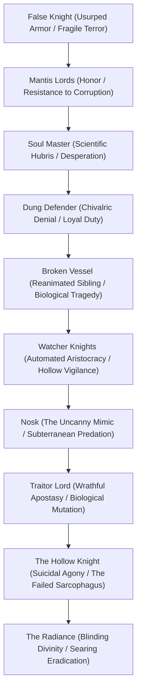
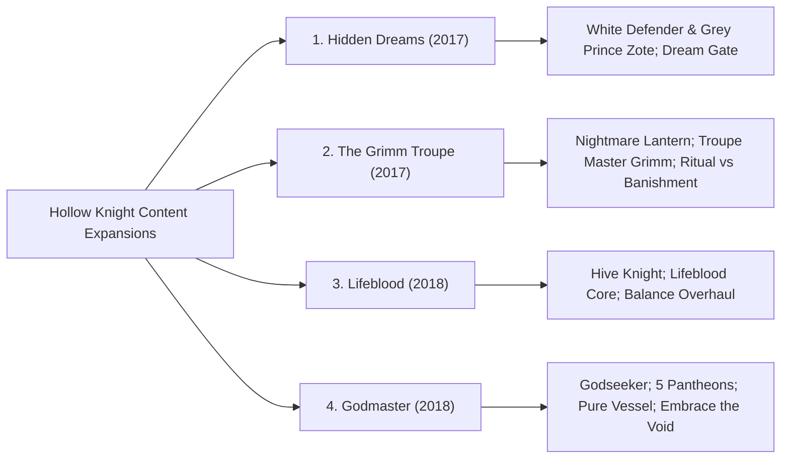

# Boss Encounters, Symbolic Combat, and Content Expansions: *Hollow Knight*

- **Object of Analysis:** Major Boss Encounters, Content Packs (*Hidden Dreams*, *The Grimm Troupe*, *Lifeblood*, *Godmaster*), and Optional Gauntlets
- **Theoretical Framing:** Ludic Symbolism, Combat Choreography as Characterization, Ritual Cycles, and Theocratic Deification
- **Epistemic Standards:** Tier 1 (Confirmed Canon), Tier 2 (Strongly Supported Interpretation), Tier 3 (Speculative Theory)

---

## 1. Major Boss Encounters and Combat Symbolism

In *Hollow Knight*, boss battles do not function merely as mechanical difficulty checks; they operate as **hermeneutic encounters** where character history, social ideology, and biological tragedy are communicated through combat choreography, arena architecture, and musical leitmotifs.

### 1.1 False Knight & Failed Champion
- **Identity & Context:** A frail, defenseless Maggot—the lowest, most abused servant caste in Hallownest—who stole the colossal white armor of Great Knight Hegemol while he slept [Tier 1].
- **Combat Symbolism & Mechanics:** Wields an oversized mace that slams the earth, causing rubble to rain down. When staggered, the armor's helmet pops open, revealing the small, weeping, terrified maggot head [Tier 1]. The Maggot does not fight out of malice, but out of desperate cowardice:
  > *"I wanted to protect the others... but I was so small. The armor made me strong."* [Tier 1].
- **Failed Champion (Dream Rematch):** In the Maggot’s dying dream, the speed and violence are tripled, dealing two masks of damage per swing. Represents the tragic compensation of the powerless: dreaming of absolute, crushing physical violence to mask profound systemic vulnerability [Tier 2].

### 1.2 Mantis Lords & Sisters of Battle
- **Identity & Context:** The three sovereign matriarchs of the Mantis Village who govern through uncompromising martial honor and territorial defense [Tier 1].
- **Combat Symbolism & Mechanics:** A masterclass in rhythmic, chivalric fencing. The Lords sit on elevated bone thrones. The first Lord engages alone; upon her defeat, the remaining two drop simultaneously into the arena [Tier 1]. Their strikes—wall-clinging projectile throws, rapid downward thrusts, horizontal dashes—are completely uninfected: their eyes burn cold and clear, moving with razor precision rather than erratic rage [Tier 1].
- **Narrative Consequence:** Upon defeat, the Mantis Lords do not perish. They stand, raise their scythe-lances, and bow deeply to the Knight [Tier 1]. Across the entire Mantis Village, all mantis warriors cease hostility and bow in respect, transforming the region into an allied safe zone. Proves that civilization can survive collapse through disciplined self-restraint and mutual respect [Tier 2].
- **Sisters of Battle (Godhome):** In the Pantheon of Hallownest, all three sisters fight simultaneously in a breathtaking dance of hyper-speed attacks, elevating martial honor into pure aesthetic ecstasy [Tier 1].

### 1.3 Soul Master & Soul Tyrant
- **Identity & Context:** The head of the Soul Sanctum who led the aristocratic scholars in extracting Soul from living citizens to attain physical immortality [Tier 1].
- **Combat Symbolism & Mechanics:** Teleports erratically across the arena, hovering in the air while launching glowing white orbs of concentrated Soul. His signature attack—a colossal downward body slam (*Desolate Dive*)—literally shakes the marble floor. In Phase 2, he sheds his bloated ceremonial robes, becoming a frenzied, levitating phantom slamming repeatedly into the earth [Tier 1].
- **Symbolic Function:** The embodiment of scientific hubris divorced from moral constraint. In his madness, he believed he had conquered death, yet his mind is completely warped by the very plague he sought to escape [Tier 1].

### 1.4 Dung Defender (Ogrim) & White Defender
- **Identity & Context:** The loyal, boisterous Great Knight Ogrim, living in self-imposed exile in the sewers beneath the City of Tears, guarding the grove and memory of Lady Isma [Tier 1].
- **Combat Symbolism & Mechanics:** Burrows joyfully through mounds of dung, hurling bouncing dung spheres and erupting from the floor with booming, operatic laughter (*"Doma! Doma! Doma-doma-doma!"*) [Tier 1]. Christopher Larkin’s theme is a noble, brass-heavy chivalric march, contrasting hilariously yet poignantly with the scatological arena [Tier 1].
- **White Defender (Dream Rematch):** In Ogrim's dream, the filth vanishes, replaced by a gleaming silver colosseum. He fights in his pristine white knightly armor, flanked by the heroic statues of his four fallen comrades and the Pale King [Tier 1]. When defeated five times, he wakes to find his dream fading, quietly acknowledging the tragic reality that his golden age is dead and his friends are dust [Tier 1].

### 1.5 Broken Vessel & Lost Kin
- **Identity & Context:** One of the Knight’s discarded siblings who escaped the Abyss, died in the Ancient Basin, and whose cracked chitin shell has been parasitically reanimated by the infection’s luminous orange lightseed blobs [Tier 1].
- **Combat Symbolism & Mechanics:** Fights with a distorted, mirror image of the Knight's own moveset: slashing with a crude nail, air-dashing, and slamming the ground to release a fountain of infection bubbles [Tier 1]. Unlike the Knight, the Broken Vessel’s movements are jerky, spasmodic, and involuntary—it is literally a corpse puppeted by a parasitic fungus [Tier 2].
- **Emotional Pathos:** Upon defeat, the orange infection bursts forth and dissipates. The hollow shell falls to its knees, briefly extending a hand toward the Knight in a gesture of fraternal recognition before collapsing lifeless into the dust [Tier 1]. Slaying one's own brother becomes an act of mercy, liberating a discarded child from non-consensual biological desecration [Tier 2].

### 1.6 Watcher Knights
- **Identity & Context:** Six hollow, ornamental suits of royal armor standing guard at the summit of the Watcher’s Spire in the City of Tears, protecting the sleeping body of Lurien the Watcher [Tier 1].
- **Combat Symbolism & Mechanics:** As the Knight approaches, the inanimate suits are invaded by swarms of infected lightseed parasites, bringing the metal hulls to life two at a time [Tier 1]. They roll into giant bouncing metal spheres, slashing with massive broadswords. 
- **Symbolic Function:** Represents the automated, depersonalized vigilance of an aristocratic police state. Lurien does not need living guards; he relies on empty armor inhabited by the very infection he sought to seal, emphasizing the grotesque cannibalization of royal defenses [Tier 2].

### 1.7 Nosk
- **Identity & Context:** A terrifying, shapeshifting predatory creature dwelling in the deepest, pitch-black warrens of Deepnest [Tier 1].
- **Combat Symbolism & Mechanics:** In the corridors leading to its lair, the player repeatedly spots what appears to be *themselves*—an identical masked Knight running just ahead in the dark, leading the player deeper into a web-strewn cavern [Tier 1]. Upon reaching the lair, the figure steps onto a mound of corpses, its neck snaps backward with a sickening crunch, and its body violently contorts into an eight-legged arachnid monstrosity with an inverted mask [Tier 1].
- **Psychological Dimension:** Nosk is an apex ambush predator that lures prey by mimicking the faces of their loved ones or their own visage [Tier 1]. It reflects the psychological horror of the uncanny (*das Unheimliche*): confronting an identical copy of the self that conceals feral, devouring violence [Tier 2].

### 1.8 Traitor Lord
- **Identity & Context:** The former fourth ruler of the Mantis Tribe who refused to accept the truce with Hallownest and deeply resented the authority of his sisters [Tier 1]. When his daughter died, his grief and lust for power drove him to willingly embrace the Radiance’s infection [Tier 1].
- **Combat Symbolism & Mechanics:** Unlike the nimble, disciplined Mantis Lords, the Traitor Lord is bloated, muscular, and grotesque, towering over the player. His attacks hit for two full masks of damage, unleashing massive orange shockwaves that fill the screen [Tier 1].
- **Thematic Contrast:** Illustrates the Faustian bargain of the Infection. The Traitor Lord gained raw physical power, but lost his honor, his family, and his autonomy, becoming a feral brute guarding the very borders he once scorned [Tier 2].

### 1.9 The Hollow Knight & Pure Vessel
- **The Hollow Knight:** Fought inside the Temple of the Black Egg. A tragic, limping, self-harming cripple tethered by chains. In Phase 3, as the Radiance takes full control, it floats in the air, vomiting fountains of orange bile, while desperately attempting to stab itself to death with its nail [Tier 1].
- **Pure Vessel:** Fought at the apex of the Pantheon of the Knight in Godhome. The uninfected, fully grown, perfect incarnation of the Vessel in its prime [Tier 1]. Possesses instantaneous teleportation, crystalline nail parries, blinding soul pillars, and sweeping void tendrils. It exhibits no voice, no hesitation, and no flaw—the terrifying realization of the Pale King's eugenic ideal [Tier 1].

### 1.10 The Radiance & Absolute Radiance
- **The Radiance:** Fought atop the clouds of the Dream Realm after dream-nailing the Hollow Knight. A colossal, moth-like deity of blinding white and golden light, raining swords, laser beams, and homing light orbs [Tier 1]. Phase 4 forces the player to climb floating platforms as laser beams sweep across the screen, reaching the summit where the Void rises to drag the god down [Tier 1].
- **Absolute Radiance (Godmaster):** The supreme, unrestrained prime form of the sun-god encountered at the peak of the Pantheon of Hallownest. The attacks are dizzyingly rapid, relentless, and unforgiving, requiring near-superhuman pattern recognition and mechanical mastery [Tier 1].

---

## 2. Comprehensive Analysis of the Four Content Expansions

### 2.1 Hidden Dreams (August 2017)
- **Core Additions:** Two major dream boss encounters (White Defender and Grey Prince Zote), the **Dream Gate** teleportation ability, and new Stag Station mechanics [Tier 1].
- **Thematic Significance:** Explores the divergence between physical reality and psychic memory. By introducing the Dream Gate, the expansion eases navigational friction while reinforcing the mystical utility of the Dream Nail. 
- **Psychological Parody & Tragedy:** *Grey Prince Zote* satirizes romantic delusion and toxic masculine bravado, while *White Defender* provides an achingly sad portrait of heroic nostalgia—a knight living in literal filth while dreaming of an immaculate court that has long ceased to exist [Tier 2].

### 2.2 The Grimm Troupe (October 2017)
- **Core Additions:** The Nightmare Lantern questline, Troupe Master Grimm, Brumm/Nymm, Divine, the Grimmchild charm, and Nightmare King Grimm [Tier 1].
- **The Metaphysics of the Nightmare Realm:** Introduces a parallel cosmic dimension to the Dream Realm: the **Nightmare Realm**, presided over by the ancient, scarlet **Nightmare Heart** [Tier 1]. The Grimm Troupe are nomadic, theatrical ritualists who travel to dying kingdoms drawn by the psychic embers of their fall [Tier 1]:
  > *"The lantern is lit. The ritual begins. Gather the flames to feed the child."* [Tier 1].
- **The Ritual vs. Banishment Dilemma:**
  - *Option A: Complete the Ritual.* Slay **Nightmare King Grimm** in a dizzyingly fast, crimson-drenched dance of flame and cloaks. The Nightmare Heart feeds upon the gathered flames, Grimm is reborn in the fully matured Grimmchild, and the Troupe departs to find another dying realm. The cyclical, parasitic performance continues eternally [Tier 1].
  - *Option B: Banishment.* Ally with **Brumm**, the melancholic accordionist who longs to break the cycle of servitude. Return to the Howling Cliffs and smash the Nightmare Lantern. The Troupe is banished from Hallownest; in Dirtmouth, a friendly bug named **Nymm** appears, playing cheerful accordion music and gifting the **Carefree Melody** charm [Tier 1].
- **Philosophical Value:** Poses a critical inquiry into cyclical art and ritual trauma: should suffering and performance be preserved to ensure immortality, or is it more humane to extinguish the sacred flame and choose quiet, mortal peace? [Tier 2].

### 2.3 Lifeblood (April 2018)
- **Core Additions:** Full integration of the **Hive Knight** boss encounter in the Hive, complete audiovisual polish, custom map markers, and rebalanced charm mechanics [Tier 1].
- **The Mystery of Lifeblood:** Expands the lore of the taboo blue substance known as **Lifeblood** [Tier 1]. In the Abyss, the player discovers the hidden **Lifeblood Core** sanctuary, where a colossal, insectoid cosmic entity with glowing blue eyes (the "Lifeblood Creature" or "Abyss Creature") watches from the background [Tier 1]. The Pale King explicitly outlawed Lifeblood as heretical, indicating that Hallownest’s sovereign order violently suppressed alternative biological and spiritual life-forces [Tier 2].

### 2.4 Godmaster (August 2018)
- **Core Additions:** The **Godseeker**, the realm of **Godhome**, five ascending **Pantheons**, the **Hall of Gods**, **Pure Vessel**, **Absolute Radiance**, and two revolutionary new endings [Tier 1].
- **The Theology of Attunement:** The Godseekers are a collective hive-mind of golden-masked beings who traveled from the desolate "Land of Storms" searching for gods to worship [Tier 1]. Possessing "Godtuner" devices, they enter deep meditation in the Junk Pit of the Royal Waterways, seeking to attune their minds to the greatest warriors and deities of Hallownest, believing that through worship, gods grow in splendor and power [Tier 1].
- **Transforming Tragedy into Tournament:** In Godhome, the tragic, broken figures of Hallownest are stripped of their historical context and re-imagined in their gleaming, divine prime (e.g., Pure Vessel, Sisters of Battle) [Tier 1]. Godmaster demonstrates how religious worship idealizes and aestheticizes violence, converting historical catastrophe into a gilded spectacle of gladiatorial glory [Tier 2].
- **The Apocalyptic Climax:** Completing the ultimate challenge—the **Pantheon of Hallownest** (42 consecutive bosses)—does not produce peace. Instead, the attunement overflows, causing the Knight to shed its shell and metamorphose into the **Void Given Form** (the Lord of Shades), an eight-eyed, tentacled god of absolute darkness [Tier 1]. The Void Entity violently shreds Absolute Radiance into black liquid, descends upon Godhome, and consumes the screaming Godseeker, bleeding black tentacles into the physical world [Tier 1]. Worship summons an abyss that devours the worshipper [Tier 2].

---

## 3. Master Expansion & DLC Comparative Matrix

| Content Pack | Primary Theme | Key Bosses / Rematches | Essential Upgrades / Items | Narrative Contribution | Philosophical Core |
|---|---|---|---|---|---|
| **Hidden Dreams** | Memory, Nostalgia & Parody | White Defender, Grey Prince Zote | Dream Gate (teleportation), Hidden Stag Station | Reveals Ogrim's chivalric denial and Bretta's romantic projection | The discrepancy between historical trauma and the comforting lies of memory |
| **The Grimm Troupe** | Cyclical Ritual, Performance & Flame | Troupe Master Grimm, Nightmare King Grimm | Grimmchild, Carefree Melody, Unbreakable Charms | Establishes the Nightmare Realm as cosmic counterweight to dreams | Parasitic immortality through performance vs. mortal liberation through banishment |
| **Lifeblood** | Eusocial Duty & Taboo Vitality | Hive Knight | Hiveblood charm, Lifeblood Core, custom map pins | Integrates the Bee Tribe; introduces heretical blue life-force | Sovereign suppression of alternative biological energies |
| **Godmaster** | Theocratic Deification & Apotheosis | Pure Vessel, Absolute Radiance, Sly, Sisters of Battle | Godtuner, Weathered Mask, Void Idol | Reframes bosses into divine pantheons; unlocks 2 new endings | The catastrophic consequence of worshipping power: the Void devours its altar |
