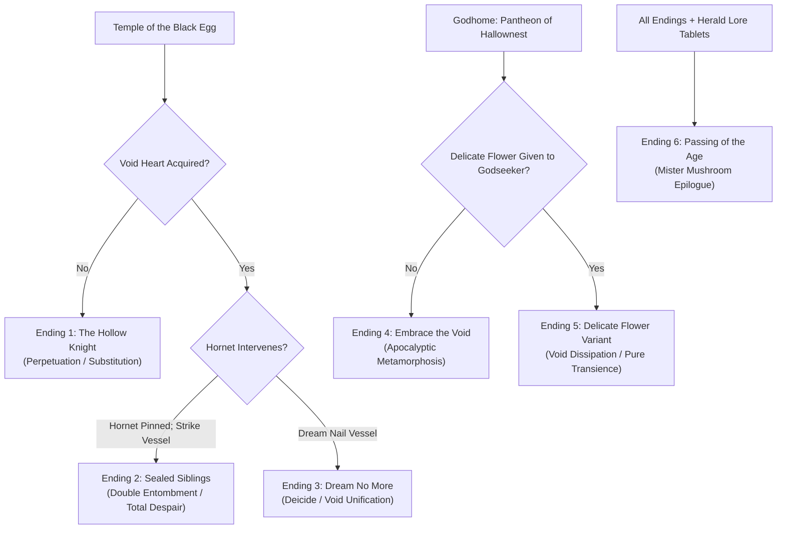

# The Endings of Hallownest: Philosophical Analysis and the Omelas Dilemma

> **Notice:** Working notes, drafted with AI, sources not yet checked line by line.

- **Object of Analysis:** The Six Canonical Endings of *Hollow Knight*
- **Theoretical Framework:** Alex Grunberg's Omelas Paradigm (2024), Giorgio Agamben's Sovereign Exception (1998), Albert Camus's Absurd Freedom (1942)
- **Epistemic Standards:** Tier 1 (Confirmed Canon), Tier 2 (Strongly Supported Interpretation), Tier 3 (Speculative Theory)

---

## 1. Overview of the Six Endings

*Hollow Knight* contains six distinct terminal outcomes across the base game and the *Godmaster* expansion. These endings do not represent simple variations of victory; they represent fundamentally different **ethical and ontological positions** regarding the perpetuation of state power, the legitimacy of utilitarian sacrifice, and the possibility of cosmic liberation.

---

## 2. Granular Analysis of Each Ending

### Ending 1: The Hollow Knight (The Substitution Bargain)
- **Unlocking Conditions:** Defeat the Three Dreamers; enter the Temple of the Black Egg **without** acquiring the Void Heart charm; slay the Hollow Knight [Tier 1].
- **Narrative Sequence:** The Knight defeats the infected, weeping Hollow Knight. As the colossal Vessel collapses into dust, the orange infection bursts forth. The Knight stands motionless, opening its mask to absorb the churning orange infection directly into its own chitinous shell. Four heavy chains drop from the ceiling, tethering the Knight’s arms and torso. The stone shell of the Black Egg reseals itself from within, plunging the chamber into darkness [Tier 1]. Outside, the orange luminescence in the eyes of Hallownest’s infected husks dims, indicating temporary suppression [Tier 2].
- **Philosophical Interpretation (The Omelas Trap):** As Alex Grunberg (2024) demonstrates, Ending 1 represents the classical utilitarian trap described in Ursula K. Le Guin’s *The Ones Who Walk Away from Omelas* (1973). The player does not fix the broken engine of empire; they merely volunteer to become the next cog. The Knight replaces the tortured child in the cellar, repeating the exact eugenic experiment instituted by the Pale King [Tier 2]. 
- **The Inevitability of Future Failure:** Because the Knight developed will, memory, and agency throughout the journey, it is **not truly hollow** [Tier 2]. In time, the Radiance will discover the emotional fracture in this new vessel, the chains will crack, and the infection will break forth once again. Ending 1 is an exercise in cyclical futility [Tier 2].

### Ending 2: Sealed Siblings (The Tragedy of Double Entombment)
- **Unlocking Conditions:** Acquire the Void Heart charm; fight the Hollow Knight until Hornet dashes into the arena, pins the Vessel with her needle, and cracks its mask. **Fail or refuse** to use the Dream Nail on the cracked mask, instead continuously striking the Hollow Knight with the physical nail [Tier 1].
- **Narrative Sequence:** The Knight slays the Hollow Knight while Hornet is in the arena. The shockwave knocks Hornet unconscious. The Knight absorbs the infection into its shell, the chains descend, and the Black Egg seals shut. Hornet is trapped inside the tomb forever. On the exterior of the Black Egg, Hornet’s horned mask is magically etched into the stone, converting her into a fourth, permanent Dreamer seal [Tier 1].
- **Philosophical Interpretation (Totalitarian Overkill):** The most harrowing ending in the game. By failing to transcend physical combat, the Knight not only perpetuates the sacrificial cycle, but actively entangles the innocent protector of the ruins within the tomb. Hallownest’s seal is now reinforced by royal Wyrm and spider bloodline, rendering the tomb permanently unopenable from the outside [Tier 1]. It represents absolute, claustrophobic despair: the total extinction of the Pale King's bloodline with zero systemic resolution [Tier 2].

### Ending 3: Dream No More (Deicide and Liberation)
- **Unlocking Conditions:** Acquire the Void Heart; when Hornet pins the Hollow Knight, strike the cracked mask with the **Awakened Dream Nail** to enter the mind of the Vessel; confront and defeat the **Radiance** in the Dream Realm [Tier 1].
- **Narrative Sequence:** The Knight enters the psychic battleground of the sun. As the Radiance is weakened, the bottom of the arena erupts with a colossal ocean of Void. The shade of the Hollow Knight appears, tearing open the face of the Radiance. The Knight sheds its physical shell, becoming a towering, multi-tentacled shadow entity that repeatedly lashes the Radiance’s face until the light shatters into black mist [Tier 1]. The Void descends back into the Abyss. 
- **The Epilogue of Mourning:** In the physical world, the Black Egg temple dissolves into wisps of smoke. Hornet awakens to find the broken, empty shell of the Knight cracked neatly in two upon the stones. In the Abyss, the millions of tortured sibling shades gaze peacefully upward before sinking into the earth, their generational trauma finally at rest [Tier 1].
- **Philosophical Interpretation (The Radical Break):** Grunberg (2024) identifies this as the "radical response" impossible in Le Guin’s prose parable. The player does not walk away; they use their interactive agency to dismantle the foundational hierarchy. By destroying the Radiance and dissolving the sacrificial vessel, the player terminates both the threat and the state apparatus designed to contain it [Tier 2]. Hallownest is left truly empty - liberated from both divine solar tyranny and royal eugenic autocracy [Tier 2].

### Ending 4: Embrace the Void (The Lord of Shades and Apocalyptic Apotheosis)
- **Unlocking Conditions:** Complete the *Pantheon of Hallownest* in Godhome **without** delivering the Delicate Flower to the Godseeker; defeat **Absolute Radiance** [Tier 1].
- **Narrative Sequence:** Upon striking the final blow against Absolute Radiance atop the floating platforms, the Knight does not merely dissolve; it undergoes a terrifying cosmic metamorphosis. Shedding its shell completely, the Knight transforms into the **Void Given Form** (the Lord of Shades) - a colossal, eight-eyed, crowned cosmic leviathan [Tier 1]. The Void Entity grabs Absolute Radiance, brutally rips her wings apart, and drags her down into the black sea, completely obliterating the light.
- **The Devouring of Godhome:** The Void Entity turns its gaze upon Godhome. Golden clouds turn to pitch; black rain floods the neoclassical spires. In the Junk Pit of the real world, black Void tendrils erupt from the eyes and mouth of the Godseeker, thrashing violently as the Void spills into the physical ruins [Tier 1].
- **The Hornet Encounter:** Outside the Black Egg, Hornet waits with drawn needle. A shadowy, massive figure emerges from the darkness - the Hollow Knight, alive and free of infection, stepping forward into the light as Hornet prepares for combat [Tier 1].
- **Philosophical Interpretation (Nietzschean Overcoming & Cosmic Horror):** Represents the danger of religious deification. The Godseekers sought to attune to the "God of Gods," and in doing so, they summoned an omnipotent entity of pure entropic negation [Tier 2]. This ending transcends the Omelas dilemma not through moral liberation, but through cosmic revolution: the oppressed matter of the Abyss ascends to devour its masters, replacing the hierarchy of light with the absolute sovereignty of the Void [Tier 2].

### Ending 5: Delicate Flower Variant (The Pure Dissipation)
- **Unlocking Conditions:** Deliver the **Delicate Flower** to the Godseeker in the Junk Pit before completing the *Pantheon of Hallownest*; defeat Absolute Radiance [Tier 1].
- **Narrative Sequence:** Identical to Ending 4 until the Void spills out of the Godseeker in the physical world. As the black tentacles burst from her body, one tentacle brushes against the glowing white petals of the Delicate Flower held in her hands [Tier 1]. The flower flashes with blinding, pure white luminescence. In an instant, the Void tentacles dissolve into harmless light particles, the Godseeker vanishes, and only a single glowing petal drifts to the floor [Tier 1].
- **Philosophical Interpretation (The Power of Pure Transience):** The Grey Mourner notes that the Delicate Flower is a frail, alien petal that cannot endure violence or harsh movement [Tier 1]. Yet, in this ending, the absolute, all-devouring fury of the Lord of Shades is peacefully neutralized not by an opposing god, but by a mortal symbol of fragile, ephemeral love and grief [Tier 2]. It suggests that the cycle of imperial violence and cosmic retaliation can be peacefully dissolved through an embrace of vulnerable transience [Tier 2].

### Ending 6: Passing of the Age (The Mister Mushroom Epilogue)
- **Unlocking Conditions:** Achieve any ending after discovering and conversing with **Mister Mushroom** across seven sequential secret locations throughout Hallownest using the Spore Shroom charm [Tier 1].
- **Narrative Sequence:** Following the credits, an extra cinematic scene plays: Mister Mushroom bows respectfully, launches himself into the sky like a rocket, and flies through the clouds. A title card appears: *"TO BE CONTINUED"* [Tier 1].
- **Philosophical Interpretation (The Indifference of Nature):** A brilliant absurdist rupture (Camus, 1942). While gods, kings, and vessels wage apocalyptic theological wars over memory and eternity, the fungal kingdom simply observes, packs its bags, and drifts off to the next dying world. Fungal biology outlasts all human and divine pretensions to permanence [Tier 2].

---

## 3. Comparative Endings Matrix

| Dimension | Ending 1: The Hollow Knight | Ending 2: Sealed Siblings | Ending 3: Dream No More | Ending 4: Embrace the Void | Ending 5: Delicate Flower Variant | Ending 6: Mister Mushroom |
|---|---|---|---|---|---|---|
| **Prerequisites** | Dreamers slain; no Void Heart | Void Heart; slay Hollow Knight | Void Heart; Dream Nail Hollow Knight | Beat Pantheon 5 (No flower) | Beat Pantheon 5 (With flower) | Talk to Mushroom 7 times |
| **Fate of the Knight** | Absorbs infection; chained in Egg | Absorbs infection; chained with Hornet | Shell shattered; shade joins Void | Metamorphoses into Void Given Form | Dissolves along with Void Entity | Unaffected |
| **Fate of Hollow Knight** | Slain by Knight | Slain by Knight | Liberated; shade attacks Radiance | Freed from infection; emerges from Egg | Freed from infection; emerges from Egg | Unaffected |
| **Fate of the Radiance** | Trapped within the Knight | Trapped within the Knight | Annihilated in Dream Realm by Void | Ripped apart and consumed in Godhome | Ripped apart and consumed in Godhome | Unaffected |
| **Fate of Hallownest** | Infection delayed; stasis continues | Eternal double tomb; no escape | Infection eradicated; kingdom at peace | Consumed by rampaging Void tendrils | Purified of both Infection and Void | Age passes; fungal spore departs |
| **Omelas Position** | Accepts the bargain; replaces child | Aggravates bargain; locks observer inside | Destroys the cellar and the utopia | The cellar devours the city | Transcends the bargain through grace | Laughs at the city; flies away |
| **Canon Status** | Confirmed alternate canonical path | Confirmed alternate canonical path | Primary base-game resolution | Canonical high-difficulty resolution | Canonical high-difficulty resolution | Canonical post-credits comic stinger |

