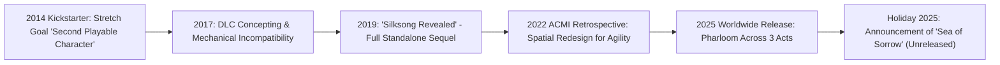
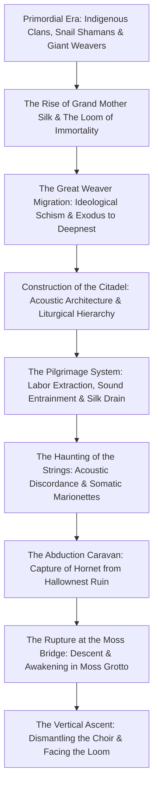
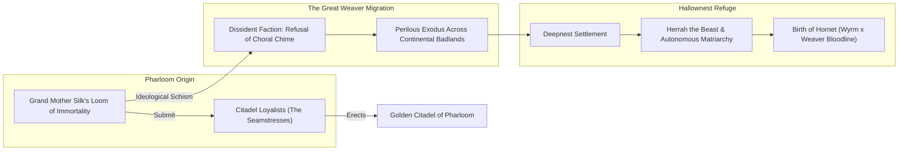
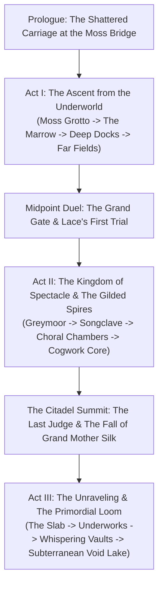
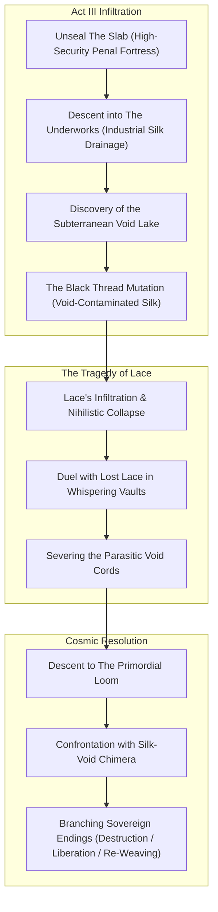

# The Song of Pharloom: Origins, Chronological History, and Narrative Reconstruction in *Hollow Knight: Silksong*

> **Notice:** Working notes, drafted with AI, sources not yet checked line by line.

- **Object of Analysis:** *Hollow Knight: Silksong* (Team Cherry, 2025)
- **Methodology:** Dual-Track Narrative Reconstruction (Studio Genesis, Diegetic Chronology, Acoustic Political Theology, and Experiential Act Structure)
- **Epistemic Standards:** Tier 1 (Confirmed Canon), Tier 2 (Strongly Supported Interpretation), Tier 3 (Speculative Theory)

---

## 1. Studio Origins & Creative Metamorphosis

The creative trajectory of *Hollow Knight: Silksong* represents one of the most remarkable evolutionary leaps in modern independent game design. During Team Cherry's initial 2014 Kickstarter campaign for *Hollow Knight*, the AUD \$56,000 stretch goal promised a "Second Playable Character" - specifically **Hornet**, intended as an alternate, lightweight campaign running through the existing assets of Hallownest [Tier 1].

### 1.1 The Mechanical Incompatibility of Hornet
As documented in curatorial retrospectives with the Australian Centre for the Moving Image (ACMI, 2022) and official developer statements (Team Cherry, 2019), when Ari Gibson and William Pellen began prototyping Hornet within Hallownest’s engine in late 2017, they encountered immediate, irreconcilable design contradictions [Tier 1]:
1. **Vertical Scale & Proportions:** Hornet is physically taller than the Knight, possessed of long, needle-wielding limbs, and designed for lightning-fast, acrobatic traversal (sprinting, automatic ledge-mantling, 45-degree diagonal downward lunges, and silk grappling) [Tier 1].
2. **Corridor Constriction:** Hallownest’s corridors, ceiling heights, and enemy collision boxes were meticulously tuned to the Knight’s stubby jump arc and deliberate pacing. Placing Hornet in Hallownest caused her to constantly strike low ceilings and effortlessly bypass platforming hazards [Tier 1].
3. **Ludic Economy:** The Knight's reliance on ethereal **Soul** (cast from a distance or focused while standing perfectly motionless) contradicted Hornet’s martial, physical persona. Hornet required a physical, tactile resource - **Silk** - which she extracts from chitin and weaves into rapid, mid-air healing (*Bind*) and lethal toolcraft [Tier 1].

Team Cherry realized that accommodating Hornet’s physical identity required building a completely new kingdom characterized by colossal vertical chambers, wider arenas, faster enemy AI, and complex acrobatic level geometry. In February 2019, Team Cherry announced that the DLC had metamorphosed into a full-scale, standalone sequel: *Hollow Knight: Silksong* [Tier 1].

---

## 2. Diegetic Chronology: The History of Pharloom

While Hallownest is an ancient empire sleeping in the silence of an autopsy, **Pharloom** is a living, pulsating, hyper-active civilization governed by ritual performance, musical liturgy, institutional surveillance, and the material extraction of silk [Tier 1; Wysocki, 2026].

### 2.1 The Primordial Era and Indigenous Ecosystems
Long before the erection of the Citadel, the vertical geological rift of Pharloom was an open chasm populated by disparate, nature-attuned insect cultures: the mosskin of **Moss Grotto**, the crustacean dockworkers of the **Deep Docks**, the indigenous hunter tribes of **Hunter's March**, and the ancient **Snail Shamans** [Tier 1]. 

The most technologically and culturally advanced civilization in this primordial era was the **Weavers** - a mysterious clan of multi-eyed, highly intelligent arachnid artisans who mastered the esoteric science of spinning silk into living mechanisms, magical sigils, and spiritual bindings [Tier 1; Morales-Primo, 2026]. 

### 2.2 The Rise of Grand Mother Silk and the Great Weaver Migration
At the spiritual center of Pharloom arose a colossal, ancient higher being: **Grand Mother Silk** [Tier 1]. Unlike the Pale King (who imparted intellect through divine ego) or the Radiance (who unified consciousness through psychic dreams), Grand Mother Silk manifested as the primordial living source of thread, weaving the fabric of the kingdom and sustaining its inhabitants through an eternal, biological loom [Tier 1].

#### The Ideological Schism
As Grand Mother Silk established the **Loom of Immortality**, she demanded that all silk spinning within the rift submit to her central design [Tier 1]. This sparked an irreconcilable civilizational and philosophical schism among the Weavers [Tier 1; Andriano & Caracciolo, 2025]:
1. **The Orthodox Seamstresses:** One faction submitted unconditionally to Grand Mother Silk, becoming the sacred seamstresses and architects of the **Citadel**. They believed that individual weaving was flawed, and that submitting one's silk to the divine mother guaranteed cultural immortality, divine order, and eternal song [Tier 1].
2. **The Dissident Weavers:** The dissident faction recognized that Grand Mother Silk's eternal loom was fundamentally parasitic. Under the guise of spiritual harmony, the Loom transformed bugs into bio-mechanical batteries whose individual life-force and creative agency were harvested to maintain the matriarch's cosmic tapestry [Tier 2]. The dissidents argued for tactile autonomy, mortal weaving, and the cultivation of shadow-arts [Tier 2].

#### The Exodus to Deepnest
Severance tablets and ancient loom-spools discovered in the abandoned sanctums of **Shellwood** and **Weavenest** record the definitive rupture [Tier 1]:
> *"We who thread the shadows shall not bend our needles to the choral chime. Better the damp darkness of foreign stones than the gilded snare of the eternal spool."* [Tier 1 / Inscription fragment].

Led by ancestral matriarchs, the dissident Weavers abandoned Pharloom, undertaking a perilous cross-continental exodus across the desolate, storm-swept wastes [Tier 1]. They migrated across the continental crust until settling in the dark, cavernous underbelly of **Deepnest** within Hallownest [Tier 1]. There, they forged an autonomous, subterranean matriarchy under Herrah the Beast, preserving their independent spinning traditions, weaving protective seals, and eventually negotiating the royal pact with the Pale King that yielded the birth of Hornet [Tier 1].

### 2.3 The Theocracy of the Citadel: Acoustic Architecture and Liturgical Surveillance
Back in Pharloom, the Citadel consolidated absolute theocratic authority over the vertical rift [Tier 1; Wysocki, 2026]. The ruling clergy - comprising the **Songclave**, the **Choir**, and the High Inquisitors - engineered a pervasive socio-religious system structured around three mechanical-liturgical pillars [Tier 1]:

#### 1. Acoustic Architecture and The Sacred Song
The Citadel is not merely an administrative capital; it is a monumental musical instrument [Tier 1]. Engineered with thousands of hollow reverberation columns, brass carillons, and colossal pipe organs embedded into the living rock, the Citadel broadcasts **The Sacred Song** across the entire kingdom [Tier 1; Wysocki, 2026]:
- **Acoustic Entrainment:** The Song functions as an infrasonic and ultrasonic frequency that soothes somatic pain while entraining the nervous systems of lower castes, inducing absolute docility and euphoric obedience [Tier 1; Wysocki, 2026].
- **Spatial Zoning:** Sound acts as a physical barrier. Certain holy chambers are calibrated to acoustic frequencies that cause uninitiated or discordant bugs to experience intense cranial agony and disorientation, effectively walling off sacred zones without physical gates [Tier 1].
- **The Songclave Clergy & Bell-Helmets:** The clergy wear heavy brass helmets shaped like bells and tuning forks. These helmets serve as acoustic resonators that filter out ambient noise and amplify the pure liturgical pitch of Grand Mother Silk, deliberately deafening the clergy to the screams and suffering of the lower classes [Tier 1].

#### 2. The Bellway Infrastructure and Temporal Hegemony
The Bellway transit system, powered by the colossal **Bell Beasts**, links the industrial lowlands to the upper spires [Tier 1]. Massive bell chimes toll at strict hourly intervals, regulating labor shifts in the bone-furnaces of The Marrow, arrival manifests at the Deep Docks, and devotional prayer cycles in the Citadel [Tier 1]. Time in Pharloom is not natural; it is dictated entirely by liturgical brass [Tier 1].

#### 3. The Pilgrimage: Exploitation of Devotional Labor
The defining ideological apparatus of Pharloom is the **Myth of the Pilgrimage** [Tier 1; Caracciolo, 2026]. Bugs across the known world are indoctrinated with the belief that ascending to the Citadel's summit will grant divine forgiveness, physical rebirth, or spiritual ascension [Tier 1]. In reality, the Pilgrimage is an extractive conveyor belt:
- In the volcanic depths of **The Marrow**, pilgrims are stripped of their wealth and pressed into forced labor, mining fossilized bone and fuel to power Citadel furnaces [Tier 1].
- At the **Deep Docks**, maritime pilgrims are subjected to exorbitant tariffs and forced into maritime dockwork [Tier 1].
- In the hidden **Underworks**, weary and depleted pilgrims are systematically bled of their natural silk glands to provide raw filament for Citadel looms [Tier 1].

### 2.4 The Haunting of the Strings and the Abduction Caravan
In recent decades, Pharloom’s grand design began to catastrophically fracture [Tier 1]. Grand Mother Silk's ancient physical body suffered from biological exhaustion, causing the sacred threads to fray and knot [Tier 1]. Concurrently, an inexplicable contamination began seeping upward from the subterranean foundations of the rift [Tier 1].

The Sacred Song distorted into a maddening, high-pitched screech known as **The Haunting** [Tier 1]. Rather than calming pilgrims, the dissonant vibration caused silk threads to erupt spontaneously from their flesh, turning common bugs, dockworkers, and Citadel sentries into twitching marionettes puppeted by distant, invisible cords [Tier 1].

Facing complete social and physical collapse, the Songclave clergy dispatched armored bell-headed cultists across the badlands in heavily warded caravans, hunting for a bug whose blood possessed sufficient divine and arachnid potency to re-spin the dying loom [Tier 1]. In the desolate barrows of Hallownest, they located and captured **Hornet** [Tier 1].

---

## 3. Experiential Narrative: The Three Acts of *Silksong*

### Prologue: The Shattered Carriage at the Moss Bridge
*Silksong* opens with a dramatic animated sequence: an armored transport caravan crosses a towering stone bridge suspended over an endless misty abyss [Tier 1]. Hornet is locked within an ornate iron cage sealed with heavy, glowing silk binding-talismans [Tier 1]. As a glowing silk butterfly flutters near her cell, Hornet channels her inner reserve of Weaver power, executing a needle thrust that detonates the talisman [Tier 1]. 

The explosion collapses the bridge. The carriage plummets into the depths of the earth, crashing violently through the lush canopy of **Moss Grotto** [Tier 1]. Hornet crawls out from the wreckage: her red cloak is tattered, her needle is blunt, and her silk reserves have been severely depleted by the binding spells [Tier 1]. Her initial quest is visceral and immediate: repair her weapons, restore her vitality, and fight her way up through the unfamiliar kingdom to uncover the forces behind her abduction [Tier 1].

### Act I: The Lowlands and the Cost of the Pilgrimage
- **Moss Grotto & The Marrow:** Hornet traverses lush, overgrown fungal caverns, re-learning basic agility: sprint-dashing, wall-grabbing, and harvesting silk by striking adversaries [Tier 1]. She defeats **Moss Mother**, an indigenous matriarch guarding her nest [Tier 1]. Ascending into **The Marrow**, lush flora gives way to brutal industrial misery: blazing bone-furnaces, molten lava vents, and exhausted pilgrims singing mournful dirges as they quarry stone [Tier 1]. Hornet challenges the **Bell Beast**, freeing the multi-legged transit creature from its parasitic bronze bridle and transforming a fearsome boss into an enduring fast-travel companion [Tier 1].
- **Deep Docks & Far Fields:** Reaching the subterranean harbor of **Deep Docks**, Hornet witnesses Pharloom’s commercial apparatus, where cargo ships laden with fossilized bone pay crushing tariffs to the clergy [Tier 1]. Exiting into the sun-drenched, golden steppes of **Far Fields**, she encounters **Shakra**, a cartographer seeking her lost master, and **Sherma**, a devout pilgrim wielding an iron pot lid and cooking ladle whose unshakeable optimism provides emotional warmth amidst structural cruelty [Tier 1].
- **The Threshold Duel with Lace:** At the **Grand Gate** separating the lowlands from the Citadel spires, Hornet is confronted by **Lace**, a mocking, theatrical duelist wielding a gilded fencing needle [Tier 1]. Lace tests Hornet in a breathtaking fencing match, deriding Hornet's foreign bloodline and warning that the Citadel will dissect her thread by thread [Tier 1]. Defeating Lace unlocks the Grand Gate, marking Hornet’s formal entry into the high theocratic kingdom.

### Act II: The Gilded Citadel and the Spectacle of Faith
- **Greymoor & Shellwood:** Hornet travels through the perpetual downpour of **Greymoor**, an atmospheric wasteland populated by scavenger crows, abandoned mansions, and eccentric performers like the flamboyant butterfly **Trobbio** [Tier 1]. In **Shellwood**, she discovers the petrified ruins of ancient Weaver colonies, reading forbidden stone inscriptions that detail the ancient schism and the flight of her ancestors to Deepnest [Tier 1].
- **Infiltrating the High Citadel (Songclave & Choral Chambers):** Reaching the high metropolis of the Citadel, Hornet witnesses the pinnacle of Pharloom’s liturgical splendor [Tier 1]. Vaulted marble halls, stained glass windows depicting Grand Mother Silk, and monumental pipe organs fill the air with thunderous song [Tier 1]. Yet the metropolis is a gilded tomb: mechanized **Cogwork Dancers** patrol the plazas, and the terrifying **Last Judge** executes pilgrims whose voices deviate from the sacred tune [Tier 1].
- **Confronting Grand Mother Silk:** At the summit of the Citadel, Hornet penetrates the sanctum of the **Great Loom** [Tier 1]. There, she finds **Grand Mother Silk** suspended in an enormous, pulsating web of golden-white silk [Tier 1]. The divine matriarch speaks in hypnotic, harmonic chords, revealing that Hornet was captured because her hybrid blood - combining Pale Wyrm divinity with Weaver biological silkcraft - is the only substance capable of restringing the fraying loom and restoring Pharloom's eternal life [Tier 1].
- **The Act II Climax & Baseline Ending:** Hornet battles Grand Mother Silk in a high-stakes, acrobatic duel. Severing the central spools shatters the matriarch's physical vessel. In a standard playthrough, this triggers **Ending 1: Weaver Queen**, where Hornet takes the throne of the loom, subduing the Discord at the cost of binding her own soul permanently to Pharloom's machinery [Tier 1]. However, if the player has uncovered the kingdom's deeper conspiracies, Act III begins.

### Act III: The Unraveling, The Void Lake, and The Primordial Loom
Unlocking Act III requires completing the multi-stage **"Silk and Soul"** questline, locating the hidden Weavenest sanctuaries across Shellwood and Whispering Vaults, and attuning with the ancient Snail Shamans [Tier 1].

#### 1. The Descent into The Slab and Underworks
Instead of ascending into light, Act III forces Hornet downward into the horrific industrial underbelly of the kingdom [Tier 1]:
- **The Slab:** A brutalist penal citadel carved into black granite where political dissidents, heretics, and failed pilgrims are incarcerated and processed [Tier 1]. Hornet must orchestrate a prison break, liberating allied NPCs while surviving elite Citadel torturers [Tier 1].
- **The Underworks:** Beneath the prison lies the Underworks - a vast network of grinding gears, brass pipes, and drainage cisterns [Tier 1]. Here, Hornet uncovers the grotesque reality of Pharloom's silk economy: pilgrims are strapped into automated drainage vats, their life-force pumped upward to feed the lavish lifestyles of the high clergy [Tier 1].

#### 2. The Awakening of the Subterranean Void Lake
In the deepest foundations beneath the Underworks, Hornet makes a terrifying discovery: Pharloom is built directly atop a massive subterranean lake of **Void** [Tier 1].
- **The Universal Substance:** Confirming that Void is not a local anomaly unique to Hallownest’s Abyss, Pharloom’s subterranean bedrock rests upon the same primordial ocean of pure darkness [Tier 1].
- **The Black Thread Mutation:** Decades of excessive industrial pressure and seismic excavation cracked the subterranean crust, allowing Void to seep into the kingdom's pressurized silk-ducts [Tier 1]. When pure biological silk contacts raw Void, it undergoes a horrific chemical mutation, generating **Black Silk** - a viscous, entangling filament that absorbs light and corrupts living minds [Tier 1]. This explains the true origin of The Haunting: it was not merely biological aging, but the corrupting touch of the Void invading the divine loom [Tier 1].

#### 3. The Tragedy and Corruption of Lace
The narrative emotional peak of Act III centers on Hornet’s rival, **Lace** [Tier 1]:
- Having lost her status and purpose following the collapse of the High Citadel, Lace ventured deep into the Whispering Vaults, seeking the hidden truth of Pharloom’s origins [Tier 1].
- Exposed to the concentrated Void lake and the shrieking discordance of the frayed strings, Lace’s fragile, performance-based identity fractured [Tier 1]. She was overcome by the Black Silk, which wrapped around her limbs and infected her gilded needle, transforming her into **Lost Lace** - a tragic, weeping phantom puppeteered by shadowy filaments [Tier 1].
- In the solemn, echoing depths of the **Whispering Vaults**, Hornet faces Lost Lace in one of the game's most demanding boss battles [Tier 1]. Lace attacks with erratic, glitching lunges, shadowy needle beams, and desperate aerial pirouettes while weeping discordant notes [Tier 1]. By defeating her, Hornet severs the void-threads, sparing Lace's life and restoring her consciousness, transforming their mocking rivalry into genuine mutual respect and shared survival [Tier 1].

#### 4. The Primordial Loom and Cosmic Resolution
Armed with her ancestral needle, the awakened crests of Pharloom, and her synthesized understanding of Silk and Void, Hornet descends to the absolute foundation of the world: **The Primordial Loom** [Tier 1]. There, she confronts Grand Mother Silk's final, desperate incarnation - an entity that attempted to weave the encroaching Void into her sacred tapestry, resulting in a horrifying, multi-phased cosmic chimera of white thread and black shadow [Tier 1].

By overcoming this entity, Hornet dismantles the mechanical theocracy of Pharloom once and for all, unlocking the game's expansive branching finales (*Silk and Soul*, *Song of Deliverance*, or *The Void Weaver*), resolving the historical debt of her ancestors and redefining what it means to be sovereign in a post-divine world [Tier 1].
