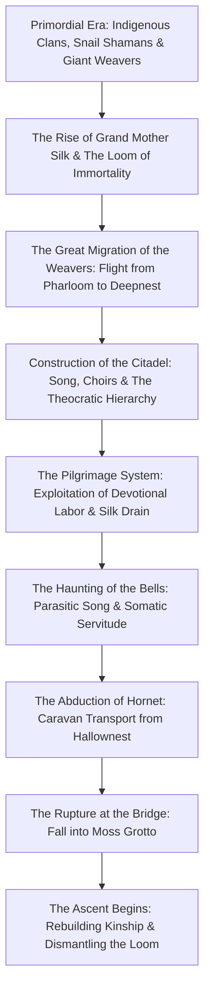
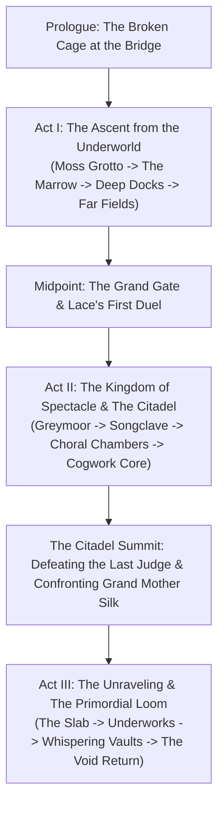

# The Song of Pharloom: Origins, Chronological History, and Narrative Reconstruction in *Hollow Knight: Silksong*

- **Object of Analysis:** *Hollow Knight: Silksong* (Team Cherry, 2025)
- **Methodology:** Dual-Track Narrative Reconstruction (Studio Genesis, Diegetic Chronology, and Experiential Act Structure)
- **Epistemic Standards:** Tier 1 (Confirmed Canon), Tier 2 (Strongly Supported Interpretation), Tier 3 (Speculative Theory)

---

## 1. Studio Origins & Creative Metamorphosis

The creative trajectory of *Hollow Knight: Silksong* represents one of the most remarkable evolutionary leaps in modern independent game design. During Team Cherry's initial 2014 Kickstarter campaign for *Hollow Knight*, the AUD \$56,000 stretch goal promised a "Second Playable Character"—specifically **Hornet**, intended as an alternate, lightweight campaign running through the existing assets of Hallownest [Tier 1].

### 1.1 The Mechanical Incompatibility of Hornet
As documented in curatorial interviews with the Australian Centre for the Moving Image (ACMI, 2022) and official developer retrospectives (Team Cherry, 2019), when Ari Gibson and William Pellen began implementing Hornet within Hallownest’s engine in late 2017, they encountered immediate, irreconcilable design contradictions [Tier 1]:
1. **Vertical Scale & Proportions:** Hornet is physically taller than the Knight, possessed of long, needle-wielding limbs, and designed for lightning-fast, acrobatic traversal (sprinting, mantle-grabbing, 45-degree diagonal downward lunges, and silk grappling) [Tier 1].
2. **Corridor Constriction:** Hallownest’s corridors, ceiling heights, and enemy collision boxes were meticulously tuned to the Knight’s stubby jump arc and deliberate pacing. Placing Hornet in Hallownest caused her to constantly hit her head on low ceilings and easily bypass complex platforming hazards [Tier 1].
3. **Ludic Economy:** The Knight's reliance on ethereal **Soul** (cast from a distance or focused while standing perfectly motionless) did not fit Hornet’s martial, physical persona. Hornet required a physical, tactile resource—**Silk**—which she extracts from chitin and weaves into rapid, mid-air healing (*Bind*) and lethal toolcraft [Tier 1].

Team Cherry realized that accommodating Hornet’s physical identity required building a completely new kingdom characterized by colossal vertical chambers, wider arenas, faster enemy AI, and complex acrobatic level geometry. In February 2019, Team Cherry announced that the DLC had metamorphosed into a full-scale, standalone sequel: *Hollow Knight: Silksong* [Tier 1].

---

## 2. Diegetic Chronology: The History of Pharloom

While Hallownest is an ancient empire sleeping in the silence of an autopsy, **Pharloom** is a living, pulsating, hyper-active civilization governed by ritual performance, musical liturgy, institutional surveillance, and the material extraction of silk [Tier 1].

### 2.1 The Primordial Era, Indigenous Clans, and the Weavers
Long before the erection of the Citadel, the vertical land of Pharloom was an open geological rift populated by disparate, nature-attuned insect cultures: the mosskin of **Moss Grotto**, the crustacean dockworkers of the **Deep Docks**, the indigenous hunter tribes of **Hunter's March**, and the ancient **Snail Shamans** [Tier 1]. 

The most technologically and culturally advanced civilization in this primordial era was the **Weavers**—a mysterious clan of multi-eyed, highly intelligent arachnid artisans who mastered the esoteric science of spinning silk into living mechanisms, magical sigils, and spiritual bindings [Tier 1]. 

### 2.2 The Rise of Grand Mother Silk and the Weaver Schism
At the spiritual center of Pharloom arose a colossal, ancient higher being: **Grand Mother Silk** [Tier 1]. Unlike the Pale King (who gave intellectual thought) or the Radiance (who claimed psychic dreams), Grand Mother Silk manifested as the primordial source of living thread, weaving the fabric of the kingdom and sustaining its inhabitants through an eternal, biological loom [Tier 1].

However, a fundamental civilizational schism tore the Weavers apart [Tier 1]:
- One faction submitted to Grand Mother Silk, becoming the sacred seamstresses and architects of the **Citadel**, using silk to construct colossal golden spires, mechanical bellways, and musical pipe organs [Tier 1].
- Another faction—the ancestral forebears of Herrah the Beast and Deepnest's Weavers—recognized that Grand Mother Silk's eternal loom was parasitic, transforming bugs into mindless silk-producing batteries [Tier 2]. This dissident Weaver faction fled Pharloom, undertaking a perilous cross-continental exodus across the barren wastes to find refuge in the subterranean depths of **Deepnest** in Hallownest [Tier 1].

### 2.3 The Theocracy of the Citadel: Song, Bell, and Pilgrimage
Back in Pharloom, the Citadel consolidated absolute theocratic authority over the land [Tier 1]. The ruling clergy—comprising the **Choir**, the **Songclave**, and the high inquisitors—engineered a pervasive socio-religious system structured around three pillars [Tier 1]:
1. **The Sacred Song:** A continuous, multi-harmonic acoustic resonance broadcast through gigantic pipe systems and musical chambers throughout the kingdom. The Song acts as a subliminal hymn that soothes pain, inspires divine awe, and subtly rewires the nervous systems of listening bugs, ensuring absolute docility [Tier 1].
2. **The Bellway Infrastructure:** A kingdom-spanning network of massive brass bells and transit lines maintained by the **Bell Beasts**, symbolizing the unceasing vigilance and temporal schedule of the theocracy [Tier 1].
3. **The Pilgrimage:** The genius of Pharloom's autocracy is that it does not rule primarily through physical walls; it rules through the **myth of the Pilgrimage** [Tier 1]. Bugs from across the world are lured to Pharloom by the promise that climbing to the Citadel’s summit will grant spiritual enlightenment, forgiveness, or physical transformation [Tier 1]. In reality, the Pilgrimage is a meat-grinder: as pilgrims climb, their physical labor is harvested in the mines of The Marrow, their goods are taxed at the Deep Docks, and their biological silk is drained in the Underworks to feed the insatiable looms of the high clergy [Tier 1].

### 2.4 The Haunting and the Sickness of the Strings
In recent decades, Pharloom's sacred order began to rot from within. Grand Mother Silk's ancient body grew decrepit and erratic, causing the sacred threads to tighten into suffocating snares [Tier 1]. The Song became discordant, mutating into a maddening, high-pitched screech—the "Haunting"—that caused pilgrims to become bound in tangled, parasitic white silk threads, transforming them into twitching, marionette-like husks puppeted by distant strings [Tier 1].

Desperate to restore the vigor of Grand Mother Silk and revitalize the dying looms, the Citadel dispatched armored cultists and silk-hunters across the badlands to kidnap bugs of potent, ancient bloodlines [Tier 1]. In the decaying ruins of Hallownest, their hunting caravan struck the ultimate prize: **Hornet**, the princess-protector born of royal Wyrm and Weaver blood [Tier 1].

---

## 3. Experiential Narrative: The Three Acts of *Silksong*

### Prologue: The Cage and the Plunge
The game opens with an animated cinematic: a carriage driven by bell-headed cultists transports Hornet inside a cage sealed with heavy, glowing silk talismans across a colossal stone bridge spanning a misty chasm [Tier 1]. A mysterious butterfly of light flutters near the cage; Hornet focuses her remaining strength, strikes the binding talisman with her needle, and shatters the lock [Tier 1]. The resulting explosion destroys the bridge; the carriage plummets into the depths of a subterranean abyss, crashing through the verdant canopy of **Moss Grotto** [Tier 1].

Hornet awakens at the absolute base of Pharloom. Her dress is torn, her needles are blunt, and her silk glands have been severely drained by the binding seal [Tier 1]. Her objective is immediate, physical, and primal: survive, regain her lost power, and climb upward to discover who captured her and why [Tier 1].

### Act I: The Lowlands and the Cost of the Pilgrimage
- **Moss Grotto & The Marrow:** Hornet navigates lush mossy caves, learning to run, wall-cling, and harvest silk by striking enemies. She encounters **Moss Mother**, an indigenous matriarch defending her brood [Tier 1]. Entering **The Marrow**, the pastoral beauty vanishes, replaced by blazing bone-furnaces, volcanic magma vents, and sweatshops where pilgrims toiling with pickaxes sing grim marching chants [Tier 1]. Hornet defeats the **Bell Beast**, freeing the colossal, multi-legged transit creature from a parasitic brass collar, transforming a terrifying boss into a loyal fast-travel ally [Tier 1].
- **Deep Docks & Far Fields:** At the **Deep Docks**, Hornet confronts the industrial maritime economy of Pharloom, where ships laden with fossilized bone and metal pay heavy tithes to the Citadel [Tier 1]. Traveling through the golden, wind-swept steppes of **Far Fields**, she meets **Shakra**, a cartographer seeking her lost master, and **Sherma**, a tiny, devout pilgrim armed with a cooking spoon whose pure-hearted optimism contrasts starkly with the world's brutality [Tier 1].
- **The Threshold Duel with Lace:** At the precipice of the **Grand Gate** leading to the upper kingdom, Hornet is intercepted by **Lace**, a mocking, hyper-agile duelist wielding an ornate gilded fencing needle [Tier 1]. Lace tests Hornet in a breathtaking fencing duel, mocking her rustic provincial origin and warning that the Citadel will unpick her thread by thread [Tier 1]. Upon defeating Lace, Hornet breaches the Grand Gate, stepping into the upper stratum of the civilization.

### Act II: The Gilded Citadel and the Spectacle of Faith
- **Greymoor & Shellwood:** Hornet traverses the melancholic, rain-soaked moors of **Greymoor**, an atmospheric region populated by crow-like scavenger bugs and eccentric performers (such as the pompous theatrical butterfly **Trobbio**) [Tier 1]. In **Shellwood**, she walks among the petrified, hollowed-out exoskeletons of ancient trees and bugs, discovering hidden shrines that reveal the Weavers once ruled these forests before they were driven into exile [Tier 1].
- **Infiltrating the Citadel (Songclave & Choral Chambers):** Hornet reaches the glorious, golden metropolis of the **Citadel**. The architecture is breathtaking: vaulted marble ceilings, stained-glass windows depicting Grand Mother Silk, colossal pipe organs, and choral halls where masked choristers sing hymns of perpetual devotion [Tier 1]. Yet, beneath the liturgical splendor lies a totalitarian surveillance apparatus. Hornet is hunted by the **Cogwork Dancers**—graceful, clockwork mechanical automatons driven by internal silk-springs—and the **Last Judge**, a towering, hammer-wielding inquisitor enforcing the King's peace [Tier 1].
- **The Confrontation with Grand Mother Silk:** At the apex of the High Citadel, Hornet penetrates the sanctum of the **Great Loom**. Here, she encounters **Grand Mother Silk** suspended within a colossal web of pulsating, golden-white silk threads [Tier 1]. The divine matriarch speaks in multi-tonal, hypnotic harmonies, revealing that she orchestrated Hornet’s capture: Hornet's hybrid bloodline represents the ultimate catalyst required to re-weave the frayed fabric of Pharloom [Tier 1]. 
- **The Act II Climax:** Hornet battles Grand Mother Silk in a dramatic multi-phase duel. Upon victory, Hornet severs the central looms. In a standard playthrough, this triggers the initial baseline ending (**Ending 1: Weaver Queen**), wherein Hornet takes the throne of the loom, subduing the discord at the cost of binding herself to the kingdom [Tier 1]. However, if the player has explored the hidden margins of the world, Act III unlocks.

### Act III: The Unraveling, The Void, and The Primordial Loom
- **Unlocking Condition:** Complete the "Silk and Soul" questline; discover the hidden **Weavenest** sanctums in Shellwood and the Whispering Vaults; attune with the ancient **Snail Shamans** and the mysterious **Caretaker** [Tier 1].
- **The Descent into the Underworks and The Slab:** Instead of ascending into light, Act III forces Hornet downward into the horrific industrial underbelly of the Citadel: **The Slab** (a maximum-security penal colony where heretics and failed pilgrims are harvested) and the **Underworks** [Tier 1]. Here, the player discovers that Grand Mother Silk's loom is not merely unraveling; it is being corroded from beneath by an all-too-familiar substance: **the Void** [Tier 1].
- **The Return of the Void:** Centuries ago, when the ancient Weavers fled Hallownest, they brought with them forbidden alchemical knowledge of the dark lake beneath the earth [Tier 2]. In the lowest forgotten vats of Pharloom, ancient pools of Void have awakened, seeping into the silk-pipes and creating grotesque, hybridized abominations—chitinous bugs bound in white silk with bleeding black eyes and shadowy tendrils [Tier 1].
- **The Lost Lace Encounter:** In the deepest reaches of the Whispering Vaults, Hornet confronts **Lost Lace**, whose mind has been fractured by the dissonant song and consumed by Void contamination [Tier 1]. In a deeply emotional, high-speed duel, Hornet must defeat her former rival to liberate her soul from the parasitic strings [Tier 1].
- **The Climax of the Primordial Loom:** Hornet descends into the Primordial Loom to confront the fused, cosmic entity born of Grand Mother Silk's desperate union with the Void, resolving the conflict through multiple branching endings that determine whether Pharloom is liberated, destroyed, or fundamentally re-woven [Tier 1].

