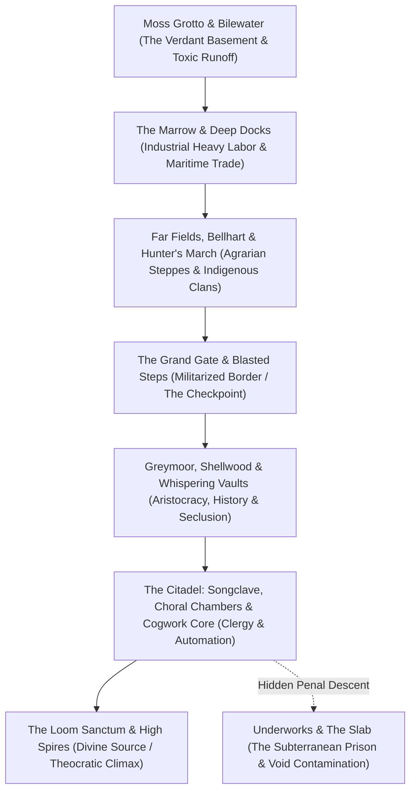

# Area-by-Area Spatial Analysis and Social Architecture: Pharloom

> **Historical Working Note:** This file contains preliminary exploratory notes drafted during kickoff. It is now formally superseded and verified by the deeper modular research files in `lore/ss_01_*.md through lore/ss_08_*.md, timelines/pharloom_timeline.md, and themes/05_class_labor_and_the_people_who_remain.md`. All claims are cataloged in `data/claims.csv`.

- **Object of Analysis:** The Complete Geography and Factional Architecture of Pharloom (22 Regions and Sub-Areas)
- **Methodology:** Vertical Spatial Stratigraphy, Political Architecture, Sociological Topography
- **Epistemic Standards:** Tier 1 (Confirmed Canon), Tier 2 (Strongly Supported Interpretation), Tier 3 (Speculative Theory)

---

## 1. Topological Structure and the Philosophy of Ascent

While Hallownest is defined by a **subterranean descent into forgotten guilt**, Pharloom is structured as an **ascending vertical pilgrimage through active social stratification**. The geography of Pharloom is an architectural manifestation of a theocratic class pyramid: the lowest, darkest caverns house manual labor, resource extraction, and indigenous tribes; the middle plateaus host commerce, transport, and artistic spectacle; and the soaring, sunlit spires of the Citadel contain the ruling clergy, automated clockwork ballrooms, and the divine loom of Grand Mother Silk.

---

## 2. Region-by-Region Analytical Matrix

| Region | Historical Identity & Function | Present Condition & Architecture | Inhabitants, Factions & Major NPCs | Key Bosses / Encounters | Traversal / Progression Gating | Music & Affective Atmosphere | Narrative & Sociological Meaning |
|---|---|---|---|---|---|---|---|
| **Moss Grotto** | Ancient primordial botanical aquifer at the base of the Pharloom rift | Lush, overgrown mossy grottoes; dripping stalactites, glowing lumafly flora | Mosskin tribes, indigenous larva, Flea Caravan | Moss Mother (Matriarch), Moss Charger | Basic needle attacks, sprinting, ledge mantling | Gentle, plucked harp and acoustic guitar; pastoral rebirth, organic innocence | The cradle of life; where Hornet awakens, reconnecting with raw earth before facing stone |
| **The Marrow** | The mineral and volcanic furnace powering Pharloom’s heavy industry | Blazing bone-calcining kilns, lava vents, volcanic ash, heavy steam pipes | Pilgrims turned forced-laborers, Bone Carver clans | Bell Beast (Collar Boss), Skull Hunter | Sprint-jumping over magma; wall-sliding on charred basalt | Pounding industrial drums, anvil clangs, harsh low brass; brutal, scorching toil | The labor base of empire: where pilgrims are stripped of individuality and forced to smelt bone |
| **Deep Docks** | Subterranean maritime trading port and customs inspection zone | Brackish canals, towering wooden gantries, colossal rusty crane hooks | Crustacean dockworkers, Forge Daughter, Cargo Inspectors | Steel Assassin Sharpe (Caravan ambush) | Swimming, rope-swinging, harpoon traversal | Swashbuckling rhythmic strings, creaking timber, splashing brine; gritty commerce | The economic border: illustrates how the Citadel extracts heavy tariffs from all incoming trade |
| **Far Fields** | Vast, sun-drenched golden savannah plateau between lowlands and citadel | Swaying golden wild grass, ancient monoliths, crumbling aqueducts | Shakra (cartographer), Sherma, Garmond & Zaza | Wild Boar Beast, Plains Hunter | Sprinting across open terrain; vertical updrafts | Sweeping orchestral strings, acoustic guitar, soaring flute; epic wanderlust | The romantic illusion of pilgrimage: vast beautiful open plains masking predatory dangers |
| **Bellhart** | Ancient transit crossroads town situated around a colossal bronze bell tower | Quaint stone dwellings, bell-shaped chimneys, cobbled courtyards | Bell Ringers, retired pilgrims, Flea Master | None (Regional Hub Area) | Bellway transit hub; bench restoration | Mellow chime arpeggios, warm cello, humming town chatter; peaceful domestic haven | A functioning community: shows how ordinary bugs carve out warmth beneath the giant bells |
| **Hunter's March** | Sacred hunting grounds of the indigenous masked predatory clans | Dense thorn-thickets, bone totems, camouflaged snare traps | Indigenous hunter tribes, Masked Stalkers, Seth | Hunter Chief, Seth (Martial duel) | Acrobatic wall-jumping between thorns; needle pogo | Primal percussion, clicking insect mandibles, tense woodwinds; stealthy, lethal tension | Indigenous sovereignty: a culture that rejects the Citadel's hymns in favor of raw predatory survival |
| **Blasted Steps** | Rugged, windswept stone staircase carved directly into the mountain cliff | Shattered marble pillars, sheer drop-offs, howling winds, lightning strikes | Armored Citadel sentries, lightning bugs | Last Judge Vanguard | Extreme precision platforming; gale-wind compensation | Howling winds, dramatic orchestral brass chords; perilous vertical ascent | The physical test of faith: where the weak are filtered out by natural and military force |
| **Grand Gate** | Massive, gilded border fortress sealing the entrance to the Upper Citadel | Colossal brass portcullis, fortified parapets, high watchtowers | High Inquisitors, Gatekeepers, Lace | Lace (First Duel) | Unlocks after defeating Lace; requires Gate Crest | Grand, imposing military fanfare, rhythmic snare drums; unyielding state authority | The architectural threshold of privilege: where the underclasses are formally halted |
| **Greymoor** | Melancholic, rain-drenched coastal moors and aristocratic country estates | Misty peat bogs, crumbling gothic manors, ornate iron streetlamps | Trobbio, scavenger crows, weeping aristocrats | Trobbio (Stage Boss), Crow Patriarch | Thread-gliding across misty chasms; swinging lamps | Weeping solo violin, distant thunder, pouring rain; romantic gothic melancholy | The decaying aristocracy: privileged elites indulging in theatrical drama while the world rots |
| **Shellwood** | Petrified ancestral forest of hollowed-out colossal insect carapaces | Ghostly, petrified white wood; glowing fungal moss, ancient Weaver shrines | Weaver shades, solitary spiders, Mask Maker | Weaver Phantom, Wood Carver | High-speed needle grappling between branches; Silk Soar | Ethereal, shimmering synth pads, distant chimes; ancient sacred silence | The ancestral graveyard of the Weavers: reveals the ancient history of Hornet’s maternal kin |
| **Bilewater** | Putrid drainage swamp and toxic chemical runoff reservoir beneath the mines | Poisonous green acidic sludge, rotting timber platforms, bloated leeches | Muck-scavengers, outcast lepers | Bile Beast, Sludge Tyrant | Requires acid-resistant silk boots / Isma-equivalent tool | Disgusting gurgling water, dissonant low strings; nauseating biological filth | The ecological consequence of industrialization: the toxic waste produced by the Citadel's spires |
| **The Citadel** | The supreme sovereign metropolis, religious capital, and theocratic core | Vaulted white-and-gold marble palaces, stained glass, soaring spires | The Choir, High Priests, Cogwork Dancers | Cogwork Dancers, High Prelate | Elevator networks, Silk-powered ziplines; requires High Crest | Resplendent choral polyphony, grand pipe organ, soaring soprano; majestic theocracy | The beating heart of Pharloom: architectural perfection sustaining an eternal, parasitic sacred lie |
| **Songclave** | Administrative and liturgical cloister of the sacred musical clergy | Marble cloisters, acoustically tuned archways, towering organ pipes | Masked choristers, hymn writers, liturgical monks | The Fourth Chorus | Musical resonance puzzles; bell attunement | Layered, multi-part sacred vocal motets; divine transcendent order | The ideological apparatus: where the hypnotic sacred songs are composed and broadcast |
| **Choral Chambers** | Colossal amphitheaters designed for mass choral synchronization | Towering acoustic domes, gilded balconies, velvet liturgical seating | Pious pilgrims, singing automatons | Choral Choir Master | Navigating vibrating acoustic shockwaves | Thundering, resonant choir and organ counterpoint; overwhelming sensory awe | The manufacture of mass ecstasy: where pilgrims surrender their individuality to divine harmony |
| **Whispering Vaults** | Secret archives and treasury buried behind the high cathedral walls | Dust-covered scroll libraries, crystalline memory prisms, silk tapestries | The Caretaker, Scribes of Silk | Lost Lace (Act III Corrupted Boss) | Deciphering ancient glyphs; Void-resistant cloak | Whispering hushed voices, haunting minor-key flute; forbidden knowledge, dread | The repository of truth: where the Citadel hides records of the Weaver schism and the Void |
| **Underworks** | The concealed industrial machinery beneath the Citadel's polished marble | Iron catwalks, grinding gears, high-pressure steam valves, silk vats | Enslaved mechanical workers, silk extractors | Steam Automaton, Scribe Golem | Heat-resistant plating; navigating moving steam pistons | Clanging iron rhythms, hissing high-pressure steam, grinding gears; brutal sweatshop | The hidden material base: exposing that the Citadel's holy light is powered by slave machinery |
| **Cogwork Core** | The clockwork mechanical engine at the heart of the Citadel | Intricate spinning brass gears, pendulum blades, silk-tension springs | Mechanical repair bugs, Cogwork Sentinels | Master Automaton | High-speed precision platforming off rotating gear teeth | Rapid, ticking mechanical harpsichord, syncopated percussion; relentless clockwork | The mechanization of nature: where biology is entirely replaced by synthetic clockwork order |
| **The Slab** | The terrifying maximum-security subterranean penal fortress and dungeon | Iron cages suspended over abyssal pits, solitary torture cells, iron chains | First Sinner, condemned heretics, sadistic wardens | High Warden, Executioner Beetle | Breaking cell barriers; stealth and evasion routes | Deep, scraping iron chains, muffled groans, sub-bass drones; hopeless confinement | The violence sustaining the holy city: where anyone who questions the Song is quietly disappeared |
| **Mount Fay** | Freezing, blizzard-swept alpine mountain peak towering above Pharloom | Jagged frozen glaciers, howling blizzards, treacherous icy rock needles | Frost-adapted beetles, highland eagles | Frost Patriarch | Managing freezing status; grappling across icy pinnacles | Howling wind storms, crystalline celesta, solitary piano; desolate, freezing grandeur | The natural sublime: a frozen wilderness that defies the warm, enclosed domesticity of the Citadel |
| **Sands of Karak** | Desolate, sun-scorched desert wastes on the kingdom's eastern fringe | Shifting sand dunes, bleached colossal chitin bones, sand-worm tunnels | Dune nomads, fossil hunters | Dune Leviathan | Sand-skating mechanics; dodging burrowing predators | Rhythmic hand drums, hypnotic Middle Eastern string scales; baking, relentless heat | The arid exterior: reminding travelers that outside Pharloom’s rift lies only indifferent desert |
| **Weavenest Sanctums** | Sacred, hidden subterranean sanctuaries constructed by ancestral Weavers | Intricate hanging web palaces, glowing geometric silk seals, cradles | Weaver Shades, Elder Spirits, Seth | Ancient Weaver Guardian | Activating ancestral bloodline memories; unlocks Weaver abilities | Gentle, shimmering string pizzicato, sacred harp; ancestral kinship, ancient maternal warmth | Hornet’s true heritage: where she discovers her maternal lineage and the secrets of the needle |
| **The Loom Sanctum** | The divine apex of Pharloom; the metaphysical heart of the Great Loom | Colossal pulsating web of golden-white silk threads suspended over eternity | Grand Mother Silk, The High Clergy | Grand Mother Silk (Act II / Act III Prime) | Master of all movement abilities; three-dimensional needle flight | Monumental, multi-layered symphonic choir and full orchestra; ultimate divine majesty | The climax of civilization: the source of all silk, where the divine matriarch weaves reality |

