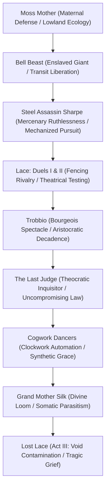
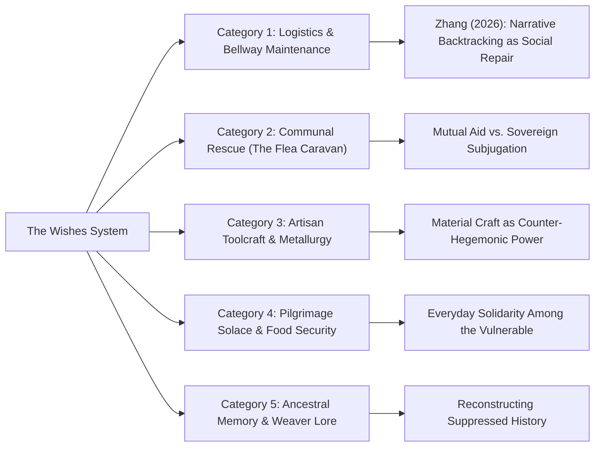

# Boss Encounters, The Wishes System, and Communal Agency: *Hollow Knight: Silksong*

> **Historical Working Note:** This file contains preliminary exploratory notes drafted during kickoff. It is now formally superseded and verified by the deeper modular research files in `lore/ss_07_the_last_judge.md, lore/ss_10_wishes_and_community_quests.md, and characters/tier_a_*.md`. All claims are cataloged in `data/claims.csv`.

- **Object of Analysis:** Major Boss Encounters, The Wishes System, and Optional Communal Questlines
- **Theoretical Framing:** Combat Choreography as Characterization, Bohan Zhang's Backtracking Mechanics (2026), and The Ethics of Mutual Aid
- **Epistemic Standards:** Tier 1 (Confirmed Canon), Tier 2 (Strongly Supported Interpretation), Tier 3 (Speculative Theory)

---

## 1. Major Boss Encounters and Combat Choreography

In *Hollow Knight: Silksong*, combat encounters reflect Hornet's unique mobility, fencing discipline, and biological connection to silk. Enemies are faster, more acrobatic, and possess multi-tiered positional awareness, requiring the player to weave offense, evasion, and mid-air tool deployment into a fluid, expressive dance.

### 1.1 Moss Mother
- **Identity & Encounter Context:** The maternal guardian of the Moss Grotto caverns, roosting in an overgrown hanging bell nest surrounded by her newborn larvae [Tier 1].
- **Combat Symbolism & Mechanics:** Swoops across the arena, smashing her heavy rounded abdomen into the earth, causing loose stalactites to dislodge from the ceiling. When staggered, she screeches, calling her larvae to defend her [Tier 1]. Teaches the player the foundational rhythm of Hornet's movement: jumping, sprint-evasion, and striking from above with the diagonal needle dive [Tier 1].
- **Thematic Function:** Establishes immediately that in Pharloom, nature fights fiercely to protect its young, contrasting with Hallownest where parents sacrificed their children [Tier 2].

### 1.2 Bell Beast
- **Identity & Context:** A massive, four-legged subterranean beast fitted with an agonizing brass bell-collar that drives it mad with continuous acoustic vibrations [Tier 1].
- **Combat Symbolism & Mechanics:** Charges across the volcanic arena with terrifying momentum, leaping off basalt pillars and slamming the floor, causing geysers of magma to erupt [Tier 1]. Hornet must use her needle to vault over its sweeping horns and strike the heavy brass collar binding its neck [Tier 1].
- **Narrative Consequence:** Upon destroying the collar, the beast does not die; it collapses in exhaustion, purrs softly as Hornet strokes its snout, and becomes the loyal guardian of the Bellway transit network [Tier 1]. 

### 1.3 Steel Assassin Sharpe & The Trio
- **Identity & Context:** A ruthlessly professional mercenary armed with specialized clockwork harpoon-blades, dispatched by a foreign syndicate to assassinate Hornet and harvest her royal silk [Tier 1].
- **Combat Symbolism & Mechanics:** Fights with lethal military precision, coordinating strikes alongside his two subordinate scouts. Sharpe uses rapid dash-thrusts, smoke bombs, and grappling wires, forcing Hornet to navigate a dynamic multi-target battlefield [Tier 1].
- **Thematic Function:** Reminds the player that Pharloom exists within a wider continental trade network where foreign capital and mercenary guilds profit from imperial collapse [Tier 2].

### 1.4 Lace (The Fencing Duels)
- **Duel I (The Grand Gate):** The introductory duel at the border between lowlands and high kingdom. Lace tests Hornet’s speed, parrying needle thrusts with a metallic *clang* and laughing as she pirouettes through the air [Tier 1].
- **Duel II (Greymoor Opera Gardens):** A rain-slicked, high-speed duel atop the gothic parapets. Lace incorporates rapid triple-thrusts, mid-air feints, and explosive silk-bursts. Her voice lines reveal genuine fascination with Hornet’s refusal to submit to the Citadel's authority [Tier 1].
- **Combat Choreography as Intimacy:** The fencing encounters with Lace operate as physical dialogue. Neither warrior relies on brute force; victory requires reading body language, anticipating subtle tells, and matching tempo. Combat becomes the primary medium through which two solitary, deadly women establish mutual recognition [Tier 2].

### 1.5 Trobbio
- **Identity & Context:** The self-proclaimed "Master of the Stage," a lavishly dressed butterfly showman commanding the private opera house of Greymoor [Tier 1].
- **Combat Symbolism & Mechanics:** A battle set against literal theatrical scenery. Trobbio glides across the stage on silk wires, hurling bouquets of explosive velvet flowers, commanding stage-lights to crash downward, and freezing in dramatic heroic poses to trigger blinding flashbang explosions (*"Encore! Marvel at my genius!"*) [Tier 1].
- **Thematic Satire:** Demonstrates how the upper classes in Pharloom retreat into self-indulgent, aesthetic fantasy to ignore the systemic violence beneath their feet [Tier 2].

### 1.6 Cogwork Dancers
- **Identity & Context:** A pair of synchronized clockwork androids fashioned from gilded brass and silk-tension springs, presiding over the grand ballroom of the Citadel [Tier 1].
- **Combat Symbolism & Mechanics:** A mesmerizing, mechanical waltz. The twin dancers spin across the polished marble floor, their razor-sharp hoop skirts slashing everything in their path. They mirror each other's movements with mathematical perfection, requiring Hornet to thread between their synchronized hitboxes [Tier 1].
- **Symbolic Function:** The terrifying zenith of the Citadel's mechanization: living bugs replaced by immortal, obedient automatons that execute their lethal choreography without emotion or fatigue [Tier 2].

### 1.7 The Last Judge
- **Identity & Context:** The supreme grand inquisitor of the Citadel, a towering, armored figure wielding a massive, bell-shaped executioner’s warhammer and blazing cinder lanterns [Tier 1].
- **Combat Symbolism & Mechanics:** The brutal gatekeeper of the High Spires. The Judge slams his warhammer to send cascading waves of golden flame across the arena, charges forward with crushing shoulder-rams, and calls down incandescent pillars of sacred light [Tier 1].
- **Thematic Significance:** The embodiment of religious fanaticism and state violence. The Last Judge fights not for personal glory, but to enforce the absolute purity of the Sacred Song, viewing Hornet as an unsanctified blasphemy that must be hammered into ash [Tier 1].

### 1.8 Grand Mother Silk
- **Identity & Context:** The divine matriarch of Pharloom, encountered at the summit of the Great Loom [Tier 1].
- **Combat Symbolism & Mechanics:** A colossal, multi-phase encounter. In Phase 1, Grand Mother Silk floats in the center of the arena, manipulating hundreds of golden silk threads that weave across the screen into lethal geometric laser grids [Tier 1]. In Phase 2, she detaches from the loom, morphing into an agile, multi-armed arachnid deity lunging with colossal woven scythes, accompanied by an overwhelming, multi-voice operatic choir [Tier 1].
- **Symbolic Meaning:** Hornet must sever the divine threads holding the god together, literally unraveling the fabric of the theocracy through the precision of her needle [Tier 2].

### 1.9 Lost Lace (Act III)
- **Identity & Context:** In Act III, when the Void leaks into the Whispering Vaults, Lace sacrifices herself to hold back the encroaching darkness, becoming infected and corrupted by Void tendrils [Tier 1].
- **Combat Symbolism & Mechanics:** A heart-wrenching inversion of her previous fencing elegance. Her gilded needle is stained pitch-black; her movements are erratic, desperate, and weeping. Dark shadow-explosions accompany her lunges, and her laughter is replaced by guttural, agonized cries [Tier 1].
- **Thematic Climax:** Defeating Lost Lace is not an act of triumphant conquest, but an act of profound mourning, echoing the tragedy of the Hollow Knight in the first game [Tier 2].

---

## 2. The Wishes System: Communal Agency and Backtracking

While *Hollow Knight* featured localized, individual NPC encounters, *Silksong* formalizes side activities into the **Wishes System** - a kingdom-spanning quest board and personal commission registry maintained at shrines and town bulletin boards throughout Pharloom [Tier 1].

### 2.1 Theoretical Framework: Narrative Backtracking as Social Reconstruction
In his foundational study on Metroidvania narrative mechanisms, Bohan Zhang (2026) demonstrates that *Silksong* radically reframes the purpose of backtracking. In traditional Metroidvanias, backtracking is self-serving: the player returns to old rooms to hoard power-ups for their own avatar. 

In *Silksong*, the Wishes system transforms backtracking into an act of **social repair and mutual aid** [Tier 2]. When Hornet revisits the lowlands to deliver medicine to sick miners in The Marrow, escort stranded pilgrims across Far Fields, or return lost baby Fleas to the carnival, her traversal actively knits broken communities back together [Tier 2]. The player’s spatial labor does not conquer the land; it heals it.

---

## 3. Master Wishes & Side Quest Analysis Matrix

| Wish Title | Quest-Giver & Location | Initial Request / Problem | Objective & Travel Path | Related NPCs | Narrative Revelations | Ludic Rewards | Thematic Meaning |
|---|---|---|---|---|---|---|---|
| **The Lost Caravan** | Flea Master (Bellhart) | 30 baby Fleas scattered across Pharloom by windstorm | Explore hidden platforming crevices across all regions | Flea Caravan, Caravan Merchants | Reveals the resilience of nomadic cultures enduring imperial oppression | Shell Shards, Rosary strings, Circus minigames | Joyful community-building flourishing in the shadow of empire |
| **A Warm Bowl** | Sherma (Far Fields Waystation) | Hungry, exhausted pilgrims freezing on the road | Gather fire-lichen from The Marrow and tubers from Moss Grotto | Sherma, Pilgrim Band | Exposes the cruelty of the Citadel offering spiritual promises while starving bodies | Stew Pot Tool (passive health regen), Rosaries | Everyday solidarity and food security as true sacred acts |
| **Ring of the Master** | Shakra (Hunter's March) | Lost tracking signal of her missing martial instructor | Ascend Blasted Steps; locate master's discarded spear | Shakra, Master's Spirit | Uncovers that her master reached the Citadel and rejected its corrupt hymns | Master's Ring (extends needle parry window) | Rejection of blind obedience; honoring truth over institutions |
| **Bells of the Deep** | Bell Ringer (Bellhart) | The grand resonance bell of Bellhart is cracked | Harvest volcanic brass-ore from deep magma veins in The Marrow | Bell Beast, Forge Daughter | Documents the ancient history of the Bellways as free public infrastructure | Upgraded Bell Chime (faster fast-travel call) | Reclaiming public transit from commercial and theocratic monopoly |
| **The Smith's Burden** | Forge Daughter (Deep Docks) | Needs hardened fossil-chitin to temper master needles | Hunt three Armored Leviathans in Sands of Karak | Forge Daughter, Cargo Guild | Reveals the extraction of ancient fossil beds to feed Citadel military war | Needle Tempering (Tier 3 damage upgrade) | Working-class craftsmanship and material mastery over magic |
| **Threads of the Past** | The Caretaker (Whispering Vaults) | Missing scrolls describing the Weaver migration | Infiltrate hidden Weavenest sanctums in Shellwood | Snail Shamans, First Sinner | Crucial lore: confirms Weavers fled to Deepnest to escape Grand Mother Silk | Silk Spool Fragment, Ancient Crest Slot | Reconstructing suppressed historical memory to dismantle state propaganda |
| **The Gilded Needle** | Lace (Greymoor Manors) | Informal challenge to duel across three scenic vantage points | Meet Lace at high cliffs; execute flawless fencing parries | Lace | Reveals Lace’s underlying loneliness and disillusionment with the Choir | Fencing Crest, Gilded Pouch | Combat as reciprocal vulnerability and the blossoming of kinship |
| **Voice of the Fallen** | First Sinner (The Slab) | Slay the brutal Executioner Beetle holding the dungeon keys | Penetrate maximum-security cells in The Slab; execute Warden | First Sinner, Condemned Heretics | Exposes the horrific extent of political disappearances in the holy city | Key of the Sinner; unlocks Act III alternate ending | Radical abolition: breaking open the prison that underpins the sacred state |

