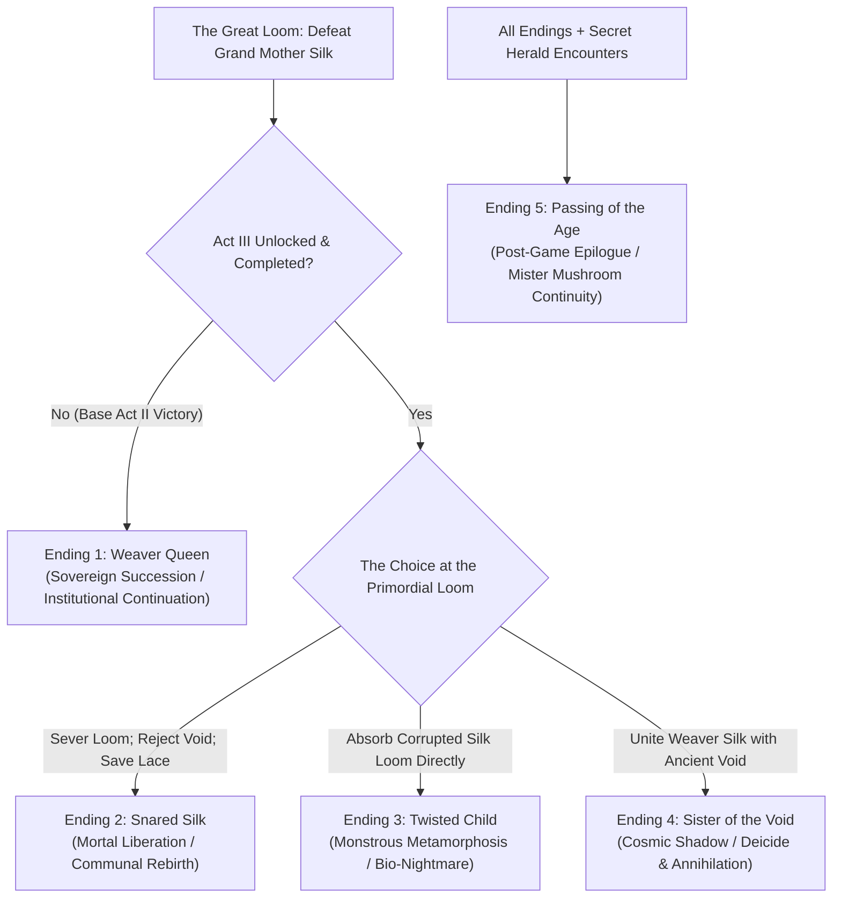

# The Endings of Pharloom: Theocratic Collapse, Void Resurgence, and Sovereignty in *Silksong*

> **Historical Working Note:** This file contains preliminary exploratory notes drafted during kickoff. It is now formally superseded and verified by the deeper modular research files in `lore/ss_09_three_act_structure.md, lore/contested_readings.md, and themes/02_faith_theocracy_and_the_machinery_of_belief.md`. All claims are cataloged in `data/claims.csv`.

- **Object of Analysis:** The Five Canonical Endings of *Hollow Knight: Silksong* (2025)
- **Theoretical Framework:** Political Theology, The Critique of Sovereign Succession, Sympoietic Liberation
- **Epistemic Standards:** Tier 1 (Confirmed Canon), Tier 2 (Strongly Supported Interpretation), Tier 3 (Speculative Theory)

---

## 1. Overview of Silksong's Endings Architecture

In *Hollow Knight: Silksong*, endings are not determined simply by final boss execution; they reflect Hornet's choices regarding **kinship, sovereignty, and the handling of the Great Loom** [Tier 1]. The player can choose to inherit the theocratic machinery, repeat the sacrificial errors of her father (the Pale King), succumb to corrupted biological fusion, or unleash the forbidden Void to sever Pharloom’s parasitic strings forever.

---

## 2. Granular Analysis of Each Ending

### Ending 1: Weaver Queen (The Sovereign Succession)
- **Unlocking Conditions:** Complete Act II; ascend the High Citadel; defeat the Last Judge and Grand Mother Silk **without** pursuing the Act III "Silk and Soul" questline or entering the Underworks [Tier 1].
- **Narrative Sequence:** Upon striking the final blow against Grand Mother Silk, the divine entity disintegrates into glowing white fibers. The Great Loom begins to collapse, threatening to tear down the Citadel spires. Hornet stands before the throne of threads. Recognizing that severing the loom completely would plunge millions of dependent pilgrims into madness and death, Hornet raises her needle, casts her own silk glands onto the spindle, and takes her seat upon the gilded throne [Tier 1]. Her white-and-red cloak is slowly enveloped by golden woven fibers; she closes her eyes as the pipe organs swell with a new, solemn melody. Hornet becomes the new **Weaver Queen of Pharloom** [Tier 1].
- **Philosophical Interpretation (The Tragedy of Sovereign Succession):** Mirrors the ethical tragedy of Ending 1 in *Hollow Knight*. Faced with systemic collapse, the revolutionary protagonist ends up inheriting the very throne she sought to destroy [Tier 2]. Hornet saves the kingdom from instantaneous destruction, but at the cost of her own personal freedom, becoming trapped as the new biological power source for the Citadel’s institutional apparatus [Tier 2].

### Ending 2: Snared Silk (Mortal Liberation and Communal Rebirth)
- **Unlocking Conditions:** Complete Act III; rescue First Sinner from The Slab; purify Lost Lace using the Weaver Needle; defeat the Primordial Loom entity; choose to **sever the central spindle** while refusing to absorb the divine power [Tier 1].
- **Narrative Sequence:** In the climactic battle within the heart of Pharloom, Hornet and a restored Lace fight back-to-back against the convulsing Primordial Loom. With a synchronized double-needle thrust, they sever the anchor-threads of the kingdom. The golden looms shatter into millions of glittering, drifting dust particles [Tier 1]. Across Pharloom, the parasitic Sacred Song goes quiet; the bells toll once in pure, resonant release; and the white puppet-strings binding the pilgrims dissolve [Tier 1].
- **The Epilogue of Freedom:** The Citadel’s false divine aura fades, leaving only ordinary stone and mortal bugs. In the courtyard of Bellhart, Sherma smiles as he serves soup to pilgrims who are now free to walk their own paths; Shakra resumes her journey to foreign lands; and the Flea Caravan sets off into the desert. On a high cliff overlooking the dawn, Hornet and Lace stand together, their weapons sheathed, gazing out across the vast world beyond Pharloom [Tier 1].
- **Philosophical Interpretation (Abolition of the Sacred Machine):** The triumph of Donna Haraway’s (2016) "sympoiesis" and mutual aid. The hero does not replace the god; she abolishes the institution of divinity altogether [Tier 2]. Civilization survives not by freezing time or monopolizing power, but by embracing vulnerability, transience, and horizontal community [Tier 2].

### Ending 3: Twisted Child (The Monstrous Metamorphosis)
- **Unlocking Conditions:** In Act III, consume all forbidden Weaver Relics without attuning with the Snail Shamans; allow the corrupted silk-ichor to saturate Hornet's spool; defeat the final boss and choose to **bind the entire corrupt loom into Hornet's body** [Tier 1].
- **Narrative Sequence:** Hornet attempts to absorb the ancient loom, but the necrotic, Void-tainted silk overwhelms her biology. Her mask violently splits down the center, sprouting four glowing red compound eyes and elongated, arachnid mandibles [Tier 1]. Colossal white-and-black silk cocoons wrap around her contorting body as she ascends into the ceiling, suspended as a monstrous, chittering biological spider-abomination. The Citadel goes silent in horror as the newly transformed "Twisted Child" spins an inescapable, suffocating web across the entire upper kingdom [Tier 1].
- **Philosophical Interpretation (The Hubris of Consumptive Power):** A horrifying biological cautionary tale. When an individual attempts to monopolize a corrupt systemic force without ethical grounding or communal accountability, the force consumes the individual, converting the liberator into a grotesque, devouring tyrant [Tier 2].

### Ending 4: Sister of the Void (Cosmic Deicide and Annihilation)
- **Unlocking Conditions:** Complete the "Silk and Soul" questline; carry the **Void-Stained Thread** acquired from the deepest Underworks; defeat the Primordial Loom; shatter the barrier between Pharloom and the subterranean Void Lake [Tier 1].
- **Narrative Sequence:** As the Primordial Loom falters, Hornet stabs her needle into the abyssal floor, channeling the ancient Void dormant beneath Pharloom. The black lake erupts upward in a colossal tsunami of shadow. Tendrils of pure Void coil around Hornet’s arms, recognizing her royal Wyrm bloodline [Tier 1]. Together with the Void, Hornet violently rips the divine tapestry of Grand Mother Silk to shreds, dragging the high clergy and the golden spires of the Citadel into the pitch-black abyss [Tier 1]. 
- **The Shadow Over Pharloom:** The entire Citadel collapses into rubble. Hornet emerges from the ruins walking calmly, her cloak stained inky black, flanked by shadows, her eyes glowing with abyssal majesty - a true "Sister of the Void" [Tier 1].
- **Philosophical Interpretation (The Apocalyptic Reset):** Echoes Ending 4 (*Embrace the Void*) of *Hollow Knight*. Represents radical, total deicide: the absolute eradication of a corrupt civilization through the unbridled fury of the cosmos [Tier 2]. It frees the oppressed, but leaves behind an inhospitable, haunted wasteland governed by shadows [Tier 2].

### Ending 5: Passing of the Age (The Cosmic Epilogue)
- **Unlocking Conditions:** Complete any ending after locating and conversing with **Mister Mushroom** in his seven hidden post-game locations across Pharloom, followed by discovering the secret Weaver Obelisk in the Sands of Karak [Tier 1].
- **Narrative Sequence:** Following the credits, Mister Mushroom pops up from the sand dunes, bows comically, and blasts off into space with rocket propulsion. A final title card appears: *"THE AGE PASSES. BEYOND BOTH KINGDOMS."* [Tier 1].
- **Philosophical Value:** Reaffirms Team Cherry’s signature cosmological irony: human, bug, and divine institutions rise and fall, but the cosmic fungal kingdom persists, observing imperial folly with cosmic levity [Tier 2].

---

## 3. Master Endings Comparison Matrix: *Silksong*

| Dimension | Ending 1: Weaver Queen | Ending 2: Snared Silk | Ending 3: Twisted Child | Ending 4: Sister of the Void | Ending 5: Passing of the Age |
|---|---|---|---|---|---|
| **Prerequisites** | Complete Act II (Base Boss) | Complete Act III; Purify Lace | Consume all tainted relics | Channel Void Thread in Act III | Find Mister Mushroom in 7 spots |
| **Fate of Hornet** | Inherits throne; bound to the loom | Liberated; wanders with Lace | Mutates into arachnid beast | Becomes Void-wielding deicide queen | Unaffected; departs world |
| **Fate of Lace** | Remains alone in the high city | Purified; journeys alongside Hornet | Cocooned / Trapped in silk | Banished or lost in shadows | Unaffected |
| **Fate of Grand Mother Silk** | Slain; replaced by Hornet | Annihilated; loom unraveled | Consumed and hybridized | Consumed and torn apart by Void | Unaffected |
| **Fate of Pharloom** | Preserved in theocratic stasis | Liberated from holy servitude | Smothered in monstrous web | Citadel obliterated into ruins | Age passes; world continues |
| **Philosophical Core** | The trap of sovereign succession | Abolition of the divine machine | The grotesque corruption of hubris | Cosmic revolution via annihilation | Absurdist ecological persistence |
| **Canon Status** | Confirmed alternate canonical path | Confirmed baseline heroic path | Confirmed bad/tragic outcome | Confirmed high-difficulty cosmic path | Canonical post-credits easter egg |

