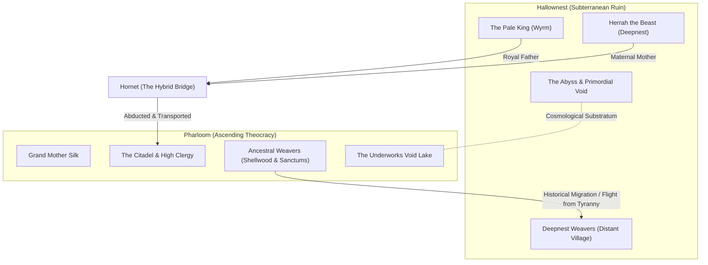
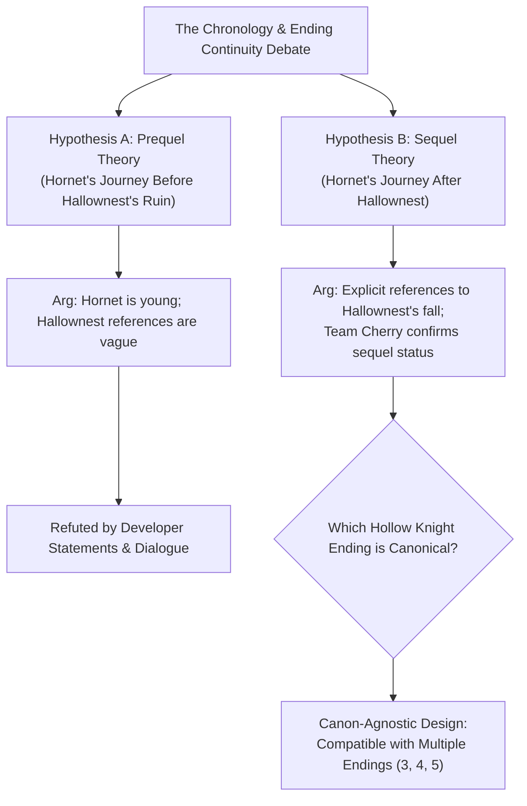

# Cross-Game Continuity, Lore Architecture, and Unresolved Mysteries: Hallownest and Pharloom

- **Objects of Analysis:** Inter-Kingdom Connections across *Hollow Knight* (2017) and *Hollow Knight: Silksong* (2025)
- **Theoretical Framing:** Trans-Fictional World-Building, Epistemic Fragmentation, and Canon Demarcation
- **Epistemic Standards:** Tier 1 (Confirmed Canon), Tier 2 (Strongly Supported Interpretation), Tier 3 (Speculative Theory)

---

## 1. The Historical and Mythological Nexus

Team Cherry does not construct a rigidly serialized cinematic universe; rather, they employ **rhizomatic, mythological world-building** where two vast kingdoms exist on the same physical and cosmological plane, connected by deep geological, biological, and historical conduits.

---

## 2. Core Strands of Continuity

### 2.1 The Weaver Migration and the Deepnest Connection
- **The Confirmed History:** In *Hollow Knight*, the **Weavers** of Deepnest are presented as a secretive, reclusive clan of six-eyed arachnid weavers inhabiting the **Weaver's Den** and the Distant Village [Tier 1]. By the time the Knight explores Hallownest, the Weavers have abandoned their dwellings, leaving behind only the *Weaversong* charm and silk tapestries indicating they returned to their "ancient homeland" [Tier 1].
- **The Pharloom Revelation:** *Silksong* definitively confirms that Pharloom is that ancestral homeland [Tier 1]. Tablets and ancestral shrines in **Shellwood** and the hidden Weavenest sanctums reveal that centuries before Hallownest's founding, a faction of Weavers rebelled against Grand Mother Silk's suffocating theocratic monopoly over thread, undertaking a perilous cross-continental exodus across the barren wastes to establish an autonomous colony in Deepnest [Tier 1]. When Hallownest collapsed into the infection, surviving Weavers fled back across the wastes to Pharloom, carrying with them forbidden knowledge of Hallownest's alchemical Soul-magic and the darkness of the Abyss [Tier 1].

### 2.2 Hornet's Lineage as a Geopolitical and Biological Bridge
Hornet is the unique biological and political bridge linking both civilizations [Tier 1]:
1. **The Paternal Wyrm Heritage:** Through the Pale King, Hornet inherits the constitution of a higher being: immense physical durability, resistance to memory-stripping wastelands, and royal sovereignty [Tier 1].
2. **The Maternal Weaver Heritage:** Through Herrah the Beast, Hornet inherits organic silk production, arachnid agility, predatory combat instincts, and the ability to weave tools and traps [Tier 1].
3. **The Catalyst for Capture:** The Citadel's high clergy did not kidnap Hornet by chance. Grand Mother Silk's divine loom was decaying, requiring an infusion of fresh, noble Weaver blood to maintain structural tension. Hornet was targeted because she represents the purest living convergence of ancient Wyrm authority and ancestral Weaver biology [Tier 1].

### 2.3 Snail Shamans and the Alchemical Continuum
In *Hollow Knight*, the Snail Shamans are solitary, shell-dwelling sorcerers who manipulate **Soul** and craft spells from discarded snail remains (e.g., *Vengeful Spirit*, *Shade Soul*) [Tier 1]. In *Silksong*, Snail Shamans appear in secluded mounds, practicing an advanced synthesis of **Soul and Silk** [Tier 1]. This continuity confirms that Snail Shamans represent a ubiquitous, pan-continental mystical caste whose arcane understanding of organic energy transcends individual imperial borders [Tier 2].

### 2.4 The Universal Cosmological Substratum: The Void
One of the most consequential revelations of *Silksong* (Act III) is that the **Void is not unique to Hallownest** [Tier 1]. While the Pale King discovered the Abyss in the lowest foundations of Hallownest, *Silksong* establishes that the Void is a **universal primordial layer** that underlies all landmasses beneath the crust [Tier 2]. In Pharloom, ancient pools of Void exist deep beneath the Underworks and The Slab. When Grand Mother Silk's looms began unraveling, the void began seeping upward into the silk-pipes, proving that whenever a civilization attempts to impose an unnatural, immortal monoculture, the entropic Void inevitably rises to claim it [Tier 2].

---

## 3. The Great Chronological & Canonical Debates

### 3.1 Prequel vs. Sequel: Resolving the Timeline
Following *Silksong*'s announcement in 2019, a prominent fan hypothesis posited that *Silksong* was a prequel set before the events of *Hollow Knight*, citing Hornet’s intact physical vitality and the apparent death of Hallownest. 

However, official developer records and in-game dialogue conclusively refute the prequel hypothesis [Tier 1]:
- **Developer Confirmation:** Team Cherry’s official reveal announcement (February 14, 2019) and subsequent blog updates explicitly define *Silksong* as the **"standalone sequel to Hollow Knight"** [Tier 1].
- **Diegetic In-Game Evidence:** In *Silksong*, Hornet makes direct, unambiguous references to Hallownest as a fallen, ruined kingdom of her past:
  > *"I have seen one kingdom drown in its own proud silence... I will not watch another strangle upon its own song."* — Hornet dialogue in the Citadel [Tier 1].
- Furthermore, Hornet possesses intimate, firsthand knowledge of the dangers of the Void, the tragedy of the Vessels, and the failure of royal monuments, which could only have been acquired through the events of *Hollow Knight* [Tier 1].

### 3.2 Which *Hollow Knight* Ending is Canonical?
A central epistemological question for game studies scholars is how *Silksong* handles the multiple branching endings of the 2017 predecessor. 

Team Cherry has consistently maintained an **inclusive, canon-agnostic design philosophy** [Tier 1]. They have explicitly rejected the notion of a single "true ending" that invalidates player choice, stating that all endings in *Hollow Knight* represent legitimate, alternative realities of equal validity [Tier 1].

*Silksong* is meticulously scripted to remain broadly compatible with all non-entombment endings:
- In **Ending 3 (Dream No More)**, the infection is destroyed, the Black Egg dissolves, and Hornet survives, standing outside the tomb with her needle. She is free to be abducted by the Pharloom caravan [Tier 2].
- In **Ending 4 (Embrace the Void)**, Hornet stands with drawn needle as the uninfected Hollow Knight emerges from the Black Egg. While the physical Godseeker is consumed, the wider fate of Hallownest remains an open frontier from which Hornet could be captured [Tier 2].
- In **Ending 5 (Delicate Flower Variant)**, the Void Entity is peacefully dissipated, leaving the physical world intact and Hornet alive [Tier 2].
- Only **Ending 1 (The Hollow Knight)** and **Ending 2 (Sealed Siblings)** present irreconcilable continuity conflicts if taken literally (since Ending 2 permanently traps Hornet inside the stone egg). However, within Team Cherry’s mythological framework, these endings represent tragic, dark branches of history rather than invalidations of the sequel [Tier 2].

---

## 4. Master Lore Continuity and Canon Certainty Register

| Lore Element | Empirical In-Game / Developer Evidence | Analytical Interpretation | Canon Certainty Tier | Competing Hypotheses |
|---|---|---|---|---|
| **Hornet's Parentage** | Midwife dialogue, White Lady dialogue, Herrah dream sequence | Daughter of Pale King (Wyrm) and Herrah (Spider) | **Tier 1 (Confirmed Canon)** | None (Unanimously established) |
| **Weaver Origin & Pharloom** | Shellwood tablets, Weavenest shrines, Silksong dialogue | Weavers originated in Pharloom; faction fled to Deepnest | **Tier 1 (Confirmed Canon)** | Early theory that Weavers were indigenous only to Hallownest (Refuted) |
| **Sequel Status of Silksong** | Team Cherry 2019 announcement, Hornet in-game dialogue | Takes place chronologically *after* the fall of Hallownest | **Tier 1 (Confirmed Canon)** | Prequel hypothesis (Refuted by official canon) |
| **Universal Nature of the Void** | Act III Underworks Void Lake, Void-stained threads | Void is a pan-continental subterranean layer, not exclusive to Hallownest | **Tier 1 (Confirmed Canon)** | Void was artificially created by Pale King (Refuted; he merely harvested it) |
| **Grand Mother Silk's Nature** | Choral hymns, Loom Sanctum architecture, boss dialogue | Primordial arachnid higher being who weaves living silk | **Tier 1 (Confirmed Canon)** | Grand Mother Silk is merely a giant mechanical automaton (Refuted) |
| **The Nature of the Caravan Cultists** | Prologue cinematic, The Marrow inquisitor dialogue | Devout Pharloom agents dispatched to capture royal bloodlines | **Tier 1 (Confirmed Canon)** | Cultists were rogue mercenaries operating without church orders (Partially supported) |
| **Precise Time Elapsed Between Games** | Faded condition of Hallownest relics; Hornet's combat memories | Estimated several decades or centuries of insect time | **Tier 3 (Speculative Theory)** | Could be mere weeks/months, or an entire historical epoch |
| **Fate of Hallownest during Silksong** | Hornet's melancholic retrospection; lack of direct updates | Hallownest remains a quiet, peaceful graveyard of memory | **Tier 2 (Strongly Supported)** | Hallownest was repopulated by new insect kingdoms (Unsubstantiated) |
| **Origin of Grand Mother Silk vs. Wyrms** | Cosmic mythology, absence of molting shells in Pharloom | Grand Mother Silk belongs to an ancient, pre-Wyrm arachnid pantheon | **Tier 2 (Strongly Supported)** | Grand Mother Silk is a mutated Wyrm (No supporting textual evidence) |
