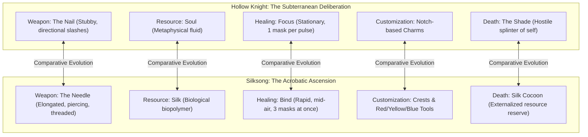

# Comparative Ludic Systems and Mechanical Ontologies: Nail vs. Needle, Soul vs. Silk

- **Objects of Analysis:** Core Gameplay Mechanics across *Hollow Knight* (2017) and *Hollow Knight: Silksong* (2025)
- **Theoretical Framing:** Procedural Rhetoric (Bogost, 2007), Ergodic Embodiment (Aarseth, 1997; Calleja, 2011), Ludonarrative Integration
- **Epistemic Standards:** Tier 1 (Confirmed Canon), Tier 2 (Strongly Supported Interpretation), Tier 3 (Speculative Theory)

---

## 1. The Dialectic of Core Systems: Nail vs. Needle

The mechanical divergence between *Hollow Knight* and *Hollow Knight: Silksong* is not merely an iterative refinement of controls; it represents an **ontological shift in the player-avatar’s physical embodiment and relationship with virtual space**.

---

## 2. Granular Systems Comparison

### 2.1 Combat Mechanics: Directional Pogo vs. Diagonal Penetration
- **The Knight’s Nail:**
  - *Geometry:* Four cardinal directions (horizontal slash, upward vertical slash, downward pogo).
  - *Physics:* The downward slash upon enemies or environmental hazards (spikes, mushrooms) triggers a crisp, vertical rebound ("pogo") that resets the Knight's double jump and dash, creating a rhythm of vertical bouncing [Tier 1].
  - *Nail Arts:* Heavy, charged slashes (*Great Slash*, *Dash Slash*, *Cyclone Slash*) requiring the player to hold and release the attack button while navigating [Tier 1].
  - *Combat Persona:* Deliberate, grounded, reactive, and methodical. The Knight stands firm, parrying with exact timing and managing tight spacing [Tier 2].
- **Hornet’s Needle:**
  - *Geometry:* Long-range piercing thrusts, rapid horizontal multi-strikes, and an iconic **45-degree diagonal downward lunge** [Tier 1].
  - *Physics:* Striking enemies with the diagonal dive propels Hornet forward-upward at an angle, rewarding aggressive offensive pursuit. Hornet automatically vaults over ledges (*mantling*) and sprints across flat terrain without consuming stamina [Tier 1].
  - *Silk Skills:* Instead of charged nail arts, Hornet consumes Spool Silk to unleash instantaneous acrobatic special moves (*Thread Storm*, *Silken Harpoon*, *Gilded Drill*) [Tier 1].
  - *Combat Persona:* Acrobatic, predatory, aerial, and kinetic. Hornet does not wait for openings; she creates them through blinding mobility and vertical dominance [Tier 2].

### 2.2 Resource Economies: Metaphysical Soul vs. Biological Silk
- **Soul (Hollow Knight):**
  - *Nature:* An ethereal, glowing white magical fluid extracted from the minds of enemies upon impact [Tier 1].
  - *Storage:* Contained within the Knight’s white ceramic mask and up to three supplementary Soul Vessels [Tier 1].
  - *Utility:* Shared directly between offensive spell casting (*Vengeful Spirit*, *Desolate Dive*, *Howling Wraiths*) and restorative **Focus** [Tier 1].
  - *Procedural Meaning:* Forces the player into an agonizing strategic dilemma: do I spend Soul offensively to kill the boss faster, or do I hoard Soul defensively to heal? [Tier 2].
- **Silk (Silksong):**
  - *Nature:* A tangible, tensile biological biopolymer wound onto a cylindrical spindle (the **Spool**) [Tier 1].
  - *Storage:* Measured in spool threads and segment notches [Tier 1].
  - *Utility:* Fuels both the **Bind** ability and active **Silk Skills**, as well as crafting secondary tools [Tier 1].
  - *The Bind Mechanic:* Unlike the Knight’s agonizingly slow stationary Focus (which takes ~1.5 seconds per single mask and leaves the Knight completely defenseless), Hornet’s **Bind** consumes an entire full spool in a split-second burst, instantly restoring **three masks of health** simultaneously [Tier 1]. Crucially, Bind can be executed **mid-air while falling or leaping off a wall** [Tier 1].
  - *Procedural Meaning:* Encourages hyper-aggressive risk-taking. Healing is not a punishment that breaks the flow of combat; it is an integrated acrobatic flourish performed in the heat of battle [Tier 2].

### 2.3 Customization Architecture: Charms vs. Crests and Tools
- **The Charm System (Hollow Knight):**
  - Consists of 40 individual badges slotted into a limited number of "Notches" (up to 11) [Tier 1].
  - Operates as a free-form alchemical puzzle, allowing highly specialized emergent synergies (e.g., *Quick Slash* + *Mark of Pride* for nail reach; *Shaman Stone* + *Spell Twister* for devastating spell builds; *Shape of Unn* + *Quick Focus* for mobile slug-healing) [Tier 1].
  - Features the high-risk **Overcharming** mechanic: forcing an extra charm into an exhausted notch slot causes the Knight to take double damage from all attacks [Tier 1].
- **The Crest & Tool System (Silksong):**
  - Replaces free-form notches with **Crests**—foundational archetypes that fundamentally alter Hornet’s entire moveset, attack animations, and tool slots (e.g., *Hunter Crest* for raw speed; *Weaver Crest* for silk-trapping; *Wanderer Crest* for defensive parries) [Tier 1].
  - Each Crest provides color-coded slots for specialized, craftable physical equipment:
    - **Red Tools (Offensive):** Throwing knives, sting shards, pimpillo bombs, drill spikes [Tier 1].
    - **Yellow Tools (Mobility & Utility):** Compass pins, auto-gather magnets, thread-gliders, speed spools [Tier 1].
    - **Blue Tools (Defensive & Retaliatory):** Chitin carapaces, healing mist spores, thorny retaliation spikes [Tier 1].
  - *Procedural Meaning:* Shifts customization from abstract magical attributes to tangible, material craftsmanship. Hornet is a pragmatic hunter who prepares physical gear for specific regional biomes [Tier 2].

### 2.4 Death Penalties and Epistemology of Failure
- **The Shade (Hollow Knight):**
  - Upon death, the Knight’s shell shatters, spilling its accumulated Geo and leaving behind its **Shade**—a hostile, hovering void wraith that occupies the exact spot of death [Tier 1].
  - The Knight’s Soul meter is cracked, capping maximum Soul capacity until the Shade is tracked down and executed in personal combat [Tier 1].
  - *Psychological Meaning:* Forces a terrifying confrontation with the self. Death externalizes the repressed darkness within the vessel; to recover one's wealth, one must repeatedly slay one’s own soul [Tier 2].
- **The Silk Cocoon (Silksong):**
  - Upon death, Hornet’s physical body dissolves, leaving behind a **Silk Cocoon** suspended in the environment [Tier 1].
  - Striking the Cocoon with the needle instantly bursts it open, fully restoring Hornet’s Silk Spool to maximum and releasing an explosive wave of defensive silk threads that stagger nearby enemies [Tier 1].
  - Currency (**Rosaries**) can be actively protected from loss by visiting merchants and stringing loose beads into permanent necklaces [Tier 1].
  - *Psychological Meaning:* Failure is treated not as an existential psychic curse, but as an externalized emergency reserve. The Cocoon acts as a tactical resupply point that aids the player in re-engaging the encounter that killed them [Tier 2].

---

## 3. Master Mechanics Comparison Matrix

| System Dimension | *Hollow Knight* (2017) | *Hollow Knight: Silksong* (2025) | Critical / Theoretical Distinction |
|---|---|---|---|
| **Primary Weapon** | The Nail (Chitin / Iron broadsword) | The Needle (Refined rapier with threaded eye) | Blunt slashing vs. Surgical piercing and weaving |
| **Primary Resource** | Soul (Metaphysical psychic fluid) | Silk (Biological tensile biopolymer) | Spiritual/intellectual animus vs. Somatic material secretion |
| **Healing Execution** | *Focus:* Stationary, grounded, ~1.5s per mask | *Bind:* Rapid, mid-air / mobile, 3 masks at once | Vulnerable meditation vs. Acrobatic triage under pressure |
| **Downward Attack** | Vertical 90-degree downward pogo | Diagonal 45-degree forward-downward lunge | Bouncing platformer rhythm vs. Aggressive aerial penetration |
| **Movement Abilities** | Dash, Mantis Wall-Cling, Super Dash, Double Jump | Sprint, Ledge-Mantle, Harpoon Grapple, Silk Soar | Discrete ability gating vs. Fluid continuous parkour |
| **Customization Core** | 40 Charms in unformatted Notch slots | Interchangeable Crests with Red/Yellow/Blue Tool slots | Abstract magical badges vs. Modular artisan gear loadouts |
| **Secondary Combat** | 3 Magical Spells (Vengeful, Dive, Wraiths) | Diverse craftable Tools (Bombs, Traps, Stingers) | Arcane sorcery vs. Industrial and alchemical munitions |
| **Death Consequence** | Hostile Shade; cracked Soul Vessel; Geo lost | Silk Cocoon; loose Rosaries lost unless strung | Existential self-slaughter vs. Tactical supply recovery |
| **Economic Currency** | Geo (Fossilized shell currency) | Rosaries & Shell Shards (Prayer beads & metal fragments) | Universal imperial fiat vs. Sacred liturgical and craft barter |
| **Spatial Traversal** | Stag Stations (Domestic animal transit) & Dream Gate | Bellways (Colossal bell transit lines) & Couriers | Feudal postal network vs. Industrial theocratic infrastructure |
| **Map Navigation** | Cornifer's hand-drawn maps; Quill; Compass charm | Shakra's surveyed maps; Compass integrated into Crests | Fragile exploratory ignorance vs. Professional tactical surveying |
| **Difficulty Curve** | Punishing, deliberate, attrition-based survival | Lightning-fast, twitch-reflex, highly aggressive combat | Mastery of patience vs. Mastery of kinetic momentum |

