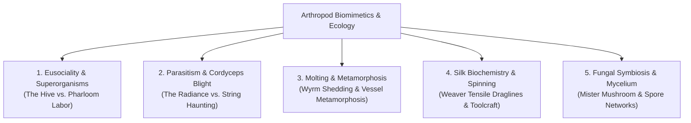
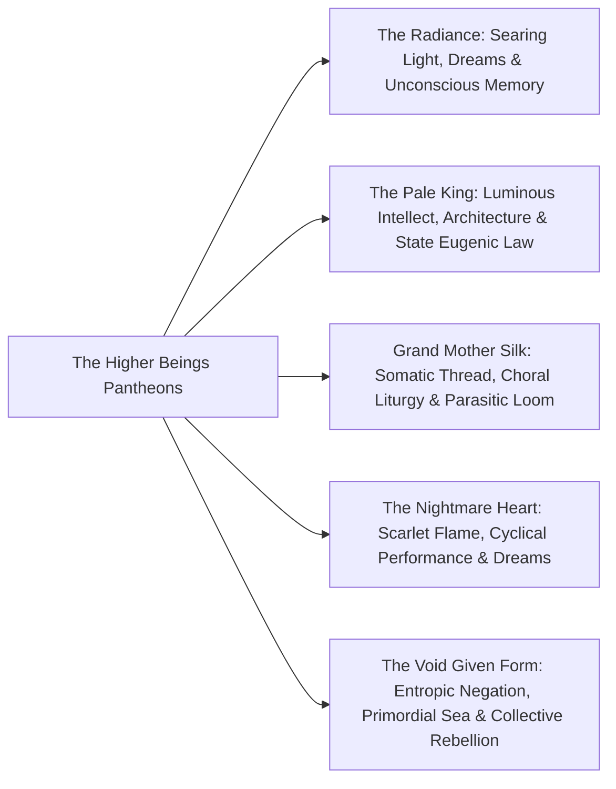
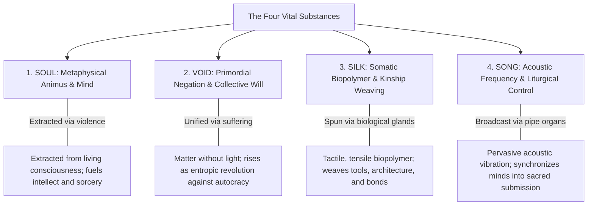

# The Chitinous Sacred: Ecology, Entomology, Political Theology, and Material Symbolism

- **Objects of Analysis:** Comparative Systems of Biology, Divinity, Ritual, and Material Culture across *Hollow Knight* and *Silksong*
- **Theoretical Framing:** Nonhuman Ecologies (Morton, 2016; Chang, 2019), Eusocial Superorganisms (Wilson & Hölldobler, 1990), The Numinous (Otto, 1917), Sacred Geography (Eliade, 1959), Vital Materialism (Bennett, 2010), Sympoiesis (Haraway, 2016)
- **Epistemic Standards:** Tier 1 (Confirmed Canon), Tier 2 (Strongly Supported Interpretation), Tier 3 (Speculative Theory)

---

## 1. Entomological Reality and Fictional World-Building

Team Cherry’s deployment of insect biology transcends mere decorative aestheticization. Rather than treating insects as humans in miniature chitinous costumes, the developers weave authentic **arthropod behaviors, biochemical secretions, and ecological niches** into the foundational architecture of their societies and mechanics.

### 1.1 Eusociality, Colony Defense, and the Superorganism
In entomological science, **eusociality** represents the highest level of animal social organization, characterized by cooperative brood care, overlapping generations, and a reproductive division of labor into distinct castes (Wilson & Hölldobler, 1990).
- **The Hive (Hollow Knight):** The Bee Tribe of the Hive functions as a textbook eusocial superorganism [Tier 1]. Governed by the deceased **Queen Vespa**, the worker bees and heavily armored **Hive Knights** prioritize the defense of the colony above individual survival. Crucially, Queen Vespa explicitly rejects the Pale King's individualistic intellect, warning that imposing foreign sapience onto an insect superorganism creates existential confusion [Tier 1]:
  > *"Our minds are our own, bound by our Queen... We have no need for your King's false dawn."* [Tier 1].
- **Pharloom's Labor Brigades (Silksong):** In Pharloom, eusocial biology is violently perverted by the Citadel [Tier 2]. Ant, beetle, and crustacean castes are stripped of natural colony autonomy and reorganized into industrial chain-gangs in The Marrow and the Deep Docks, demonstrating how theocratic imperialism co-opts natural insect labor instincts for systemic extraction [Tier 2].

### 1.2 Parasitism, Blight, and Cordyceps Biology
The central crises of both games are fundamentally biological epidemics [Tier 2]:
- **The Radiance and Cordyceps Infection (Hollow Knight):** The orange infection mimics the real-world parasitic fungus *Ophiocordyceps unilateralis*, which infects carpenter ants, alters their neurochemistry to force suicidal climbing behavior, and eventually erupts from their exoskeletons to disperse spores [Tier 2]. The Radiance's infection operates identically: it invades the brain through dreams, triggers erratic physical twitching, creates orange fungal-like pustules, and reanimates dead husks into feral vectors of infection [Tier 1].
- **The String Haunting (Silksong):** Pharloom's plague represents an arachnid parasitic entanglement [Tier 2]. Discordant acoustic frequencies cause Grand Mother Silk’s threads to bore directly into the nervous systems of pilgrims, turning them into marionettes (*"the Haunting"*) [Tier 1]. The biological horror shifts from internal fungal bursting to external somatic puppet-mastery [Tier 2].

### 1.3 Molting, Metamorphosis, and Chitinous Transience
Arthropod existence is defined by **ecdysis**—the periodic shedding of an inelastic exoskeleton to permit growth. Team Cherry elevates this biological reality into a central mythological motif [Tier 2]:
- **The Wyrm's Molting:** The Pale King did not arrive as an insect; he was a colossal Wyrm that died and molted at Kingdom's Edge, leaving behind an enormous, mountain-sized hollow shell (the *Cast-Off Shell*) from which his tiny bipedal monarch form emerged [Tier 1]. Divine death is framed as an extreme biological metamorphosis [Tier 2].
- **The Shedding of Masks:** The Vessels are defined by their white ceramic-chitin masks. When the Knight transforms into the Void Given Form in Godhome, it violently shatters its mask, shedding the physical insect chassis to reveal the fluid, formless shadow beneath [Tier 1].

### 1.4 The Biophysics of Silk
As Abraham U. Morales-Primo (2026) documents, *Silksong*’s silk mechanics are directly grounded in the biophysics of spider dragline silk (Vollrath & Knight, 2001). Real-world major ampullate spider silk exhibits tensile strength comparable to high-grade steel alloy while retaining extreme elasticity due to its liquid-crystalline phase-transition and alanine-rich $\beta$-sheet nanocrystals. Hornet’s ability to use silk as a high-velocity grappling cable, a razor-sharp cutting snare, and a biological suture for wound closure (*Bind*) directly mirrors the biological multifunctionality of arachnid spidroin proteins [Tier 2].

---

## 2. Political Theology: Higher Beings and the Construction of the Sacred

In Team Cherry's cosmology, gods are not omnipotent creators existing outside time; they are **higher beings**—colossal, biologically distinct entities endowed with luminous or void essence whose power is maintained through worship, memory, and the material control of populations [Tier 1].

### 2.1 The Economy of Worship and the Numinous
Drawing on Rudolf Otto’s (1917) phenomenology of the numinous as *mysterium tremendum et fascinans* (a mystery inspiring both terror and awe), higher beings in Hallownest and Pharloom command devotion through overwhelming sensory spectacle:
- **The Radiance:** Generates blinding, solar awe that burns away rational intellect, appealing to primal passion and ecstatic surrender [Tier 1].
- **The Pale King:** Radiates a blinding white intellectual beacon that promises permanence, law, and elevated consciousness, captivating through the promise of eternal order [Tier 1].
- **Grand Mother Silk:** Deploys symphonic acoustic resonance and tactile material sustenance, drawing worshippers into a sensory web of choral love and total biological dependence [Tier 1].

However, this divinity is fundamentally vulnerable: **gods die when they are forgotten** [Tier 1]. The Radiance was driven to near-extinction because the Moth Tribe ceased her worship; Grand Mother Silk is decaying because her loom is frayed. Divinity is not an absolute state; it is an active, precarious economic relationship maintained through the systematic extraction of psychic or material resources from mortal subjects [Tier 2].

### 2.2 Sacred Space and the Axis Mundi: Descent vs. Ascent
Mircea Eliade (1959) theorized that traditional religious societies organize space around an **Axis Mundi**—a central cosmic pillar connecting the underworld, earth, and sky:
- **Hallownest’s Inverted Axis:** The sacred axis of Hallownest is directed **downward**. The seat of royal memory is buried deep underground (the City of Tears), while the ultimate truth of the kingdom resides in the absolute lowest darkness: the **Abyss** [Tier 1]. To know the sacred in Hallownest is to dig into the grave, confronting the repressed bones upon which civilization was erected [Tier 2].
- **Pharloom’s Ascending Axis:** In Pharloom, the Axis Mundi is classically **vertical**. The Citadel towers into the sky, commanding a literal geographic pilgrimage from the dark lowlands toward the sunlit spires of the Loom Sanctum [Tier 1]. Ascent is spiritualized as virtue, purifying the pilgrim through physical labor until they reach the high altar of sacrifice [Tier 2].

---

## 3. Vital Materialism: The Metaphysics of Substances

Jane Bennett’s (2010) "vital materialism" posits that matter is not passive or inert; substances possess intrinsic agency, trajectories, and the power to form vibrant assemblages. In both games, the primary forces of power and magic are grounded in four distinct material substances:

### 3.1 Soul vs. Void: The Metaphysical Polarities of Hallownest
- **Soul:** The luminous, fluid essence of life, consciousness, and will. It is extracted by striking living beings, glowing white, and can be refined into concentrated kinetic force (*spells*) or cellular regeneration (*focus*) [Tier 1]. In the hands of the Soul Master, it becomes a commodity harvested through mass execution [Tier 1].
- **Void:** The primordial, liquid shadow that sits beneath all being [Tier 1]. Unlike Soul (which is individualistic and conscious), the Void is an ocean of cold, entropic substance devoid of light. In isolation, Void is erratic, hostile, and formless; but when unified beneath a single will through the **Void Heart**, it acts as a colossal, collective, revolutionary force capable of tearing down gods [Tier 1].

### 3.2 Silk vs. Song: The Material-Acoustic Hegemony of Pharloom
- **Silk:** A corporeal, biological biopolymer produced within the glands of living insects [Tier 1]. It serves simultaneously as biological connective tissue, defensive armor, lethal weaponry, industrial infrastructure, and artistic medium [Tier 1]. Donna Haraway’s (2016) concept of "sympoiesis" (making-with) perfectly captures the Weavers’ relationship with silk: it is a craft of multi-species kinship that ties bodies directly to the land [Tier 2].
- **Song:** The acoustic counterpart to silk. While silk binds bodies physically, the **Sacred Song** binds minds psychologically [Tier 2]. Broadcast through colossal brass pipes, carillons, and choral cathedrals, the Song functions as an acoustic ideology—a pervasive soundscape that normalizes exhaustion and converts exploitation into spiritual joy [Tier 2].

---

## 4. Master Comparative Matrix of Religious and Ecological Systems

| Analytical Dimension | *Hollow Knight* (Hallownest) | *Hollow Knight: Silksong* (Pharloom) | Theoretical Anchor |
|---|---|---|---|
| **Dominant Arthropod Metaphor** | Eusocial bees (The Hive) vs. Solitary beetles vs. Fungal mycelium | Industrialized insect labor brigades vs. Predatory arachnid weavers | Wilson & Hölldobler (1990); Haraway (2016) |
| **Pathological Blight** | The Infection: Solar dream-cordyceps bursting from chitin | The Haunting: Acoustic silk-string marionette possession | Morton (2016) "Dark Ecology" |
| **Sovereign Deity** | The Pale King (Wyrm: Cold, rational architect of mind) | Grand Mother Silk (Arachnid: Luminous, choral weaver of thread) | Otto (1917) "The Numinous" |
| **Displaced / Forgotten Deity** | The Radiance (Solar moth deity fighting against erasure) | The Primordial Weavers (Exiled matriarchs erased from history) | Eliade (1959) Forgotten Hierophanies |
| **Cosmic Counter-Weight** | The Void (The Abyss beneath the kingdom) | The Void (Universal substratum seeping into the Underworks) | Bennett (2010) Vital Materialism |
| **Sacred Direction** | Downward Descent: Archaeological excavation into guilt | Upward Ascent: Liturgical pilgrimage toward authority | Eliade (1959) *Axis Mundi* |
| **Primary Material Commodity** | Soul: Extracted metaphysical fluid | Silk: Extruded biological biopolymer | Bennett (2010) "Thing-Power" |
| **Ideological Mechanism** | The Promise of Eternal Mind and Intellectual Order | The Sacred Song and the Promise of Pilgrimage Transfiguration | Wysocki (2026) Liturgical Hegemony |
| **The Sacrificial Mechanism** | The Omelas bargain: Mass slaughter of infant Vessels | The Pilgrimage siphon: Continuous somatic extraction of workers | Grunberg (2024); Agamben (1998) |
| **Communal Counter-Ethic** | Quiet companionship: Quirrel, Elderbug, Iselda, Myla | Active mutual aid: Wishes system, Flea Caravan, Sherma | Haraway (2016) Sympoietic Kinship |

