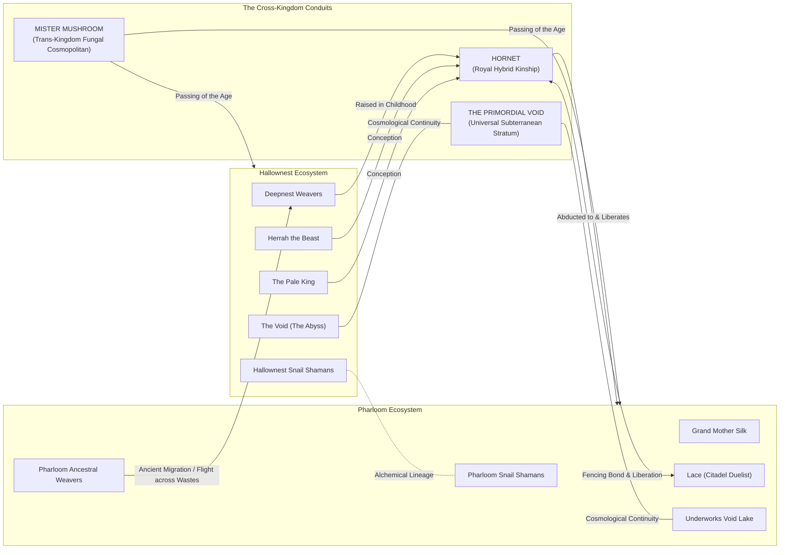

# Character Relationship Maps and Network Topologies: Hallownest and Pharloom

> **Historical Working Note:** This file contains preliminary exploratory notes drafted during kickoff. It is now formally superseded and verified by the deeper modular research files in `characters/relationship_maps.md, data/edges.csv, and themes/07_parents_children_and_succession.md`. All claims are cataloged in `data/claims.csv`.

- **Objects of Analysis:** Social, Political, Familial, and Theological Networks in *Hollow Knight* and *Hollow Knight: Silksong*
- **Methodology:** Sociometric Network Analysis, Diagrammatic Structuralism, Factional Topology
- **Epistemic Standards:** Tier 1 (Confirmed Canon), Tier 2 (Strongly Supported Interpretation), Tier 3 (Speculative Theory)

---

## 1. Hallownest Character Relationship Network

```mermaid
graph TD
    subgraph Royal_House ["The Sovereign House of Hallownest"]
        PK["The Pale King (Wyrm Monarch)"]
        WL["The White Lady (Consort / Root)"]
        HK["The Hollow Knight (Chosen Sarcophagus)"]
        Ghost["The Knight (Discarded Sibling / Avatar)"]
        Siblings["Millions of Aborted Vessels (The Abyss)"]
        BV["Broken Vessel / Lost Kin"]
    end

    subgraph The_Five_Knights ["The Five Great Knights"]
        Ogrim["Ogrim (Dung Defender)"]
        Isma["Isma (Botanical Knight)"]
        Dryya["Dryya (Protector of Queen)"]
        Hegemol["Hegemol (Mighty Armor)"]
        Zemer["Ze'mer (Grey Mourner)"]
    end

    subgraph The_Dreamers ["The Three Dreamers (The Seals)"]
        Monomon["Monomon the Teacher (Archives)"]
        Lurien["Lurien the Watcher (Spire)"]
        Herrah["Herrah the Beast (Deepnest)"]
    end

    subgraph The_Protagonist_Bridge ["The Royal Bridge"]
        Hornet["Hornet (Daughter of Wyrm & Spider)"]
    end

    subgraph Independent_Tribes ["Independent Sovereignties & Factions"]
        Mantis["Mantis Lords (Village)"]
        Traitor["Traitor Lord (Infected Exile)"]
        Vespa["Queen Vespa & Hive Knight (The Hive)"]
        Moths["The Seer (Moth Tribe Survivor)"]
        Hunter["The Hunter (Solitary Predator)"]
    end

    subgraph Divine_Entities ["Primordial Deities & Cosmic Realms"]
        Rad["The Radiance (Solar Dream God)"]
        Void["The Void / Void Given Form"]
        Grimm["Troupe Master Grimm (Nightmare Heart)"]
        Gods["Godseeker (Attuners of Godhome)"]
    end

    subgraph Companions_Town ["Citizens, Wanderers & Companions"]
        Quirrel["Quirrel (Disciple of Monomon)"]
        Elderbug["Elderbug (Dirtmouth)"]
        Cornifer["Cornifer & Iselda (Cartography)"]
        Sly["Great Nailsage Sly & 3 Masters"]
        Cloth["Cloth (Seeking Courage)"]
        Myla["Myla (Tragic Miner)"]
        Zote["Zote the Mighty"]
        Bretta["Bretta (Dreamer of Grey Prince)"]
    end

    %% Genealogies & Sacrifices
    PK ---|Royal Consorts| WL
    PK & WL -->|Bred in Abyss & Void-Infused| HK & Ghost & Siblings & BV
    PK ---|Political Bargain Bedding| Herrah
    Herrah -->|Biological Mother| Hornet
    PK -->|Biological Father| Hornet

    %% Knighthood & Service
    PK ---|Chivalric Command| Ogrim & Isma & Dryya & Hegemol & Zemer
    Dryya ---|Defended to Death| WL
    Ogrim ---|Guards Grove of| Isma
    Zemer ---|Mourns Lover: Daughter of| Traitor

    %% Seals & Containment
    Monomon & Lurien & Herrah ---|Bind the Temple Seals of| HK
    HK ---|Imperfectly Contains| Rad
    Monomon ---|Entrusted Mask to| Quirrel
    Quirrel ---|Sacrifices Mask to Liberate| Monomon

    %% Divine & Tribal Conflicts
    Rad ---|Infects & Subjugates| Traitor & BV & Myla
    Rad ---|Abandoned by| Moths
    PK ---|Erased Worship of| Rad
    Void ---|Primordial Enemy of| Rad
    Ghost ---|Unifies beneath Will| Void
    Void ---|Annihilates in Deicide| Rad

    %% Testing & Kinship
    Hornet ---|Tests Martial Competence of| Ghost
    Hornet ---|Protective Sisterhood to| HK
    Mantis ---|Resisted Infection; Distrusts| PK
    Mantis ---|Banished Brother| Traitor

    %% Companionship
    Ghost ---|Companionship with| Quirrel & Cloth & Elderbug
    Cloth ---|Assists in Slaying| Traitor
    Zote ---|Rescued by; Deludes| Bretta
    Cornifer ---|Maps Caverns for| Ghost
    Sly ---|Trains in Arts| Ghost
```

---

## 2. Pharloom Character Relationship Network

```mermaid
graph TD
    subgraph Citadel_Theocracy ["The Citadel Theocratic Apparatus"]
        GMS["Grand Mother Silk (Primordial Loom)"]
        Clergy["The High Clergy & The Choir"]
        Judge["The Last Judge (High Inquisitor)"]
        Cogwork["Cogwork Dancers (Clockwork Automation)"]
        Wardens["The Slab Wardens & Executioner Beetle"]
    end

    subgraph The_Dual_Duelists ["The Dynamic Duelists"]
        Hornet["Hornet (Princess-Protector)"]
        Lace["Lace (Gilded Fencing Prodigy)"]
        LostLace["Lost Lace (Void-Corrupted Phase)"]
    end

    subgraph Ancestral_Weavers ["The Ancient Weaver Lineage"]
        Shellwood["Ancestral Weavers (Shellwood & Sanctums)"]
        FirstSinner["First Sinner (Imprisoned in The Slab)"]
        Seth["Seth (Weavenest Guardian)"]
    end

    subgraph Mystics_Scholars ["Esoteric Guardians"]
        Caretaker["The Caretaker (Whispering Vaults)"]
        Snails["Snail Shamans (Soul & Silk Alchemy)"]
    end

    subgraph Infrastructure_Transit ["Labor, Transit & Industry"]
        BellBeast["The Bell Beast (Liberated Leviathan)"]
        ForgeDaughter["The Forge Daughter (Blacksmith)"]
        Miners["Enslaved Miners (The Marrow)"]
        Dockers["Crustacean Dockworkers (Deep Docks)"]
    end

    subgraph Pilgrims_Wanderers ["Pilgrims, Nomads & Performers"]
        Sherma["Sherma (Pure Devout Pilgrim)"]
        Shakra["Shakra (Warrior Cartographer)"]
        Garmond["Garmond & Zaza (Comic Knight & Beast)"]
        Trobbio["Trobbio (Theatrical Butterfly)"]
        FleaMaster["The Flea Master & Lost Fleas (Caravan)"]
    end

    subgraph Cosmic_Undercurrent ["The Primordial Abyss of Pharloom"]
        PharloomVoid["The Underworks Void Lake"]
    end

    %% Hierarchy & Extraction
    GMS ---|Presides over & Feeds via| Clergy
    Clergy ---|Commands State Enforcement of| Judge & Wardens
    Judge ---|Executes Pilgrims & Guard| GMS
    Clergy ---|Manufactures Clockwork| Cogwork
    Wardens ---|Tortures & Drains Silk from| FirstSinner & Miners

    %% Central Duelist Arc
    GMS ---|Surrogate Mother / Patron to| Lace
    Lace ---|Fencing Rival $\to$ Intimate Peer to| Hornet
    PharloomVoid ---|Contaminates into| LostLace
    Hornet ---|Purifies & Liberates| LostLace

    %% Weaver Lineage & Blood
    Shellwood ---|Ancestral Kin to| FirstSinner & Seth & Hornet
    Hornet ---|Carries Wyrm & Weaver Blood of| Shellwood
    GMS ---|Sought to Harvest Royal Silk of| Hornet
    FirstSinner ---|Reveals Forbidden Schism to| Hornet
    Seth ---|Martial Gatekeeper Testing| Hornet

    %% Alchemy & Lore
    Caretaker ---|Guards Forbidden Scrolls for| Hornet
    Snails ---|Synthesizes Soul & Silk Spools for| Hornet
    PharloomVoid ---|Threatens to Corrode Looms of| GMS

    %% Labor Liberation
    Hornet ---|Destroys Parasitic Collar of| BellBeast
    BellBeast ---|Transports across Bellways| Hornet & Sherma
    ForgeDaughter ---|Tempers Needles & Tools for| Hornet

    %% Pilgrimage Solidarity
    Hornet ---|Rescues & Receives Stew from| Sherma
    Shakra ---|Surveys & Sells Maps to| Hornet
    Hornet ---|Rescues 30 Baby Fleas for| FleaMaster
    Trobbio ---|Stages Theatrical Duel against| Hornet
    Garmond ---|Assisted in Hunts by| Hornet
```

---

## 3. Trans-Kingdom Comparative Network Model

