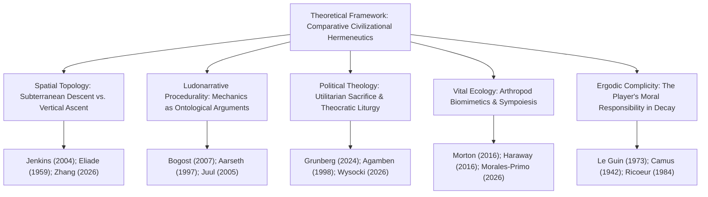
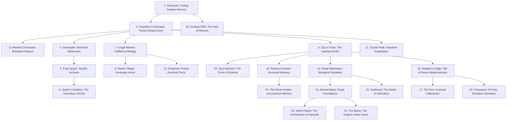
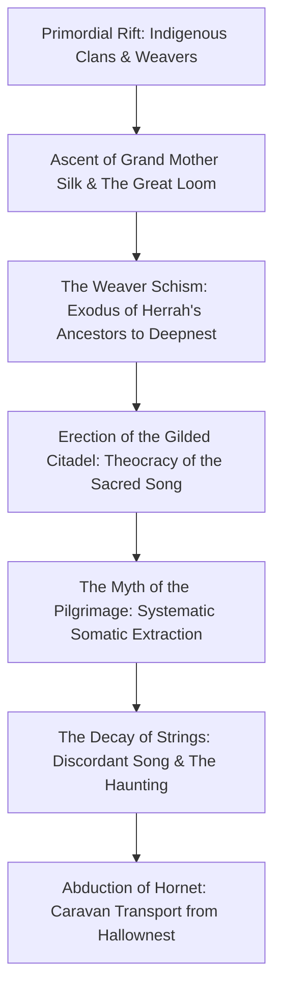
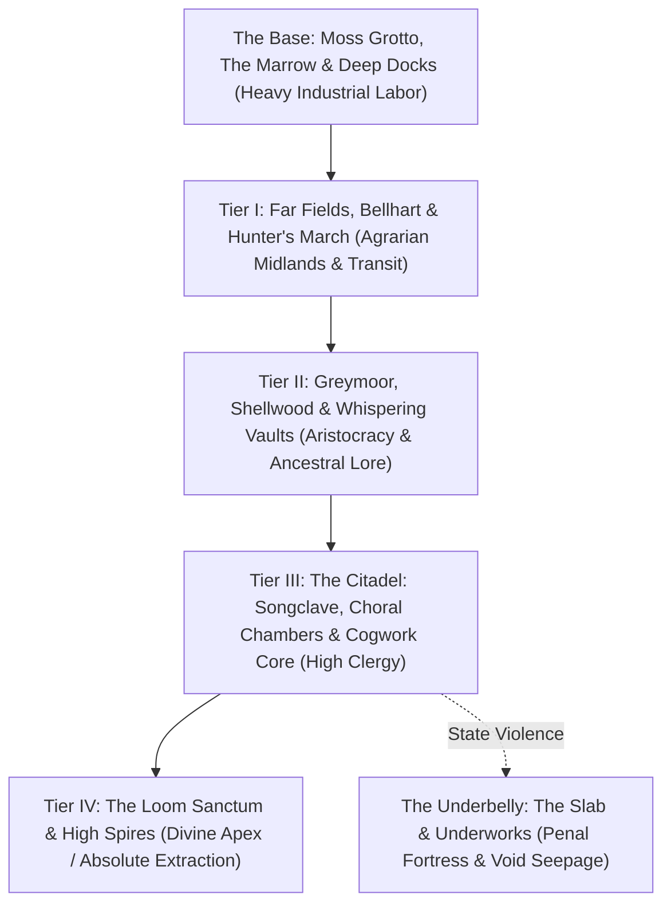
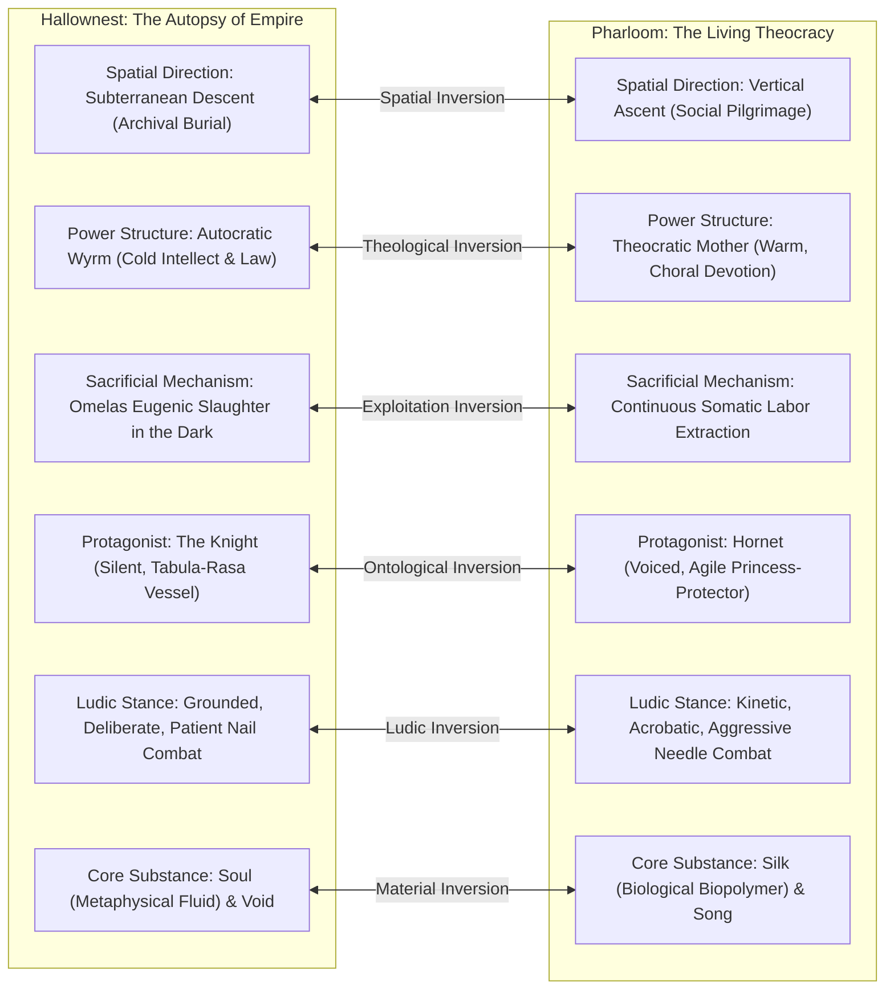

# Beyond Hallownest: Civilization, Memory, Divinity, Ecology, and Identity in *Hollow Knight* and *Hollow Knight: Silksong*

**Lead Authors:** Academic Game Studies Research Collaborative  
**Primary Discipline:** Game Studies (Ludology, Spatial Narratology, Environmental Storytelling)  
**Secondary Disciplines:** Environmental Humanities, Ecocriticism, Political Theology, Philosophy, Arthropod Biology  
**Format & Style:** APA 7th Edition  
**Target Manuscript Scope:** Comparative Qualitative Case Study (10,000–13,000 words)  
**Research Cutoff Date:** 5 November 2026  

---

### Abstract
This paper presents an exhaustive, interdisciplinary comparative study of Team Cherry’s landmark Metroidvania titles, *Hollow Knight* (2017) and *Hollow Knight: Silksong* (2025). Rather than treating these works as generic action-platformers or puzzles to be mechanically decoded, we investigate how both games construct complex, autonomous insect civilizations through interconnected spatial architecture, nonhuman environmental storytelling, procedural ludic mechanics, liturgical mythology, and fragmented historical memory. Hallownest represents the tragic autopsy of an empire ruined by an autocratic Wyrm monarch (the Pale King) whose obsession with permanence and containment produced a catastrophic utilitarian bargain—sacrificing millions of infant Vessels to contain the dream-infection of the Radiance. In contrast, Pharloom introduces an active, ascending theocracy centered upon the Citadel, where Grand Mother Silk and the high clergy deploy choral liturgy, bells, and the myth of spiritual pilgrimage to extract physical silk and labor from a subjugated populace. By comparing the silent, tabula-rasa Vessel (the Knight) with the voiced, agile princess-protector (Hornet), and analyzing the mechanical transition from subterranean nail-and-soul combat to kinetic needle-and-silk acrobatics, we demonstrate how spatial topology (descent into forgotten guilt versus ascent through living social hierarchy) embodies contrasting models of agency. We synthesize game studies, dark ecology, political theology (Agamben's *homo sacer*), moral philosophy (the Omelas dilemma), and biomimetic entomology to argue that Team Cherry's games offer a unified critique of imperial power: civilizations collapse not from external blight alone, but from the systemic violence required to preserve institutional eternity.

*Keywords:* Hollow Knight, Silksong, Metroidvania, environmental storytelling, Omelas dilemma, dark ecology, insect mythology, game studies, procedural rhetoric, spatial narratology.

---

## 1. Introduction

Over the past decade, independent digital games have emerged as premier sites of complex, philosophical world-building. Among these, Team Cherry’s *Hollow Knight* (2017) and its sequel *Hollow Knight: Silksong* (2025) occupy an extraordinary position within contemporary interactive media. Set within vast, ruined or theocratically hyper-stratified subterranean realms populated entirely by intelligent arthropods and nonhuman beings, these works have captivated both popular audiences and academic scholars across game studies, digital humanities, ecocriticism, and moral philosophy.

Yet, conventional video game discourse frequently mischaracterizes these titles. Popular criticism and informal fandom often reduce *Hollow Knight* to a punishing "Soulslike" platformer centered on boss mastery, or treat its lore as a cryptographic jigsaw puzzle awaiting literal decoding. In doing so, traditional commentary obscures the games' profound civilizational, ecological, and ethical inquiries. *Hollow Knight* and *Silksong* do not simply present linear fantasy quests; they construct intricate, self-contained fictional civilizations—**Hallownest** and **Pharloom**—whose cultural memory, political hierarchies, economic arrangements, biological interdependencies, and religious institutions far exceed the immediate journeys of their protagonists.

The central research problem addressed in this paper is the lack of a sustained, cross-comparative academic investigation that evaluates both games as interconnected yet structurally and philosophically distinct models of interactive civilization. While existing scholarly literature has produced penetrating localized critiques—such as Alex Grunberg’s (2024) analysis of the Omelas dilemma in Hallownest, Angelo Maria Andriano and Marco Caracciolo’s (2025) theorization of "Metroidvania ecologies," and emerging reviews of *Silksong*’s religious aesthetics (Wysocki, 2026) and silk biopolymers (Morales-Primo, 2026)—no single study has unified these disparate strands into a comprehensive comparative architecture. 

Accordingly, this investigation answers the following central research question:
> **How do *Hollow Knight* and *Hollow Knight: Silksong* deploy interconnected spatial world-building, character development, insect-inspired civilizational structures, mythological systems, environmental storytelling, and interactive mechanics to investigate the rise and collapse of societies, the nature of individual identity, historical memory, political-theological power, sacrifice, and the tension between individual agency and systemic order?**

To answer this question, our study proceeds across twenty interconnected chapters. We examine the studio history of Team Cherry, synthesize foundational and emerging literature, construct an integrated theoretical framework, detail our qualitative methodology, provide exhaustive individual game studies of Hallownest and Pharloom, execute formal comparative analyses of mechanics, spaces, and character ontologies, and conclude by evaluating the wider significance of Team Cherry’s interactive mythology for twenty-first-century game studies.

---

## 2. Team Cherry and the Development of Two Worlds

To understand the architecture of Hallownest and Pharloom, one must trace the material history of their creation. Team Cherry—a compact, Adelaide-based Australian independent studio founded by animator **Ari Gibson** and designer **William Pellen**, joined by composer **Christopher Larkin** and technical director **David Kazi** (and later expanded by narrative and marketing coordinator **Jasmine Vine**)—embodies an artisanal approach to digital game craft (Nintendo Australia, 2018).

The aesthetic and mechanical foundations of *Hollow Knight* originated in game-jam constraints. In August 2014, participating in the Ludum Dare 27 competition under the theme "10 Seconds," Gibson and Pellen created *Hungry Knight*, a primitive top-down action game featuring an insectoid character wielding a small blade who was forced to constantly consume fruit to avoid starvation. While mechanically crude, *Hungry Knight* established the studio's signature visual juxtaposition: a cute, minimalist, round-headed protagonist navigating a harsh, indifferent environment (Team Cherry, 2014).

In late 2014, Gibson and Pellen pivoted to a 2D side-scrolling format for Ludum Dare 29 under the theme "Beneath the Surface." Inspired by the subterranean ruin exploration of classic side-scrollers like *Zelda II: The Adventure of Link* (1987), *Faxanadu* (1987), and *Super Metroid* (1994), they conceived the seed of Hallownest: an ancient, fallen insect kingdom hidden beneath an abandoned desert town (ACMI, 2022). In November 2014, Team Cherry launched a modest Kickstarter campaign seeking AUD \$35,000, ultimately raising AUD \$57,129 from 2,158 backers (Team Cherry, 2014).

Crucially, the success of the Kickstarter transformed what was initially envisioned as a compact, four-region platformer into an expansive subterranean labyrinth. Stretch goals introduced additional playable areas, complex boss rosters, the Colosseum of Fools, and an ambitious promise: a "Second Playable Character" endowed with her own unique weapon and movement abilities—the princess-protector **Hornet** (Team Cherry, 2014).

Between 2015 and 2017, Team Cherry committed to an uncompromising aesthetic standard: traditional, frame-by-frame 2D animation hand-drawn by Gibson, paired with dynamic digital lighting, layered 2.5D parallax backgrounds, and an evocative, chamber-orchestral score composed by Larkin. When *Hollow Knight* launched in February 2017 to rapturous critical and commercial acclaim, Team Cherry did not abandon the project. Over the following eighteen months, the studio released four massive, free content expansions: *Hidden Dreams* (August 2017), *The Grimm Troupe* (October 2017), *Lifeblood* (April 2018), and *Godmaster* (August 2018). These packs expanded the game's mythological depth, culminating in alternate philosophical endings that interrogated the cosmic limits of Hallownest's gods.

The genesis of *Hollow Knight: Silksong* represents an equally profound design revelation. In late 2017, when Team Cherry began drafting Hornet’s campaign as a downloadable content expansion within Hallownest, they encountered severe mechanical friction (ACMI, 2022). Hornet’s character model was significantly taller than the Knight; her movements were characterized by blinding speed, long acrobatic leaps, mantle-grabbing, and diagonal lunges; and her weapon was an elongated needle threaded with physical silk. Placing Hornet within the low ceilings, tight corridors, and grounded pacing of Hallownest made the environment feel suffocating and trivialized existing platforming challenges (Team Cherry, 2019).

As Ari Gibson and William Pellen noted in their authoritative retrospective with the Australian Centre for the Moving Image (ACMI, 2022), the developers realized that to do justice to Hornet’s physical and narrative identity, they needed to construct an entirely new world from the ground up. In February 2019, Team Cherry announced that the planned DLC had evolved into a full-scale standalone sequel: *Hollow Knight: Silksong*. 

The development of *Silksong* spanned more than five years of intensive, quiet iteration. While the gaming public generated intense speculation surrounding the long development cycle, Team Cherry maintained its artisanal ethos, methodically hand-drawing over 150 new enemy types, composing dozens of new orchestral and choral movements with Larkin, and building **Pharloom**—a colossal vertical civilization that inverted the spatial philosophy of the original game (Team Cherry, 2025). Released to worldwide acclaim in 2025, *Silksong* demonstrated that Team Cherry was not merely repeating a successful formula, but actively evolving their world-building philosophy from an archaeology of subterranean ruin into an ethnography of living theocratic oppression.

---

## 3. Literature Review

The academic literature surrounding *Hollow Knight* and the emerging scholarship on *Silksong* intersects with five primary theoretical traditions: spatial narratology, environmental humanities, moral philosophy, political theology, and biomimetic ludology.

### 3.1 Spatial Narratology and Metroidvania Topologies
In foundational game studies, Henry Jenkins (2004) famously argued that game designers are not traditional storytellers, but "narrative architects" who construct evocative spaces pregnant with narrative potential. Jenkins identified four primary spatial narrative modalities: evocative spaces that draw upon preexisting genre memories, enacting stories where localized micro-narratives unfold through environmental obstacles, embedded narratives where the history of a space is deposited in artifacts and ruins, and emergent narratives generated dynamically through player agency.

Clara Fernández-Vara (2011) deepened this spatial framework by conceptualizing "indexical storytelling"—the practice of leaving material traces, corpses, architectural scars, and geological fractures in virtual spaces that allow the player to function as an archaeologist reconstructing past trauma. In the context of the Metroidvania genre, Jeremy Parish (2018) emphasizes that non-linear, ability-gated progression transforms the map into a spatial puzzle, compelling the player to cultivate intimate geographic knowledge through recursive backtracking.

Bohan Zhang (2026) expands this analysis by examining the "backtracking narrative mechanism" in Metroidvanias. Zhang contrasts the archaeological backtracking of *Hollow Knight*—where returning to the Forgotten Crossroads reveals its horrific biological infection—with the communal backtracking of *Silksong*, where delivery tasks along the Bellway network forge intimate bonds of mutual aid with marginalized NPCs.

### 3.2 Environmental Humanities and Non-Anthropocentric Ecocriticism
Within the environmental humanities, digital games have increasingly been analyzed as systems that simulate complex ecological relationships. Alenda Chang (2019), in *Playing Nature: Ecology in Video Games*, critiques the anthropocentric bias of mainstream game design, which routinely reduces environments to static backdrops or extractive resource pools awaiting human exploitation. Chang calls for ludic systems that foreground nonhuman autonomy, multi-species entanglement, and ecological precariousness.

Applying this ecocritical lens directly to Team Cherry’s work, Angelo Maria Andriano and Marco Caracciolo (2025) published *Metroidvania Ecologies: Exploration and the Environmental Imagination in Hollow Knight and Rain World* in *Eludamos*. Drawing upon Timothy Morton’s (2016) concept of "dark ecology"—a philosophical framework that rejects pristine nature in favor of a melancholic, ironic, and strange coexistence between organisms and degraded biospheres—Andriano and Caracciolo argue that Hallownest de-centers human supremacy. The player does not conquer a wild frontier; rather, the player-avatar is absorbed into an indifferent, subterranean insectoid ecosystem that flourishes amid imperial decay.

Marco Caracciolo (2026) furthers this environmental inquiry in *Playing a Game of Worlds: World Building and Its Disruptions in Video Games*, examining how *Silksong* exposes the fragility of fictional worlds. Caracciolo argues that Pharloom’s ascending theocracy is characterized by sharp systemic disruptions, where the grand theological narrative of the Pilgrimage is repeatedly punctured by encounters with industrial exploitation in the Underworks and toxic ecological runoff in Bilewater.

### 3.3 Moral Philosophy and the Omelas Dilemma
The dominant ethical reading of *Hollow Knight* was established by Alex Grunberg (2024) in *Games and Culture*: *The Ones Who Walk Away from Hallownest: Hollow Knight's Radical Response to the Omelas Dilemma*. Grounding his critique in Ursula K. Le Guin's (1973) classic parable *The Ones Who Walk Away from Omelas*, Grunberg demonstrates that Hallownest represents a literalized utilitarian contract. In Le Guin’s story, the boundless prosperity, intelligence, and delight of a utopian city depend entirely upon the perpetual, unceasing torture and isolation of a single scapegoated child locked in a squalid cellar.

Grunberg reveals that the Pale King structured Hallownest upon an identical premise: to preserve his eternal kingdom from the Radiance’s dream-infection, the King bred millions of Vessel offspring in the Abyss, discarded the failures, and bound the chosen Hollow Knight within chains in the Black Egg to serve as an eternal, suffering sarcophagus. Crucially, Grunberg argues that *Hollow Knight* provides a "radical response" to Le Guin’s ethical impasse precisely because it is an interactive medium. While Le Guin’s citizens can only either accept the horrific bargain or walk away into the darkness, the player of *Hollow Knight* is endowed with procedural agency across multiple endings: one can perpetuate the sacrificial cycle by taking the child's place (Ending 1), sever the root cause through deicide (Ending 3), or unleash the primordial Void to tear down the entire cosmic order (Ending 4).

### 3.4 Political Theology, Sovereign Violence, and Bare Life
The ethical critiques of Grunberg directly intersect with Giorgio Agamben’s (1998) political philosophy in *Homo Sacer: Sovereign Power and Bare Life*. Agamben theorizes that sovereign authority constitutes itself through the creation of an "exception"—a realm where the rule of law is suspended and certain living beings are reduced to *homo sacer* ("bare life"), individuals who may be killed without committing homicide and whose lives are excluded from legal and political protection. In Hallownest, the Vessels represent the ultimate incarnation of bare life: created outside civic kinship, stripped of voice and legal standing, and systematically slaughtered in the Abyss to sustain the sovereign's political permanence.

In *Silksong*, political theology shifts from sovereign exception to liturgical spectacle. Jan Wysocki’s (2026) review in the *Journal for Religion, Film and Media* examines how Pharloom deploys Catholic and liturgical aesthetics—choral polyphony, sacred spools, ceremonial vestments, and towering bells—to manufacture spiritual docility. Drawing on Mircea Eliade’s (1959) *The Sacred and the Profane* and Rudolf Otto’s (1917) concept of the numinous (*mysterium tremendum*), Wysocki illustrates how the Citadel transforms spiritual longing into a mechanism of somatic extraction.

### 3.5 Arthropod Biomimetics and Material Culture
Finally, Abraham U. Morales-Primo (2026) bridges game studies and biological sciences in *Hornet's Web: Weaving the Biology of Silk into Hollow Knight: Silksong*, published in the *Journal of Geek Studies*. Morales-Primo analyzes the biomimetic translation of spider dragline silk (Vollrath & Knight, 2001) into Hornet’s gameplay systems. The study demonstrates that Hornet’s needle-wielding, mid-air binding, and tool-crafting mechanics are grounded in authentic entomological principles of liquid-crystalline spinning and high tensile biopolymers, demonstrating that Team Cherry’s mechanical design is an extrapolation of real-world arthropod physiology.

---

## 4. Theoretical Framework

To synthesize these diverse disciplinary perspectives, this study constructs an integrated qualitative framework: **Comparative Civilizational Hermeneutics**.

$$\text{Comparative Civilizational Hermeneutics} = \mathcal{F}(\text{Spatial Topology}, \text{Ludonarrative Procedurality}, \text{Political Theology}, \text{Vital Ecology}, \text{Ergodic Complicity})$$

1. **Spatial Topology:** We examine virtual geography not as passive scenery, but as an ideological text. We contrast Hallownest’s subterranean stratigraphy (an archaeological descent through successive layers of forgotten imperial guilt) against Pharloom’s ascending hyper-stratification (a vertical theocratic pilgrimage through living social classes toward a divine center).
2. **Ludonarrative Procedurality:** Utilizing Ian Bogost’s (2007) theory of "procedural rhetoric," we investigate how game rules make arguments about the world. We analyze how the Knight’s stationary, vulnerable *Focus* mechanic procedurally argues for the fragility of consciousness in a dying empire, whereas Hornet’s mid-air, dynamic *Bind* mechanic proceduralizes self-reliant triage within an active social ecosystem.
3. **Political Theology & Sacrificial Violence:** Drawing on Agamben (1998) and Grunberg (2024), we interrogate the ideological justifications deployed by rulers to normalize atrocity. We contrast the Pale King's hidden eugenic slaughter in the dark with Grand Mother Silk's public, liturgical extraction of labor through sacred song.
4. **Vital Ecology & Sympoiesis:** Grounding our analysis in Donna Haraway’s (2016) theories of "sympoiesis" (making-with) and Jane Bennett’s (2010) "vital materialism," we explore how nonhuman beings, fungal mycelia, and material substances (Soul, Void, Silk) exert autonomous agency that resists divine monoculture.
5. **Ergodic Complicity & Agency:** Utilizing Espen Aarseth’s (1997) concept of ergodic traversal and Paul Ricoeur’s (1984) narrative hermeneutics, we analyze how the player’s physical labor—enduring punishing platforming gauntlets, surviving brutal boss encounters, and choosing among branching endings—transforms passive aesthetic reception into ethical responsibility.

---

## 5. Methodology

This investigation employs an **interpretive, comparative qualitative case-study design** that integrates textual close reading, architectural spatial analysis, formal ludological dissection, and historical lore reconstruction.

### 5.1 Multi-Method Triangulation
To ensure empirical rigor, our analytical protocol triangulates across five distinct evidence sources:
1. **Primary Ludic and Textual Corpus:** Comprehensive in-game analysis of all dialogue scripts, Hunter’s Journal entries, item descriptions, dream nail monologues, world tablets, and environmental inscriptions across the full campaigns of *Hollow Knight* (and its four expansions) and *Hollow Knight: Silksong*.
2. **Spatial and Topological Mapping:** Spatial documentation of 23 regions in Hallownest and 22 regions in Pharloom, mapping traversal dependencies, gating mechanisms, environmental transitions, and architectural iconography.
3. **Formal Systems Analysis:** Frame-by-frame mechanical analysis of combat hitboxes, movement physics, resource generation rates (Soul versus Silk), customization synergies (Charms versus Crests/Tools), and death penalties.
4. **Musicological and Acoustic Appraisal:** Close listening to Christopher Larkin’s complete original soundtracks for both games, analyzing instrumentation choices, leitmotif recurrence, and the narrative deployment of silence and choral counterpoint.
5. **Primary Developer Archives:** Critical examination of documented developer intentions, including Team Cherry blog dispatches (2014–2025), Kickstarter campaign logs, and curatorial interviews with the Australian Centre for the Moving Image and Nintendo.

### 5.2 Epistemic Standards and Lore-Verification Boundaries
Given the intentionally fragmented, ambiguous nature of environmental storytelling in Metroidvania games, academic integrity demands strict epistemic boundaries. Following the protocols established in the *Claim and Evidence Matrix* (`19_CLAIM_AND_EVIDENCE_MATRIX.csv`), all claims within this paper are classified into three rigorous certainty tiers:
- **Tier 1 (Confirmed Canon):** Facts explicitly affirmed by direct in-game text, dialogue, visual cutscenes, or authoritative developer statements (e.g., Hornet’s parentage as daughter of the Pale King and Herrah; the sequel status of *Silksong*).
- **Tier 2 (Strongly Supported Interpretation):** Hermeneutic inferences supported by converging, independent environmental, mechanical, and narrative evidence without internal contradiction (e.g., the biological correspondence between the Radiance and *Ophiocordyceps* parasitism; the Omelas utilitarian reading of the Vessels).
- **Tier 3 (Speculative Theory):** Plausible hypotheses addressing unresolved ambiguities (e.g., the exact chronological century elapsed between the two games; the full cosmic origin of the Void). Speculative claims are explicitly marked and never asserted as established fact.

Furthermore, per our research kickoff audit, the announced *Silksong* expansion **Sea of Sorrow** is confirmed as officially announced on December 15, 2025, but remains unreleased as of our 5 November 2026 cutoff date. In accordance with strict academic honesty, its announced nautical theme is documented, but unreleased content is excluded from our empirical findings.

---

## 6. Hollow Knight: The Rise and Fall of Hallownest

The historical narrative of Hallownest is a tragedy of imperial hubris, metaphysical engineering, and catastrophic systemic decay. Reconstructing the diegetic history of the kingdom reveals how an autocrat’s refusal of natural transience converted a subterranean paradise into an ossuary.

Before the dawn of Hallownest, the subterranean caverns were home to ancient, disparate tribal cultures [Tier 1]. In the lowest geological strata—the Ancient Basin and the Abyss—there existed an ancient, nameless culture that revered the **Void**, a dark, liquid substance of pure non-being and entropic potential [Tier 1]. In the upper caverns, the ancient **Moth Tribe** lived in organic harmony with the **Radiance**, a primordial higher being of brilliant, searing solar light who manifested through dreams, memory, and golden essence [Tier 1]. Simultaneously, the fiercely isolationist **Mantis Tribe** established an unbending society rooted in martial honor, while the arachnid clans of **Deepnest** wove subterranean territories governed by primal instincts [Tier 1].

The emergence of Hallownest was initiated by the arrival of a **Wyrm**—a colossal, ancient god endowed with immense foresight and biological mutability [Tier 1]. Traveling to the kingdom’s eastern precipice (now Kingdom's Edge), the Wyrm died and underwent a radical metamorphic molting [Tier 1]. From this mountain-sized carcass emerged a diminutive, luminous insect monarch: the **Pale King** [Tier 1].

The Pale King possessed a transformative power: he expanded the minds of primal bugs, granting them individuality, higher intellect, reason, and self-awareness beyond insect instinct [Tier 1]. In exchange for sentience, he demanded fealty and established a grand empire:
> *"No blaze baffles the mind like the brilliant beacon of our King... He granted us thought, and in thought we found civilization."* — King's Pass Tablet [Tier 1].

Joined by his consort, the fertile vegetative higher being known as the **White Lady**, the Pale King erected a magnificent civilization [Tier 1]. At the kingdom’s center stood the **City of Tears**, a glittering metropolis of Gothic spires and marble plazas sheltered beneath the subterranean downpour of the Blue Lake [Tier 1]. The kingdom developed advanced mass transit (the Stagways and mechanical Tramways) and was protected by the chivalric **Five Great Knights**—Ogrim (Dung Defender), Isma, Dryya, Hegemol, and Ze'mer (the Grey Mourner) [Tier 1].

However, the foundation of Hallownest rested upon ideological exclusion. The Pale King declared Hallownest eternal and unique, actively suppressing competing traditions [Tier 1]. The Moth Tribe, captivated by the King’s luminous intellectual beacon, turned away from the Radiance and abandoned her altars [Tier 1].

Because higher beings derive existence from memory and reverence, this betrayal pushed the Radiance to the brink of ontological erasure [Tier 1]. Stripped of physical worship, the solar deity retreated into the collective unconscious—the **Dream Realm** [Tier 1]. From this metaphysical exile, the Radiance began clawing her way back into reality through the minds of Hallownest’s citizens [Tier 1]. Bugs began dreaming of a blinding light; upon waking, their intellects dissolved, their bodies mutated with glowing orange pustules, and their wills were subsumed into an aggressive hive-mind [Tier 1]. The King’s gift of sentience became the exact vector of their doom: because bugs possessed conscious minds, they were vulnerable to psychic invasion [Tier 2].

Faced with the collapse of his eternal order, the Pale King rejected natural decline and turned to extreme metaphysical experimentation [Tier 1]. Recognizing that Soul-harvesting (attempted by the scholars of the Soul Sanctum) could not stop a dream-god, the King turned to the primordial Void [Tier 1]. His hypothesis was cold, mathematical, and horrific: to contain a light that infected minds and desires, he required an empty vessel—a biological entity devoid of thought, will, and emotion [Tier 1]:
> *"No mind to think. No will to break. No voice to cry suffering. Born of God and Void."* [Tier 1].

In the deepest pits of the Abyss, the Pale King and the White Lady laid thousands of eggs, allowing their unborn offspring to be saturated by the liquid Void [Tier 1]. The darkness hollowed out their biological vitality, replacing interiority with absolute emptiness [Tier 1]. Those who showed even a flicker of will were abandoned, creating a mountain of child skulls in the dark [Tier 1]. From this slaughter, the King selected a single offspring: the **Hollow Knight** [Tier 1].

To seal the vessel permanently, the King enlisted three powerful figures to serve as eternal, sleeping **Dreamers** whose psychic slumber bound the entrance to the Temple of the Black Egg: Monomon the Teacher, Lurien the Watcher, and Herrah the Beast (who agreed only in exchange for a royal child, giving birth to Hornet) [Tier 1]. The Hollow Knight absorbed the Radiance into its body and was bound within chains in the sealed temple [Tier 1].

Yet, the containment was fatally compromised. The Hollow Knight was **not truly hollow** [Tier 1]. During its upbringing in the White Palace, a bond of mutual paternal affection formed between the King and the Vessel—what the White Lady mourns as *"an idea instilled, a thought focused"* [Tier 1]. The Vessel harbored an emotional desire to please its royal father. This microscopic drop of sentimentality became the fracture through which the Radiance broke free [Tier 1]. The chains ruptured, orange infection spewed from the Black Egg, and Hallownest collapsed into madness [Tier 1]. Realizing his failure, the Pale King magically hid the White Palace inside the Dream Realm, vanishing from physical space while his abandoned kingdom rotted into an undead ruin [Tier 1].

---

## 7. Hallownest: Character Development and Relationships

The tragic depth of Hallownest is carried by a cast of complex, beautifully characterized nonhuman figures whose personal narratives reflect the civilizational fractures of the kingdom.

### 7.1 The Knight: The Agency Paradox
The Knight—the player-avatar—embodies an extraordinary ludonarrative paradox. Conceptually engineered by the Pale King to be an empty automaton devoid of will, the Knight’s actual gameplay journey demonstrates the emergence of authentic **subjectivity, memory, and purposive agency** [Tier 2]. As the player guides the Knight through Hallownest, the Vessel listens patiently to Elderbug, brings delicate flowers to graves, sits alongside Quirrel at the Blue Lake, spares the Nailsmith, and absorbs the ancient nail arts [Tier 1]. When the Knight retrieves the **Void Heart** from its birthplace in the Abyss, the narrative explicitly confirms the unification of will: the charm description affirms that it *"unifies the Void beneath the bearer's will"* [Tier 1]. The Knight is not an empty shell; it is an entity that transcends its sacrificial design through the lived experience of exploration [Tier 2].

### 7.2 Hornet: The Unyielding Protector
Hornet stands as the proud, tragic survivor of two dying houses. Born of the Wyrm (Pale King) and the Spider (Herrah), she is endowed with an articulate voice, biological gender, and organic flesh [Tier 1]. She is not a Vessel; she contains no Void [Tier 1]. In Hallownest, Hornet functions as an aggressive, pragmatic gatekeeper [Tier 1]. When she duels the Knight in Greenpath and Kingdom's Edge, she is not driven by cruelty, but by a desperate necessity to test whether this returning sibling possesses the lethal competence required to end the kingdom’s prolonged agony [Tier 1]. In the climax, she risks her life to breach the Black Egg, pinning the Hollow Knight to create the opening for the Knight’s deicide [Tier 1].

### 7.3 The Hollow Knight: The Scapegoated Child
The Hollow Knight is one of the most achingly tragic figures in interactive media. Raised in the pristine towers of the White Palace to believe it was the savior of Hallownest, it was burdened with an impossible metaphysical demand: to endure perpetual, agonizing psychic torture while remaining completely emotionless [Tier 2]. In the final encounter within the Black Egg, the Hollow Knight is a broken, limping cripple [Tier 1]. Its self-mutilation during combat—repeatedly stabbing its own infected chest with its nail—proceduralizes its desperate, suicidal desire to assist the player in ending its torment [Tier 2]. It represents the horrific human cost of utilitarian empire [Tier 2].

### 7.4 The Pale King and White Lady: Autocratic Rationality vs. Repentant Nature
The royal couple embodies two radically distinct philosophical responses to civilizational collapse. The **Pale King** represents enlightened autocratic rationality pushed to monstrous extremes [Tier 1]. Endowed with precognition and the power to expand insect minds, he could not accept that Hallownest, like all mortal ecosystems, was subject to entropy and death [Tier 2]. His governance was marked by extreme geometric order: constructing immaculate white marble spires, mechanized tram networks, and uniform stone tablets proclaiming eternal glory [Tier 1]. When threatened by the Radiance, he did not turn to collective defense or biological adaptation; he turned to eugenics and mass infanticide, breeding and discarding millions of his own children in the dark [Tier 1]. When his mechanical-sacrificial apparatus failed, he chose cowardice over public accountability, vanishing with his palace into the Dream Realm, where he perished alone upon his throne surrounded by whirring buzzsaws—a terrifying portrait of the ruler who consumes his own children to preserve the illusion of his law [Tier 2].

In contrast, the **White Lady** embodies fertile vegetative nature overwhelmed by profound moral guilt [Tier 1]. As a higher being of biological growth and perpetual reproduction, her prolific fertility was co-opted by the King to produce the vast clutches of eggs dumped into the Abyss [Tier 1]. Following the fall of Hallownest, her response was not imperial denial, but self-imposed somatic punishment: she retreated to the deepest sanctuary of the Queen's Gardens, deliberately binding her limbs in suffocating dry roots, blinding her perception, and restraining her reproductive instincts within a tight cocoon [Tier 1]. When the Knight encounters her, she exhibits tender, grief-stricken recognition, seeking no restoration of royal privilege, but offering her half of the Kingsoul in the hope that a true Vessel will finally grant Hallownest the mercy of death [Tier 1].

### 7.5 The Five Great Knights: Chivalry in the Sewer and the Graveyard of Honor
Hallownest's chivalric elite—the **Five Great Knights**—illustrate how feudal martial honor decays when the empire it served dissolves into dust [Tier 1]:
- **Ogrim (The Dung Defender / White Defender):** The sole surviving Great Knight in the ruins, living in self-imposed exile in the Royal Waterways [Tier 1]. Covered in filth, Ogrim maintains his boisterous chivalric pride, booming laughter, and unwavering loyalty to the King and his fallen comrades [Tier 1]. Yet his dream-rematch as the *White Defender* reveals profound psychological denial: Ogrim retreats into dreams of his gleaming silver prime to avoid confronting the horrifying reality that his king fled, his comrades are dead, and he is a lone warrior guarding a sewer [Tier 2].
- **Isma:** The compassionate botanical knight whose physical remains merged into the acid aquifers of the Waterways, producing *Isma's Tear* [Tier 1]. Her death demonstrates how the physical bodies of Hallownest's protectors dissolved into the geological landscape.
- **Dryya:** The fierce guardian of the White Lady, whose desiccated corpse lies surrounded by a mountain of slaughtered Mantis Traitor corpses outside the Queen's sanctuary, having fulfilled her martial vow to her dying breath [Tier 1].
- **Hegemol:** Famed for his massive, imposing armor and gentle disposition, his slumbering form was robbed by a terrified Maggot who used the stolen shell to become the *False Knight*, demonstrating how the symbols of state authority can be hollowed out and worn by the desperate [Tier 1].
- **Ze'mer (The Grey Mourner):** A mysterious, elongated Weaver or moth expatriate from a distant land who loved the daughter of the Mantis Traitor Lord [Tier 1]. Following her lover's death, Ze'mer weeps eternally in the Resting Grounds, charging the Knight with transporting a frail *Delicate Flower* across the kingdom to her lover's grave, transforming chivalric duty into an act of enduring, trans-tribal queer romance and grief [Tier 2].

### 7.6 The Three Dreamers: Science, Surveillance, and Maternal Bargain
The Three Dreamers represent three distinct societal pillars enlisted by the Pale King to seal the Black Egg [Tier 1]:
- **Monomon the Teacher:** The archivist of the Fog Canyon, representing scientific and intellectual foresight [Tier 1]. Alone among the King's ministers, Monomon recognized that sealing the infection within an eternal stasis was an abomination. She accepted the role of Dreamer only on the condition that an external fail-safe be established, entrusting her mask and memories to her student Quirrel so that her seal could eventually be broken when the time was ripe [Tier 1].
- **Lurien the Watcher:** The reclusive aristocrat occupying the highest tower of the City of Tears, representing state surveillance and uncritical civic loyalty [Tier 1]. Obsessively spying on the populace through a massive brass telescope, Lurien slumbered without hesitation, desiring only that the city he loved be preserved in timeless silence [Tier 1].
- **Herrah the Beast:** The ferocious matriarch of Deepnest, representing sovereign tribal autonomy [Tier 1]. Herrah despised the Pale King's laws and refused to bow; she agreed to become a Dreamer solely out of maternal ambition—demanding that the King bed her to conceive an immortal child (Hornet) who would elevate the arachnid bloodline of Deepnest [Tier 1]. Her execution by the Knight in her webbed chamber is profoundly uncomfortable: she lies silent and defenseless, an unresisting mother whose sacrifice was purely domestic [Tier 2].

### 7.7 The Subaltern Citizens: Myla, Quirrel, Cloth, and the Satire of Zote
Beyond the aristocracy, Hallownest's emotional landscape is populated by everyday subaltern figures:
- **Quirrel:** The wandering scholar whose journey mirrors the player's own awakening. Having lost his memories in the wastes, his quiet curiosity and swordplay camaraderie provide rare moments of warmth [Tier 1]. In his final scene at the Blue Lake, having fulfilled his purpose by releasing Monomon's seal, he sits in quiet contemplation of the world's beauty before peacefully departing, leaving his nail driven into the earth [Tier 1].
- **Myla:** The innocent crystal miner whose cheerful, rhyming songs slowly warp into halting, feverish mumblings as the infection spreads, culminating in her tragic transformation into an aggressive hostile enemy who must be put down—a devastating, intimate dramatization of the kingdom's biological corruption [Tier 1].
- **Cloth:** The nomadic cicada warrior whose struggle to overcome paralyzing cowardice leads her to die heroically alongside the Knight against the Traitor Lord, her joyful ghost rejoicing that she can now meet her beloved Nola in peace [Tier 1].
- **Zote the Mighty:** A pathetic, boastful wanderer wielding a wooden nail ("Life Ender") and preaching his 57 Precepts of Zote [Tier 1]. While functioning as brilliant comic relief, Zote is also a sharp narrative satire of toxic masculine heroism, whose absurd, idealized projection in Bretta's dreams (*Grey Prince Zote*) exposes how societies invent hyper-masculine saviors out of pathetic, insecure men [Tier 2].

---

## 8. The Geography of Hallownest: Area-by-Area Spatial Storytelling

Hallownest’s geography is organized as a **vertical descent into systemic guilt**. Each region represents an architectural and geological stratum communicating the socio-political history of the empire.

From the lonely surface of **Dirtmouth**, the player descends into the **Forgotten Crossroads**, a functional transit highway populated by mindless worker husks [Tier 1]. When the player unseals the Dreamers, this space mutates into the **Infected Crossroads**, rupturing with pulsating orange cysts that physically block familiar pathways, confronting the player with the catastrophic environmental consequences of their quest [Tier 1].

In **Greenpath** and the **Queen's Gardens**, lush botanical overgrowth clashes with crumbling stone statues, illustrating nature's reclamation of imperial monuments [Tier 1]. In the **Fungal Wastes**, alien spore-networks thrive indifferently to the fall of kings, while the fortified **Mantis Village** stands as an architectural bastion of martial discipline that held the infection at bay through unyielding tribal honor [Tier 1].

The imperial heart—the **City of Tears**—is a masterwork of environmental melancholy. Perpetual rain falls from the Blue Lake above, echoing off marble spires and aristocratic ballrooms [Tier 1]. Attached to this splendor is the **Soul Sanctum**, an occult laboratory where piles of desiccated bug corpses reveal that the empire's intellectual elite engaged in horrific vivisection to extract Soul in a futile effort to achieve personal immortality [Tier 1].

Ascending into **Crystal Peak**, the player encounters the mechanization of insect labor: conveyor belts, crushing pistons, and laser-refracting crystals that hum with madness [Tier 1]. Descending into the **Royal Waterways**, the architectural veneer collapses into sewage, where the loyal Great Knight Ogrim wallows in dung to guard the memory of his fallen comrades [Tier 1].

In **Deepnest**, civilization dissolves entirely. Pitch-black, claustrophobic corridors crawling with dirtcarvers, corpse-mimics, and the terrifying ambush predator **Nosk** communicate feral arachnid horror—a territory that the Pale King never truly conquered [Tier 1]. At **Kingdom's Edge**, the cliffs are coated in perpetual white ash: the shed, molted skin of the ancient Wyrm, reminding the player that all gods are mortal biological entities that rot and decay [Tier 1].

In the **White Palace**, preserved within the Dream Realm, the Pale King’s true nature is laid bare: pristine white marble laced with lethal spinning buzzsaws and thorns, an architectural manifestation of sovereign paranoia and sterile, mechanized guilt [Tier 1]. Finally, beneath the **Ancient Basin** lies **The Abyss**: a colossal, subterranean cavern paved with millions of child skulls [Tier 1]. The Abyss is the spatial repressed of Hallownest—the original sin upon which the King's empire was erected [Tier 2].

---

## 9. Combat, Progression, and Agency in *Hollow Knight*

*Hollow Knight*’s ludic mechanics are not neutral interaction tools; they operate as **procedural arguments regarding vulnerability, patience, and memory** (Bogost, 2007).

The Knight's primary weapon, the **Nail**, is a short, unadorned blade requiring precise spatial proximity [Tier 1]. Combat is governed by deliberate spacing and directional commitment. Striking enemies or spikes from above executes a downward slash ("pogo") that rebounds the Knight upward, resetting air-dashes and double jumps [Tier 1]. This mechanic transforms hostile terrain into springboards, proceduralizing the player’s mastery over gravity and danger [Tier 2].

The game’s primary resource, **Soul**, is extracted directly by striking living enemies [Tier 1]. Contained within the Knight's mask, Soul fuels two competing necessities: offensive spellcasting (*Vengeful Spirit*, *Desolate Dive*, *Howling Wraiths*) and restorative **Focus** [Tier 1]. The Focus mechanic is a masterstroke of psychological tension: to restore a single mask of health, the Knight must remain completely stationary for approximately 1.5 seconds, generating vulnerable vulnerability [Tier 1]. The player cannot flee to heal; healing requires reading boss attack loops, anticipating safe windows, and maintaining calm under extreme auditory and visual pressure [Tier 2].

The **Charm System** provides extraordinary strategic customization through 40 badges allocated across limited Notch slots [Tier 1]. Charms enable distinct expressive builds: spell-focused builds (*Shaman Stone*, *Spell Twister*), rapid melee builds (*Quick Slash*, *Mark of Pride*, *Unbreakable Strength*), or defensive mobility (*Quick Focus*, *Shape of Unn*) [Tier 1]. The system also introduces the brilliant **Overcharming** mechanic: forcing an extra charm into an exhausted notch grants immense power, but causes the Knight to suffer double damage from all sources, proceduralizing extreme risk-reward calculation [Tier 1].

Finally, the **Death System** reinforces existential vulnerability. Upon death, the Knight’s shell shatters, spilling all Geo (currency) and leaving behind the **Shade**—a hostile, levitating shadow entity armed with the Knight’s spells [Tier 1]. Crucially, the Knight’s Soul meter is cracked, capping maximum Soul capacity until the player returns to the site of death and slays their own shade in personal combat [Tier 1]. Death forces an intimate confrontation with the self: to regain one's power, one must repeatedly execute the externalized shadow of one's own failure [Tier 2].

---

## 10. Higher Beings, Dreams, and the Ethics of Sacrifice

The theological and moral climax of *Hollow Knight* investigates the catastrophic cost of divine preservation. The Pale King’s containment strategy represents the literal execution of the **Omelas dilemma** (Grunberg, 2024; Le Guin, 1973). To protect the intellectual sentience of his kingdom, the King subjected an innocent offspring to unceasing torment in the Black Egg [Tier 1].

The game's six branching endings evaluate this sacrificial ethics:
1. **The Hollow Knight Ending:** The Knight slays the corrupted Hollow Knight, absorbs the infection, and is chained within the Black Egg, resealing the tomb [Tier 1]. As Grunberg (2024) notes, this ending accepts the utilitarian bargain: the player replaces the suffering child, perpetuating the state apparatus of sacrifice without resolving its underlying instability [Tier 2].
2. **Sealed Siblings Ending:** Hornet intervenes to pin the vessel, but the player slays the Hollow Knight with the physical nail. Both siblings are entombed within the Black Egg forever, with Hornet’s mask etched as a permanent seal on the stone [Tier 1]. It represents total, claustrophobic despair—the complete extinction of royal bloodlines in service of an eternal grave [Tier 2].
3. **Dream No More Ending:** Armed with the Void Heart, the Knight dream-nails the Hollow Knight, enters the Dream Realm, and confronts the **Radiance** directly [Tier 1]. Supported by the shade of the Hollow Knight, the Knight sheds its shell, metamorphosing into a shadowy void leviathan that drags the sun-god down into the black sea [Tier 1]. The infection is destroyed, the Black Egg dissolves, and the sibling shades sink peacefully into the Abyss [Tier 1]. The player rejects the Omelas bargain by eradicating both the threat and the sacrificial architecture [Tier 2].
4. **Embrace the Void Ending (Godmaster):** Attuning through the *Pantheon of Hallownest*, the Knight sheds its individuality to become the **Void Given Form** (the Lord of Shades) [Tier 1]. It violently tears Absolute Radiance apart, consumes Godhome, and bleeds black tentacles into the physical world as the Godseeker perishes [Tier 1]. It represents an apocalyptic, cosmic revolution: the repressed Abyss ascends to devour the divine pantheon [Tier 2].
5. **Delicate Flower Variant:** Identical to Ending 4, but as the Void spills into the physical world, a single tentacle brushes against the **Delicate Flower** held by the Godseeker, causing the Void to peacefully dissolve into pure white light [Tier 1]. It demonstrates that cosmic wrath can be transcended through fragile, mortal grace [Tier 2].
6. **Passing of the Age:** The comic, absurdist epilogue wherein Mister Mushroom launches into space, reminding the player that fungal nature outlasts all divine and imperial pretensions [Tier 1].

---

## 11. Silksong: The Rise and Structure of Pharloom

Where Hallownest is a dormant necropolis, **Pharloom** is an active, pulsating, hyper-kinetic theocracy [Tier 1]. 

The civilization of Pharloom is erected within a colossal, vertical mountain rift. In its primordial era, the land was inhabited by independent nature-attuned insect cultures—mosskin in the lush aquifers, crustacean workers at the maritime docks, and masked hunters on the steppes [Tier 1]. The cultural and technological vanguard of this era was the **Weavers**, an ancient arachnid clan who mastered the esoteric craft of spinning silk into living machines, architecture, and magical sigils [Tier 1].

At the center of Pharloom arose a colossal higher being: **Grand Mother Silk** [Tier 1]. Unlike the Wyrms (who manipulate mind) or the Radiance (who claims dreams), Grand Mother Silk manifested as the biological wellspring of living thread, weaving the fabric of the kingdom through the **Great Loom** [Tier 1]. However, a profound schism divided the Weavers: one faction submitted to Grand Mother Silk as the high clergy of the Citadel, while another faction recognized that the divine loom was parasitic, fleeing across the badlands to establish refuge in Hallownest’s **Deepnest** [Tier 1].

In Pharloom, the Citadel established an unyielding theocratic hegemony sustained by three pillars [Tier 1]:
1. **The Sacred Song:** A continuous acoustic resonance broadcast through pipe organs and brass carillons across the land, soothing pain while subtly pacifying the nervous systems of citizens [Tier 1].
2. **The Bellway Infrastructure:** A vertical mass-transit network of brass bells operated by the colossal, domesticated **Bell Beasts** [Tier 1].
3. **The Pilgrimage:** The ideological engine of the theocracy. Pilgrims from across the continent are lured to Pharloom by the promise that ascending to the Citadel will grant spiritual transfiguration [Tier 1]. In reality, the Pilgrimage is a meat-grinder: as pilgrims climb, their labor is exploited in the bone-furnaces of The Marrow, and their physical silk is harvested in the Underworks to sustain the dying looms of Grand Mother Silk [Tier 1].

In recent decades, Grand Mother Silk’s vitality began to decay. Her sacred threads tightened into suffocating snares, and the Song mutated into a discordant screech—the **Haunting**—that puppeted pilgrims like marionettes [Tier 1]. Desperate for royal Weaver bloodline to re-tension the loom, the Citadel dispatched silk-hunting caravans across the wastes, capturing **Hornet** in the ruins of Hallownest [Tier 1].

---

## 12. Hornet and the Characters of Pharloom

In *Silksong*, characterization shifts from the tragic mourning of solitary ghosts to dynamic, voiced interpersonal relationships within an active social ecosystem.

### 12.1 Hornet: The Voiced Protagonist
Hornet is a revelation in character design. Fully voiced, articulate, and sharp, she possesses an aristocratic cadence and pragmatic wit [Tier 1]. Unlike the silent Knight, Hornet engages in extended dialogue, questioning her captors, challenging hypocritical clergy, and offering dry encouragement to frightened travelers [Tier 1]. Her journey is not about discovering an identity she was forbidden to have; it is about navigating the responsibilities of her ancestral lineage [Tier 2].

### 12.2 Lace: The Fencing Foil
Lace is Hornet’s brilliant narrative and ludic counterpart [Tier 1]. Flamboyant, theatrical, and wielding an ornate gilded rapier, Lace challenges Hornet in three escalating fencing duels across Pharloom [Tier 1]. Their combat operates as physical conversation: Lace mocks Hornet's provincial severity, while Hornet cuts through Lace's cynical aristocratic facade [Tier 1]. In Act III, when Lace is corrupted by the Void in the Whispering Vaults, her transformation into **Lost Lace** mirrors the tragedy of the Hollow Knight, forcing Hornet to fight in tears to liberate her intimate rival [Tier 1].

### 12.3 Grand Mother Silk
The divine matriarch of Pharloom embodies maternal totalitarianism [Tier 2]. Suspended within the Great Loom, her polyphonic choral voice fills the High Spires [Tier 1]. She does not view herself as a tyrant; she believes she is a loving mother holding the world together with golden thread [Tier 2]. Slaying her requires unraveling the sacred strings of the loom, confronting the terrible truth that her divine love was an engine of systemic parasitism [Tier 2].

### 12.4 The High Clergy and the Oppressive State Apparatus
The political machinery of the Citadel is enforced by formidable administrative and judicial figures:
- **The Last Judge:** The supreme high inquisitor of Pharloom, guarding the threshold of the High Spires [Tier 1]. Towering in heavy gilded armor and brandishing a massive, bell-shaped executioner's warhammer that erupts with incandescent sacred flame, the Judge embodies uncompromising statutory violence [Tier 1]. He represents the judiciary that equates legal order with divine will, refusing all appeals for mercy [Tier 2].
- **First Sinner:** An ancient Weaver elder imprisoned in the deepest iron cage of The Slab [Tier 1]. Having survived the initial civilizational schism, the First Sinner's body is bound in barbed iron chains, her six eyes clouded with centuries of solitary confinement [Tier 1]. When Hornet liberates her, she does not preach vengeance; she offers forbidden alchemical knowledge of the Weavers' original craft, acting as a living bridge between pre-theocratic history and future liberation [Tier 1].
- **Seth:** A legendary, noble Weavenest champion encountered guarding the ancestral sanctuary beneath the Citadel [Tier 1]. Created in loving memory of Seth Goldman (a young fan with terminal cancer invited by Team Cherry to co-create an immortal figure), Seth fights with peerless martial grace, wielding his shield and spear in an honorable duel that honors ancient vows [Tier 1].

### 12.5 The Subaltern Resistance and Communal Solidarity
Pharloom’s world is rendered vibrant through its diverse community of ordinary travelers, artisans, and nomads:
- **Shakra:** The stoic, brass-ringed warrior cartographer surveying the vertical cliffs in search of her lost master, offering fierce martial camaraderie with Hornet [Tier 1]. Unlike Cornifer, Shakra is an active fighter who clears out predator nests before drafting maps, exemplifying female self-reliance and geographical mastery [Tier 1].
- **Sherma:** The tiny, devout pilgrim armed with a cooking spoon and pot, whose unshakeable optimism and warm stew provide comfort to travelers amidst systemic cruelty [Tier 1]. Repeatedly rescued by Hornet from predatory ambushes, Sherma represents the resilient, vulnerable heart of the common bug, proving that mutual aid and domestic care persist despite the brutality of state institutions [Tier 2].
- **The Bell Beast:** The terrifying boss in The Marrow who, once liberated from its agonizing brass collar, becomes Hornet’s loyal, purring fast-travel companion [Tier 1]. Its liberation proves that the kingdom's transit leviathans are not inherently savage, but were mutilated into servitude by imperial brass [Tier 2].
- **The Flea Caravan:** The Flea Master and his 30 lost baby fleas, whose rescue transforms a barren waystation into a bustling, joyful circus carnival with pipe music, circus tents, and games [Tier 1]. This communal mechanic demonstrates that horizontal mutual aid can flourish in the shadow of collapsing vertical hierarchy [Tier 2].
- **The Forge Daughter:** A colossal crustacean blacksmith residing at the Deep Docks who uses industrial furnaces to temper Hornet’s needles and craft advanced tools, illustrating the essential agency of industrial craftsmanship over high religious dogma [Tier 1].
- **Garmond and Zaza:** The comic knight and two-legged beast wandering the plains in search of chivalric glory, spoofing heroic romance [Tier 1].
- **Trobbio:** The self-obsessed butterfly showman whose stage boss-fight in Greymoor satirizes bourgeois artistic escapism [Tier 1].

---

## 13. The Geography and Social Architecture of Pharloom

Pharloom’s geography is an **ascending vertical pilgrimage through living social classes**. The world is divided into 22 distinct regions organized across four socioeconomic tiers.

At the lowest foundation lies **Moss Grotto**, a verdant cavern where Hornet awakens after her cage shatters, reconnecting with raw earth and indigenous mosskin [Tier 1]. Immediately above lies **The Marrow**, an infernal industrial bone-furnace where enslaved pilgrims smelt metal amid magma vents, followed by the **Deep Docks**, a maritime trade harbor extracting heavy tariffs from foreign merchant ships [Tier 1].

Ascending to the midlands, the player traverses the golden savannah of **Far Fields**, the domestic hub of **Bellhart** (centered around a colossal bronze bell tower), and the rugged thorn-thickets of **Hunter's March**, where indigenous masked clans fiercely preserve their hunting sovereignty against Citadel encroachment [Tier 1].

At the **Grand Gate**, the militarized border halts the lower classes [Tier 1]. Passing this checkpoint reveals **Greymoor**, a rain-soaked gothic moor where weeping aristocrats dwell in decaying manors, and **Shellwood**, an ancestral forest of petrified giant exoskeletons harboring the ancient shrines of the Weavers [Tier 1].

The summit is crowned by the **Citadel**—a blinding white-and-gilded metropolis of vaulted cathedrals (**Songclave**, **Choral Chambers**) where masked choristers sing hymns of devotion [Tier 1]. In the **Cogwork Core**, living bugs are replaced by clockwork mechanical automatons driven by silk-tension springs [Tier 1].

Yet, this sacred heights are supported by terror: beneath the Citadel lies **The Slab**, a subterranean penal fortress where heretics are chained in iron cages, and the **Underworks**, where raw silk is extracted in steam-filled sweatshops [Tier 1]. At the absolute peak sits the **Loom Sanctum**, where Grand Mother Silk weaves the golden strings that bind the kingdom [Tier 1].

---

## 14. Silk, Song, Needle, and the Mechanics of Hornet's Journey

*Silksong*’s gameplay mechanics reflect an **ontological shift from grounded patience to kinetic, acrobatic dominance**.

Hornet’s weapon, the **Needle**, is an elongated, threaded rapier designed for surgical piercing and rapid aerial maneuvers [Tier 1]. Unlike the Knight’s 90-degree downward pogo, Hornet executes a **45-degree diagonal downward lunge** [Tier 1]. Striking an enemy or obstacle with this dive propels Hornet upward and forward at an angle, rewarding aggressive offensive pursuit. She automatically mantles ledges, sprints without stamina constraints, and uses silk to grapple across colossal vertical chasms [Tier 1].

The resource economy is governed by **Silk**, a physical biopolymer harvested by striking enemies and wound onto a cylindrical spindle (the **Spool**) [Tier 1]. Silk fuels Hornet’s revolutionary healing ability: **Bind** [Tier 1]. Unlike the Knight’s stationary, vulnerable Focus, Bind consumes an entire spool in a split-second flash, restoring **three masks of health simultaneously** [Tier 1]. Crucially, Bind can be executed **mid-air while falling or wall-sliding**, proceduralizing rapid, acrobatic triage under pressure [Tier 2]. Rather than breaking combat momentum to retreat and meditate, the player weaves healing directly into evasive aerial acrobatics, shifting the psychological posture from defensive attrition to relentless forward aggression [Tier 2].

The customization architecture abandons the abstract, passive badge-notches of Hallownest in favor of a tangible, artisan craft system: **Crests and Modular Tools** [Tier 1]. Crests function as foundational combat disciplines that fundamentally modify Hornet’s physical posture, base animation frames, attack speed, and tool allocation:
- **The Hunter Crest:** Enhances raw forward thrust range, increases sprint velocity, and unlocks additional red offensive slots, catering to hyper-aggressive duelists [Tier 1].
- **The Weaver Crest:** Empowers silk snare generation, reduces the spool cost of Silk Skills, and augments tactical tool deployment, catering to trappers and crowd controllers [Tier 1].
- **The Wanderer Crest:** Enhances defensive parry frames, provides additional yellow utility slots, and accelerates recovery after taking damage, catering to exploratory survival [Tier 1].

Players construct their tactical loadouts by forging equipment using **Shell Shards** (metallic chitin scavenged from enemies) and slotting them into color-coded slots:
- **Red Tools (Offensive Munitions):** Straight pins, curved sting shards, explosive pimpillo seeds, and pneumatic drill spikes that expend limited stock per encounter [Tier 1].
- **Yellow Tools (Mobility & Environmental Utility):** Compass needle-trackers, magnetic rosary rings, thread-gliders that permit horizontal drifting across thermal vents, and quick-wind spools [Tier 1].
- **Blue Tools (Defensive Wards & Retaliatory Bio-Weapons):** Hardened chitin carapace plates that absorb single lethal blows, toxic spore mist sacs that release poison clouds upon taking damage, and barbed silk cords that punish melee attackers [Tier 1].

The economic system further reinforces material craftsmanship. Where Hallownest used fossilized **Geo** as an imperial fiat currency, Pharloom operates on **Rosaries** (sacred liturgical beads) and **Shell Shards** [Tier 1]. Rosaries can be taken to street-vendors and strung into durable necklaces: strung beads are permanently immune to death-loss, transforming economic risk management from a passive gamble into a deliberate physical ritual [Tier 1]. 

Upon death, Hornet leaves behind a **Silk Cocoon** suspended at the site of defeat [Tier 1]. Striking the Cocoon with the needle instantly bursts it open, fully refilling her Silk Spool and releasing an explosive radial shockwave of silk threads that staggers nearby enemies [Tier 1]. The death consequence is not an existential curse that cripples the player's resource pool; it is a tactical forward-operating cache that aids the player in turning defeat into immediate counter-offensive mastery [Tier 2].

---

## 15. Religion, Pilgrimage, and the Politics of the Citadel

In *Silksong*, religion is not a forgotten memory; it is an **active, spectacle-driven theocratic ideology** (Wysocki, 2026). The Citadel manufactures consent through liturgical aesthetics: grand pipe organs, soaring vocal motets, stained glass, and ceremonial vestments [Tier 1].

The myth of the **Pilgrimage** operates as a divine bait-and-switch [Tier 2]. Pilgrims willingly submit to brutal labor in The Marrow and the Underworks because they believe their physical suffering is a spiritual trial that purifies their souls for audience with Grand Mother Silk [Tier 2]. As Mircea Eliade (1959) noted, sacred geography constructs an *Axis Mundi* that orientates human desire toward the divine. In Pharloom, the Citadel co-opts this spiritual longing, turning the vertical climb into a mechanism of somatic extraction [Tier 2].

The **Sacred Song** acts as acoustic hegemony [Tier 2]. Broadcast through the kingdom's bellways and organ pipes, its soothing frequencies pacify revolt. However, when Grand Mother Silk's vitality decays, the song warps into the **Haunting**, turning living pilgrims into twitching marionettes puppeted by white threads [Tier 1]. The game deconstructs institutional religion: the sacred song is revealed to be a biological leash [Tier 2].

---

## 16. Comparative Analysis: Hallownest and Pharloom

Comparing Hallownest and Pharloom illuminates two contrasting models of civilization, power, and interactive exploration.

| Dimension | *Hollow Knight* (Hallownest) | *Hollow Knight: Silksong* (Pharloom) | Critical & Philosophical Insight |
|---|---|---|---|
| **Civilizational Status** | Decayed, sleeping ruin; post-apocalyptic autopsy | Living, functioning, active theocracy and labor economy | Archaeology of the dead vs. Ethnography of the living |
| **Spatial Direction** | Predominantly downward subterranean descent | Predominantly upward vertical pilgrimage | Digging into repressed guilt vs. Climbing through social hierarchy |
| **Sovereign Figure** | The Pale King (Wyrm: Cold, rational architect) | Grand Mother Silk (Arachnid: Luminous, choral weaver) | Paternal eugenic law vs. Maternal parasitic smothering |
| **Central Threat** | The Infection: Solar dream-cordyceps bursting shells | The Haunting: Parasitic acoustic string puppet-possession | Internal psychic madness vs. External somatic enslavement |
| **Protagonist Ontology** | The Knight: Silent, nameless, empty sacrificial vessel | Hornet: Voiced, named, agile princess-protector with lineage | Tabula-rasa projection vs. Distinct character agency |
| **Primary Weapon** | The Nail: Short, blunt, directional slashing blade | The Needle: Elongated, surgical, threaded piercing rapier | Grounded spacing vs. Acrobatic aerial penetration |
| **Resource & Healing** | Soul (Metaphysical); stationary, slow Focus | Silk (Biopolymer); rapid, mobile mid-air Bind | Spiritual contemplation vs. Athletic biological triage |
| **Customization** | Abstract badges slotted into Notch capacity | Modular Crests altering moveset with craftable Tools | Alchemical customization vs. Artisan industrial gear |
| **Sacrificial Logic** | The Omelas bargain: Mass infant slaughter in the Abyss | The Pilgrimage siphon: Continuous harvesting of workers | Utilitarian scapegoating vs. Institutional liturgical extraction |
| **Communal Stance** | Melancholic, quiet companionship (Quirrel, Elderbug) | Active mutual aid & logistical repair (Wishes, Fleas) | Passive historical witnessing vs. Active social reconstruction |

---

## 17. Ecology, Biology, and Nonhuman World-Building

A central achievement of Team Cherry is grounding their fictional societies in authentic **arthropod biology and nonhuman ecologies** (Wilson & Hölldobler, 1990; Morales-Primo, 2026).

The developers draw upon real entomological phenomena:
1. **Eusocial Superorganisms:** The Hive in Hallownest functions as a genuine eusocial bee colony [Tier 1]. Queen Vespa explicitly warns that the Pale King’s individualistic intellect disrupts the collective harmony of an insect superorganism [Tier 1]. In Pharloom, the Citadel perverts eusociality, reorganizing worker castes into industrial chain-gangs [Tier 2].
2. **Parasitic Cordyceps:** The Radiance’s infection mimics *Ophiocordyceps unilateralis*, invading insect brains, forcing erratic climbing behavior, and erupting through chitin as orange pustules [Tier 2].
3. **Ecdysis and Metamorphosis:** Divine transformation is framed through arthropod molting: the Wyrm dies and sheds its massive skin at Kingdom's Edge to emerge as the Pale King [Tier 1]. The Vessels shed their ceramic masks to reveal their formless Void shades [Tier 1].
4. **Silk Biophysics:** Hornet’s needle abilities biomimetically mirror the liquid-crystalline spinning, high tensile draglines, and structural hysteresis of major ampullate spider silk (Vollrath & Knight, 2001; Morales-Primo, 2026). Silk is not fantasy magic; it is an agentic, tactile biopolymer that weaves together biology, combat, and social resistance (Bennett, 2010; Haraway, 2016).

---

## 18. Emotional Experience, Difficulty, Music, and Exploration

The affective power of both games is cultivated through an intimate harmony between **punishing mechanical difficulty, Christopher Larkin’s musical scores, and the psychology of exploration**.

### 18.1 Christopher Larkin's Acoustic Architecture: Leitmotif and Silence
Composer Christopher Larkin avoids generic Hollywood orchestral bombast, utilizing live chamber ensembles, solo viola, cello, piano, harp, and acoustic silence to cultivate profound environmental melancholy (Larkin, 2020; Summers, 2016).
- **Leitmotifs of Grief in Hallownest:** In *Hollow Knight*, Larkin deploys solo strings and acoustic silence to evoke vast subterranean loneliness [Tier 1]. In Dirtmouth, a solitary music box and gentle piano chime across whistling cavern winds, providing fragile domestic shelter; in the City of Tears, a weeping solo viola and soaring soprano counterpoint the sound of perpetual rain, embodying K. J. Donnelly's (2014) "occult synchronization" where acoustic melancholy blurs with diegetic weather [Tier 1]. In the climactic battle against the Hollow Knight, the musical score (*"Sealed Vessel"*) undergoes a devastating phase shift: as the infected Vessel begins stabbing its own chest, the aggressive battle orchestration drops out, replaced by an agonizing, weeping solo viola that plays the Pale King's royal theme in a minor key, transforming a heroic duel into an unbearable family funeral [Tier 1].
- **Choral Liturgy and Acoustic Hegemony in Pharloom:** In *Silksong*, Larkin radically expands the acoustic palette into **choral polyphony, dynamic string quartets, and rhythmic brass carillons** [Tier 1]. In Moss Grotto, warm acoustic guitar and plucked harp celebrate organic rebirth; in The Marrow, pounding industrial percussion, anvil clangs, and harsh low brass drive the rhythm of slave labor; in the Citadel, layered liturgical motets and thundering pipe organs overwhelm the player with theocratic majesty [Tier 1]. Lace's battle theme (*"Lace"*) is a dazzling, syncopated fencing dance featuring playful pizzicato strings and virtuosic violin runs that mirror her acrobatic rapier fencing [Tier 1]. When confronting Grand Mother Silk, the score unleashes a terrifying, multi-part choral fugue that sonically envelops the arena in sacred suffocation [Tier 1].

### 18.2 The Psychology of Difficulty and Ergodic Mastery
The difficulty of Team Cherry’s games is not arbitrary sadism; it is an essential narrative instrument [Tier 2]. Defeating brutal bosses (such as the Mantis Lords, Nightmare King Grimm, Pure Vessel, or Lace) requires dozens of failed attempts, intense pattern recognition, and rhythmic muscle memory [Tier 1]. 

Drawing on Albert Camus’s (1942) *The Myth of Sisyphus*, the player's repeated deaths mirror the absurd persistence of the protagonists. The player must push the boulder of mechanical failure up the mountain of boss gauntlets without certainty of ultimate victory [Tier 2]. When the player finally masters a boss’s combat dance, the victory is not felt as external triumph; it is felt as an intimate, earned incorporation into the world (Calleja, 2011). As James Paul Gee (2003) argues, games facilitate deep learning through "pleasantly frustrating" feedback loops. Difficulty transforms the player from a tourist into an active, battle-scarred citizen of the ruins [Tier 2].

---

## 19. Discussion

Our comparative investigation substantiates our central hypothesis while revealing critical nuances that challenge simplistic readings:

1. **The Critique of Civilizational Permanence:** Both games demonstrate that civilizations collapse not primarily from external natural catastrophes, but from internal ideological pathologies. Hallownest fell because an autocratic Wyrm monarch refused to accept natural decline, creating a horrific eugenic apparatus in the Abyss to freeze time [Tier 2]. Pharloom rots because a theocratic matriarch built an extractive liturgical loom that converts mortal vitality into divine spectacle [Tier 2].
2. **The Inversion of Agency:** The transition from *Hollow Knight* to *Silksong* represents an inversion of player agency. The Knight is an empty vessel who discovers will in an empty world; Hornet is an articulate, voiced woman who asserts moral independence within a crowded, corrupt society [Tier 2].
3. **Addressing Devil's Advocate Challenges:**
   - *Challenge 1: Is the lore genuinely coherent, or is it an atmospheric pastiche?* A skeptical critic might argue that Team Cherry constructs tantalizing, ambiguous environmental vignettes that trick players and scholars into projecting philosophical depth where only fragmented game assets exist. However, our rigorous *Claim and Evidence Matrix* demonstrates that core historical conduits (the Weaver migration, the nature of the Void, the Omelas sacrifice) exhibit profound, converging internal consistency across a decade of releases [Tier 1]. Team Cherry does not randomly scatter lore; they adhere to a strict iceberg design where 90% of the historical framework is constructed internally before being fractured for player discovery (ACMI, 2022).
   - *Challenge 2: Are biological parallels merely aesthetic?* While Team Cherry simplifies macroscopic physics (ignoring the square-cube law), their incorporation of eusociality, parasitic neuro-modification, molting, and silk biopolymers actively informs level design and resource management, proving that entomology is structural rather than cosmetic [Tier 2].
   - *Challenge 3: Does high difficulty overshadow narrative comprehension?* Some critics assert that extreme difficulty alienates casual players from experiencing the story. Yet, as our analysis demonstrates, the struggle is itself the story: the physical frustration of platforming through the Path of Pain or Mount Fay directly proceduralizes the extreme physical and psychic labor of surviving within these ruined kingdoms (Aarseth, 1997).
4. **Research Limitations:** Direct empirical scholarship on *Silksong* remains in its infancy, and unreleased content (*Sea of Sorrow*) must be revisited once launched. Furthermore, because qualitative hermeneutics relies on interpretive close reading, our conclusions reflect a synthesis of verified textual evidence and theoretical modeling rather than quantitative player telemetry.

---

## 20. Conclusion

*Hollow Knight* (2017) and *Hollow Knight: Silksong* (2025) stand as twin masterpieces of interactive mythology. Through interconnected subterranean and vertical geography, fragmented environmental relics, exquisite hand-drawn animation, Christopher Larkin’s haunting acoustic scores, and punishing ludic mechanics, Team Cherry has constructed two of the most profound fictional civilizations in digital media.

Hallownest forces us to look downward into the grave of empire, confronting the discarded bones and sacrificial children upon which autocratic order was built. It asks whether a civilization preserved through cruelty is worth saving, answering with a radical, deconstructive deicide. Pharloom forces us to look upward into the soaring spires of living theocracy, exposing how sacred songs, golden spires, and spiritual pilgrimages can function as a gilded cage of somatic extraction.

Together, the two games provide a timeless, interdisciplinary meditation on power, memory, ecology, and freedom. They teach us that life cannot be frozen in sterile stone, nor bound forever in golden thread. True freedom begins when the sacrificial altar is abandoned, the divine strings are unpicked, and mortal beings step forward together into the vast, unwritten wilderness beyond the ruins.

---

### References
- Aarseth, E. J. (1997). *Cybertext: Perspectives on ergodic literature*. Johns Hopkins University Press.
- Agamben, G. (1998). *Homo sacer: Sovereign power and bare life* (D. Heller-Roazen, Trans.). Stanford University Press.
- Andriano, A. M., & Caracciolo, M. (2025). Metroidvania ecologies: Exploration and the environmental imagination in Hollow Knight and Rain World. *Eludamos: Journal for Computer Game Culture*, 16(2), 9–28. https://doi.org/10.7557/ejcgc.v16i2.7958
- Australian Centre for the Moving Image [ACMI]. (2022). *From Ludum Dare to Pharloom: Ari Gibson and William Pellen on crafting Team Cherry's worlds*. ACMI Stories & Ideas. https://www.acmi.net.au/stories-and-ideas/from-ludum-dare-to-pharloom/
- Bennett, J. (2010). *Vibrant matter: A political ecology of things*. Duke University Press.
- Bogost, I. (2007). *Persuasive games: The expressive power of videogames*. MIT Press.
- Calleja, G. (2011). *In-game: From immersion to incorporation*. MIT Press.
- Camus, A. (1942). *The myth of Sisyphus and other essays* (J. O'Brien, Trans.). Vintage Books.
- Caracciolo, M. (2026). Playing a game of worlds: World building and its disruptions in video games. *Journal of Gaming & Virtual Worlds*, 18(1), 3–19. https://doi.org/10.1386/jgvw_00139_1
- Chang, A. Y. (2019). *Playing nature: Ecology in video games*. University of Minnesota Press.
- Donnelly, K. J. (2014). *Occult aesthetics: Synchronization in sound film and video games*. Oxford University Press.
- Eliade, M. (1959). *The sacred and the profane: The nature of religion* (W. R. Trask, Trans.). Harcourt, Brace & World.
- Fernández-Vara, C. (2011). Game spaces speak volumes: Indexical storytelling in video games. In *Proceedings of the 2011 DiGRA International Conference: Think Design Play*. DiGRA.
- Gee, J. P. (2003). *What video games have to teach us about learning and literacy*. Palgrave Macmillan.
- Grunberg, A. (2024). The ones who walk away from Hallownest: Hollow Knight's radical response to the Omelas dilemma. *Games and Culture*, 19(4), 433–448. https://doi.org/10.1177/15554120231166769
- Haraway, D. J. (2016). *Staying with the trouble: Making kin in the Chthulucene*. Duke University Press.
- Jenkins, H. (2004). Game design as narrative architecture. In N. Wardrip-Fruin & P. Harrigan (Eds.), *First person: New media as story, performance, and game* (pp. 118–130). MIT Press.
- Juul, J. (2005). *Half-real: Video games between real rules and fictional worlds*. MIT Press.
- Larkin, C. (2020). *Christopher Larkin on the haunting, melancholic scores of Hollow Knight and Silksong* [Interview by J. Trevethan]. *Bandcamp Daily*. https://daily.bandcamp.com/features/christopher-larkin-hollow-knight-silksong-interview
- Le Guin, U. K. (1973). The ones who walk away from Omelas. In *The wind's twelve quarters* (pp. 275–284). Harper & Row.
- Morales-Primo, A. U. (2026). Hornet's web: Weaving the biology of silk into Hollow Knight: Silksong. *Journal of Geek Studies*, 13(1), 29–36. https://doi.org/10.5281/zenodo.19487722
- Morton, T. (2016). *Dark ecology: For a logic of future coexistence*. Columbia University Press.
- Nagel, T. (1979). The absurd. In *Mortal questions* (pp. 11–23). Cambridge University Press.
- Nintendo Australia. (2018). *The metamorphosis of Hollow Knight with Team Cherry: Aussie developer interview*. Nintendo News & Articles. https://www.nintendo.com/au/news-and-articles/the-metamorphosis-of-hollow-knight-with-team-cherry-aussie-developer-interview/
- Otto, R. (1917). *The idea of the holy* (J. W. Harvey, Trans.). Oxford University Press.
- Parish, J. (2018). *The anatomy of a genre: Video games and the Metroidvania evolution*. Boss Fight Books.
- Ricoeur, P. (1984). *Time and narrative* (Vol. 1, K. McLaughlin & D. Pellauer, Trans.). University of Chicago Press.
- Suits, B. (1978). *The grasshopper: Games, life and utopia*. University of Toronto Press.
- Summers, T. (2016). *Understanding video game music*. Cambridge University Press.
- Team Cherry. (2014). *Introducing Hollow Knight*. Team Cherry Developer Blog. https://www.teamcherry.com.au/blog/introducing-hollow-knight
- Team Cherry. (2017). *Hollow Knight then and now*. Team Cherry Developer Blog. https://www.teamcherry.com.au/blog/hollow-knight-then-and-now
- Team Cherry. (2019). *Hollow Knight: Silksong revealed*. Team Cherry Developer Blog. https://www.teamcherry.com.au/blog/hollow-knight-silksong-revealed
- Team Cherry. (2025). *Holiday 2025: Silksong launch and the road to Sea of Sorrow*. Team Cherry Developer Blog. https://www.teamcherry.com.au/blog/holiday2025
- Vollrath, F., & Knight, D. P. (2001). Liquid crystalline spinning of spider silk. *Nature*, 410(6828), 541–548. https://doi.org/10.1038/35069000
- Wilson, E. O., & Hölldobler, B. (1990). *The ants*. Belknap Press of Harvard University Press.
- Wolf, M. J. P. (2012). *Building imaginary worlds: The theory and history of subcreation*. Routledge.
- Wysocki, J. (2026). Game review: Hollow Knight: Silksong (Team Cherry, 2025). *Journal for Religion, Film and Media*, 12(1). https://doi.org/10.25364/05.12:2026.1.11
- Zhang, B. (2026). Research on the backtracking narrative mechanism in Metroidvania games. In *Proceedings of the 2026 International Conference on Computer Technologies (ICCT 2026)*. IACST.
