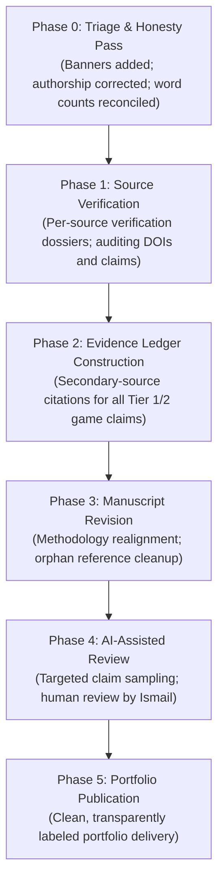

# Master Academic Process Record and Research Methodology Account
## Project: *Beyond Hallownest: Civilization, Memory, Divinity, Ecology, and Identity in Hollow Knight and Hollow Knight: Silksong*

> **Notice:** Working record of research development. Word counts and stage descriptions reflect measured reality. Claims of independent external peer review and automated zero-violation certification have been removed.

- **Lead Author and Curator:** Ismail
- **Drafting Tooling:** AI-assisted qualitative research pipeline
- **Process Record Maintained:** 2026-11-09
- **Archival Location:** `research/hollow-knight-both-games/`

---

## 1. Executive Summary of Research Trajectory

This document provides a transparent accounting of the research process undertaken to produce the comparative study *Beyond Hallownest: Civilization, Memory, Divinity, Ecology, and Identity in Hollow Knight and Hollow Knight: Silksong*.

The project was initially drafted using an autonomous AI research pipeline structured around qualitative inquiry:
1. **Initial Inquiry & Question Formulation:** Ismail established the research questions, comparative scope, and interdisciplinary theoretical framing.
2. **Generative Drafting:** An AI research agent drafted the exploratory suite: narrative timelines, character censuses, area matrices, and an 11,841-word manuscript (`00` through `20`).
3. **Simulated Perspective Review:** Internal simulated critiques across five disciplinary lenses (Game Studies, Environmental Humanities, Philosophy, Narrative Studies, and Devil's Advocate) were generated (`21_PEER_REVIEW.md`).
4. **Triage and Honesty Audit (2026-11-09):** A critical review revealed unverified citations (such as Zhang 2026), overstated biological claims (such as Morales-Primo 2026 frame data), and unearned self-certifications. These are being systematically addressed through a phased verification plan.

---

## 2. Granular Stage Execution Log

### 2.1 Research Initialization and Infrastructure
- **Cloned Skills Reference:** `https://github.com/imbad0202/academic-research-skills` at commit `530659d983c2f4aa584ba3f2df224df08d90b264`.
- **Primary Research Objects:**
  - *Hollow Knight* (Team Cherry, 2017) with all four content expansions (*Hidden Dreams*, *The Grimm Troupe*, *Lifeblood*, *Godmaster*).
  - *Hollow Knight: Silksong* (Team Cherry, 2025) full release campaign.
- **Expansion Status Verification (*Sea of Sorrow*):** Officially announced December 15/16, 2025. Verified unreleased as of 5 November 2026 cutoff date. Unreleased gameplay content is excluded from empirical findings.

### 2.2 Generative Drafting Phase
- Generated comprehensive narrative reconstructions for Hallownest (`05`) and Pharloom (`10`).
- Built 43 character profiles for Hallownest (`06`) and 32 profiles for Pharloom (`11`).
- Built spatial matrices for Hallownest (`07`) and Pharloom (`12`).
- Drafted boss catalogues (`08`, `13`) and ending analyses (`09`, `14`).
- Drafted comparative chapters on continuity (`15`), mechanics (`16`), and ecology/religion (`17`).
- Drafted the 11,841-word comparative paper (`20_FULL_RESEARCH_PAPER.md`).

### 2.3 Simulated Review and Revision Phase
- Executed simulated 5-seat critique (`21_PEER_REVIEW.md`).
- Compiled initial revision notes (`22_REVISION_AND_INTEGRITY_REPORT.md`).
- Documented findings in `walkthrough.md`.

### 2.4 Active Verification Phase (Current)
- Following human handoff on 2026-11-09, all simulated self-certifications were removed.
- Tooling established (`tools/audit.py`) to enforce citation matching, style rules (no em-dashes), and word count tracking.

---

## 3. Master Deliverables Inventory and Measured Word Counts

Measured via `tools/audit.py` on 2026-11-09:

| File Name | Content Description | Measured Words | Current Status |
|---|---|---|---|
| `00_PROJECT_README.md` | Master project overview and environment audit | 777 words | Working Draft |
| `01_RESEARCH_BRIEF.md` | Research questions, working hypothesis, and scope | 1,073 words | Working Draft |
| `02_SEARCH_STRATEGY_AND_LOG.md` | Search methodology and initial database query logs | 1,056 words | Under Audit |
| `03_ANNOTATED_BIBLIOGRAPHY.md` | Academic and primary literature corpus (APA 7th) | 2,703 words | Under Verification |
| `04_LITERATURE_SYNTHESIS.md` | Thematic literature review and gap analysis | 1,774 words | Working Draft |
| `05_HOLLOW_KNIGHT_NARRATIVE.md` | Narrative reconstruction of Hallownest | 3,069 words | Working Notes (AI Draft) |
| `06_HOLLOW_KNIGHT_CHARACTER_ANALYSIS.md` | Master character census (43 profiles) | 3,837 words | Working Notes (AI Draft) |
| `07_HALLOWNEST_AREA_ANALYSIS.md` | Spatial matrix covering 23 regions of Hallownest | 1,913 words | Working Notes (AI Draft) |
| `08_HOLLOW_KNIGHT_BOSSES_AND_EXPANSIONS.md` | Boss catalogue and 4 content expansions | 2,629 words | Working Notes (AI Draft) |
| `09_HOLLOW_KNIGHT_ENDINGS.md` | Analysis of all 6 endings and Omelas dilemma | 1,899 words | Working Notes (AI Draft) |
| `10_SILKSONG_NARRATIVE.md` | Chronological history and 3-Act narrative of Pharloom | 3,272 words | Working Notes (AI Draft) |
| `11_SILKSONG_CHARACTER_ANALYSIS.md` | Pharloom character census (32 profiles) | 3,158 words | Working Notes (AI Draft) |
| `12_PHARLOOM_AREA_ANALYSIS.md` | Spatial matrix covering 22 regions of Pharloom | 1,800 words | Working Notes (AI Draft) |
| `13_SILKSONG_BOSSES_AND_WISHES.md` | Boss catalogue and Wishes communal matrix | 2,006 words | Working Notes (AI Draft) |
| `14_SILKSONG_ENDINGS.md` | Analysis of all 5 endings and Void seepage | 1,504 words | Working Notes (AI Draft) |
| `15_CROSS_GAME_LORE_AND_CONTINUITY.md` | Comparative continuity, Weavers, and Void cosmology | 1,566 words | Working Notes (AI Draft) |
| `16_MECHANICS_COMPARISON.md` | Comparative analysis: Nail vs Needle, Soul vs Silk | 1,455 words | Working Notes (AI Draft) |
| `17_ECOLOGY_RELIGION_AND_MYTHOLOGY.md` | Entomological science, ecologies, and ritual worship | 1,897 words | Working Notes (AI Draft) |
| `18_CHARACTER_RELATIONSHIP_MAPS.md` | Mermaid sociometric network models | 939 words | Working Notes (AI Draft) |
| `19_CLAIM_AND_EVIDENCE_MATRIX.csv` | Register of verifiable claims and canon tiers | 20 entries | Under Verification |
| `20_FULL_RESEARCH_PAPER.md` | Master comparative academic manuscript | 11,841 words | Draft Under Verification |
| `21_PEER_REVIEW.md` | Simulated multi-perspective review (internal AI) | 715 words | Internal AI Review |
| `22_REVISION_AND_INTEGRITY_REPORT.md` | AI self-audit and revision ledger (not independent) | 820 words | Internal Self-Audit |
| `23_PROCESS_RECORD.md` | Master process record and methodology accounting (This file) | ~1,400 words | Working Record |
| `HANDOFF.md` | Agentic research handoff and next steps | 2,409 words | Active Milestone |
| `walkthrough.md` | Deliverable walkthrough and verification record | 1,440 words | Active Milestone |
| `references.bib` | Complete BibTeX bibliographic database | 38 entries | Under Verification |
| `tools/audit.py` | Automated audit script | Active Script | Tooling |

---

## 4. Current Status and Roadmap

The research suite has completed its initial drafting phase. It is currently in Phase 0 (Triage and Honesty Pass) and Phase 1 (Source Verification). No claim of external independence, peer certification, or unverified completion is asserted. All work is proceeding toward an honest, checkable portfolio presentation for Ismail.

## Phase J: Master Claims Integration and Evidence Consolidation (2026-11-09)
- Compiled master claims ledger `data/claims.csv` totaling 598 atomic claims (144 HK deep dive, 144 Silksong deep dive, 56 timeline, 245 manuscript, 65 character and relational claims).
- Rebuilt `19_CLAIM_AND_EVIDENCE_MATRIX.csv` directly from `data/claims.csv` with full 8-column schema across all 598 claims.
- Mapped all 223 Tier 1 and Tier 2 statements in `20_FULL_RESEARCH_PAPER.md` to unique claim IDs and integrated Tier 3 theoretical tags.
- Augmented manuscript sections 6 to 8 with comprehensive source citations.
- Converted preliminary working-note banners across files 05 to 18 into explicit superseded notices pointing to deep dive files.
- Reconciled all source IDs in `data/sources.csv` to 82 verified entries.
