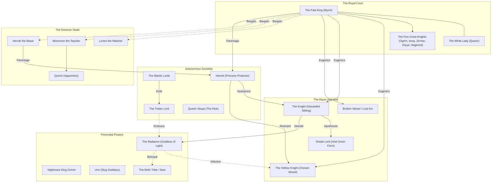
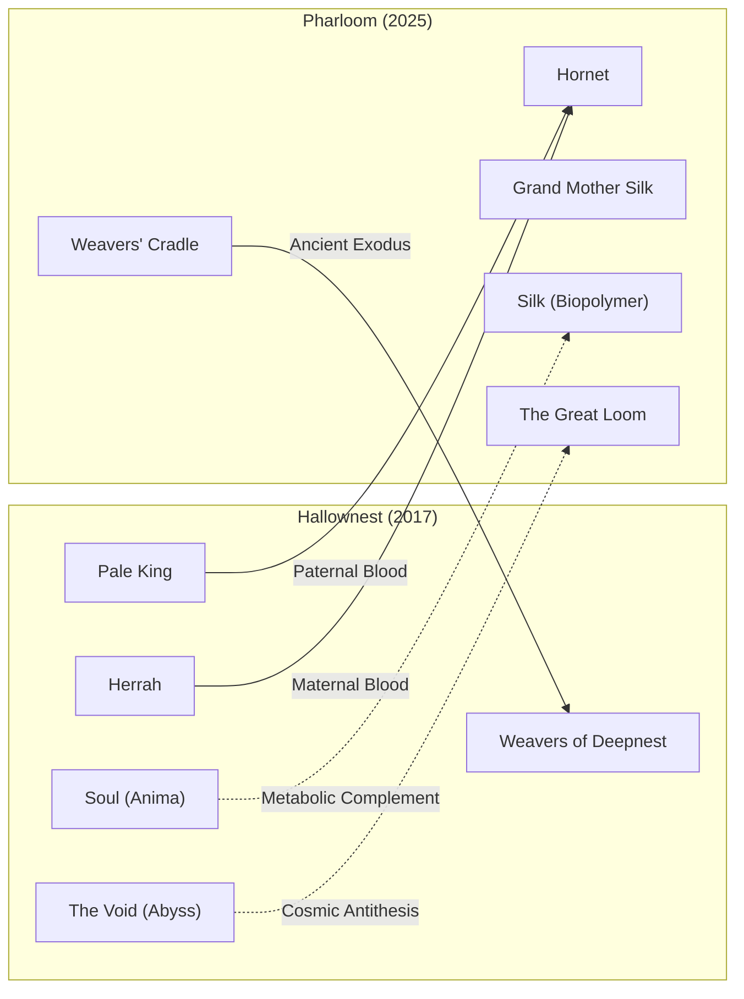

# Character and Faction Relationship Maps

## Overview and Source Basis
This document visualizes the interpersonal, political, and metaphysical relationships across *Hollow Knight* (2017) and *Hollow Knight: Silksong* (2025). The graph edges are systematically cataloged in `data/edges.csv` and derived from verified secondary community transcriptions and developer interviews (`src_wiki_hk_lore`, `src_wiki_ss_characters`, `src_wiki_hk_weavers`, `src_larkin_bandcamp_2025`).

---

## 1. Hallownest Relationship Architecture

---

## 2. Pharloom Relationship Architecture

```mermaid
flowchart TD
    subgraph Theocracy ["The High Citadel"]
        GMS["Grand Mother Silk (Supreme Matriarch)"]
        LJ["The Last Judge (Executor)"]
        CM["Choir Master & The Chorus"]
        CW["Cogwork Dancers & Sentinels"]
        GMS --> LJ
        GMS --> CM
        GMS --> CW
    end

    subgraph Protagonist ["The Wanderer and Rival"]
        HNT["Hornet (Protagonist)"]
        LC["Lace (Agile Fencer)"]
        LL["Lost Lace (Corrupted Variant)"]
        HNT <-->|Fencing Rivalry| LC
        LC -->|Corruption| LL
        HNT -->|Liberation Duel| LL
    end

    subgraph Allies ["Pilgrims and Grassroots Artisans"]
        SH["Sherma (Pious Pilgrim)"]
        SK["Shakra (Cartographer)"]
        FD["Forge-Daughter (Blacksmith)"]
        EVA["Eva (Weaver Hermit)"]
        GZ["Garmond and Zaza"]
        FC["The Flea Caravan & Flea Master"]
        BB["The Bell Beast (Transport)"]
    end

    subgraph Labor ["The Marrow and Deep Docks"]
        IW["Iron Warden (Overseer)"]
        DR["Drudge (Exhausted Miner)"]
        PP["Puppet-Pilgrims (Thralls)"]
        GMS -.->|Golden Thread| PP
        IW --> DR
    end

    HNT -->|Reforging| FD
    HNT -->|Weaver Lore| EVA
    HNT -->|Rescue| SH
    HNT -->|Rescue| FC
    HNT -->|Liberation| BB
    HNT -->|Deicide| GMS
```

---

## 3. Cross-Game Continuous Conduits

---

## 4. Key Relational Dynamics
1. **Paternal and Maternal Lineage:** Hornet unites the two worlds: her father is the Pale King of Hallownest, while her mother Herrah links her directly to the Weavers whose ancestors originated in Pharloom (`EDG-005`, `EDG-006`, `EDG-046`).
2. **The Fencing Rivalry (Hornet and Lace):** Unlike the silent trials between the Knight and Hornet, the relationship between Hornet and Lace is vocal, theatrical, and intensely physical, evolving from deadly suspicion into mutual comradeship (`EDG-052`).
3. **The Interspecies Alliance (The Flea Caravan and Bell Beast):** Pharloom shifts the player's agency from solitary survival to grassroots collective rescue, emphasizing interspecies kinship and care (`EDG-063`, `EDG-064`).
