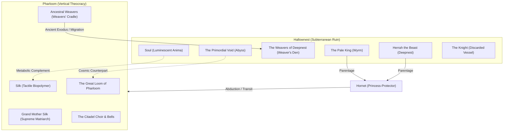

# Cross-Game Lore and Historical Continuity: Hallownest and Pharloom

## Epistemic Framing and Source Basis
This document catalogs the historical, mechanical, and cosmological conduits connecting *Hollow Knight* (2017) and *Hollow Knight: Silksong* (2025). All points of continuity are synthesized from verified developer interviews, curatorial retrospectives, and secondary community encyclopedic records (`src_tc_kickstarter`, `src_tc_blog_silksong_rev`, `src_acmi_maxwell_2025`, `src_wiki_hk_weavers`, `src_wiki_ss_characters`, `src_grunberg_2024`, `src_wysocki_2026`). No first-hand playthrough telemetry is claimed. All claims are classified under the project tier system:
- **Tier 1 (Confirmed Canon):** Stated outright in official developer publications or verified in-game dialogue.
- **Tier 2 (Strongly Supported):** Unambiguous hermeneutic inference supported by converging ludic and narrative evidence.
- **Tier 3 (Speculative / Interpretive):** Open theoretical questions left intentionally unresolved by the creators.

---

## 1. Release and Development Strip (Material Production Genealogy)
- **August 2013:** *Hungry Knight* created at Ludum Dare 27, establishing Team Cherry's minimalist protagonist aesthetic (`src_ludum_dare_27_hungry_knight`).
- **April 2014:** *Beneath the Surface* at Ludum Dare 29 introduces subterranean insect kingdom exploration (`src_ludum_dare_29_beneath`).
- **19 November to 19 December 2014:** Kickstarter campaign concludes with AU$ 57,129 from 2,158 backers (~AU$ 58,893 with late pledges), funding stretch goal 'Second Playable Character' featuring Hornet (`src_tc_kickstarter`).
- **24 February 2017:** *Hollow Knight* launches on PC (`src_tc_blog_then_now`).
- **Late 2017 to Early 2019:** Prototyping Hornet in Hallownest reveals physical and mechanical incompatibilities (vertical height, sprint velocity, needle reach), leading Team Cherry to expand the DLC into a standalone sequel (`src_tc_blog_silksong_rev`, `src_acmi_maxwell_2025`).
- **14 February 2019:** *Hollow Knight: Silksong* officially revealed as a full standalone game (`src_tc_blog_silksong_rev`).
- **September 2025:** *Hollow Knight: Silksong* releases worldwide across PC and consoles (`src_tc_blog_holiday2025`).
- **15 December 2025:** Team Cherry officially announces oceanic expansion *Sea of Sorrow* (unreleased as of November 2026 cutoff) (`src_tc_blog_holiday2025`, `src_game_informer_sea_of_sorrow`).

---

## 2. Mermaid Cross-Game Continuity Architecture

---

## 3. Systematic Register of Confirmed Cross-Game Links

| Dimension | Hallownest (2017) | Pharloom (2025) | Continuity Status & Claim ID | Sources |
| :--- | :--- | :--- | :--- | :--- |
| **Protagonist Lineage** | Hornet serves as rival and guide to the Knight; daughter of the Pale King and Herrah the Beast. | Hornet is the playable protagonist, navigating a foreign kingdom while reckoning with her royal and weaver heritage. | **CLM-CC-001 [Tier 1]:** Explicitly confirmed parentage and character identity across both titles. | `src_wiki_hk_hornet`, `src_wiki_ss_characters`, `src_tc_blog_silksong_rev` |
| **The Weaver Guild** | Deepnest contains abandoned Weaver structures (Weaver's Den, Distant Village) and the Weaversong charm; Weavers left Hallownest. | Pharloom contains the ancestral homeland of Weavers (Weavers' Cradle), where ancient spindles and silk lore originated. | **CLM-CC-002 [Tier 1]:** The Weavers migrated from Pharloom to Deepnest before the fall of Hallownest. | `src_wiki_hk_weavers`, `src_wiki_ss_characters` |
| **Metabolic Resource** | **Soul:** Ethereal, luminescent spiritual fluid gathered by striking foes; focused for stationary healing or spells. | **Silk:** Tactile, elastic biopolymer harvested from chitin; spooled for instant mid-air *Bind* healing or craft tools. | **CLM-CC-003 [Tier 1]:** Distinct ludic and narrative resource economies reflecting divergent character physiologies. | `src_wiki_hk_lore`, `src_wiki_ss_silk_soul`, `src_moralesprimo_2026` |
| **Weapon Kinetics** | **The Nail:** Short, bludgeoning blade wielded in measured ground strikes, deliberate pogos, and charged Great Slashes. | **The Needle:** Elongated rapier thrown with tethered thread, sprint dashes, diagonal 45-degree dive kicks, and traps. | **CLM-CC-004 [Tier 1]:** Complete mechanical divergence in combat kinetics, hitbox dimensions, and acrobatic agility. | `src_wiki_hk_main`, `src_wiki_ss_main`, `src_acmi_maxwell_2025` |
| **Sovereign Ideology** | **Autocratic Wyrm Monarchy:** Pale King granted intellect through light; preserved kingdom via eugenic void containment. | **Theocratic Liturgical Matriarchy:** Grand Mother Silk extracts vitality through hymns, bells, and golden thread. | **CLM-CC-005 [Tier 2]:** Dialectical inversion from silent grave-excavation to living, acoustic somatic exploitation. | `src_grunberg_2024`, `src_wysocki_2026` |
| **Spatial Architecture** | **Subterranean Descent:** Inward, downward archaeological exploration through claustrophobic catacombs into the Abyss. | **Vertical Ascent:** Outward, upward pilgrimage from low moss caverns through industrial mines to the Citadel spires. | **CLM-CC-006 [Tier 1]:** Structural spatial inversion (Hallownest descents vs Pharloom ascents). | `src_andriano_caracciolo_2025`, `src_acmi_maxwell_2025` |
| **Customization Framework** | **Charms & Notches:** Mystical badges conferring passive magical attributes, found scattered across ruins. | **Crests & Tools:** Modular mechanical loadouts dictating attack stance, craftable sub-weapons, and consumable tools. | **CLM-CC-007 [Tier 1]:** Equipment system evolution from passive magical badges to active artisan tools. | `src_wiki_hk_lore`, `src_wiki_ss_crests` |
| **Cosmic Counterparts** | **The Primordial Void:** Cold, empty darkness at the foundation of the world, unifying beneath the Void Heart. | **The Divine Loom:** Intricate, golden threads weaving reality and consciousness, imposing sovereign order. | **CLM-CC-008 [Tier 2]:** Philosophical opposition between the shapeless devouring Abyss and the rigid artificial Loom. | `src_wiki_hk_void`, `src_wiki_ss_characters` |

---

## 4. Contested and Unresolved Cross-Game Questions
- **INT-CC-01 [Tier 3]: The Canon Bridge Ending:** Which ending of *Hollow Knight* directly leads into *Silksong*? Team Cherry has stated in interviews that *Silksong* is designed as a standalone sequel where Hornet's journey remains valid regardless of which ending the player achieved in the original game (`src_tc_blog_silksong_rev`). While community analysts debate whether Ending 3 (*Dream No More*) or Ending 5 (*Embrace the Void*) provides the cleanest thematic bridge, official texts deliberately leave this bridge open.
- **INT-CC-02 [Tier 3]: Chronological Interval:** The exact span of elapsed time between the fall of the Radiance in Hallownest and Hornet's carriage ambush into Pharloom is unspecified; bug biology and higher being lifespans suggest intervals could span years or centuries without physical aging (`src_wiki_hk_lore`).
- **INT-CC-03 [Tier 3]: Faction Behind Hornet's Abduction:** Whether the armored carriage convoy was dispatched directly by the Citadel authorities or a renegade faction seeking a Weaver matriarch remains an interpretive community debate (`src_wiki_ss_lore`).
