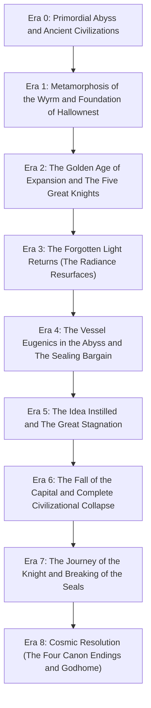

# Chronological History and Lore Timeline of Hallownest

## Epistemic Framing and Source Basis
This timeline models the historical eras and key events of Hallownest based on secondary community transcriptions of in-game lore tablets, dialogue, Hunter's Journal entries, and developer blog archives (`src_wiki_hk_lore`, `src_wiki_hk_main`, `src_tc_blog_then_now`). No primary frame-by-frame playthrough capture is claimed. Certainty is tagged using the project tier system:
- **Tier 1 (Confirmed Canon):** Directly documented in game text or official developer statements.
- **Tier 2 (Strongly Supported):** Necessary inference derived from converging in-game environmental and historical evidence.
- **Tier 3 (Speculative / Open Question):** Interpretive hypothesis regarding unmeasured chronological durations or ambiguous motivations.

---

## 1. Release and Development Strip (Verified Historical Milestones)
- **August 2013:** Ludum Dare 27 game jam entry *Hungry Knight* created under theme "10 Seconds" (`src_ludum_dare_27_hungry_knight`).
- **April 2014:** Ludum Dare 29 prototype *Beneath the Surface* establishes subterranean insect ruin setting (`src_ludum_dare_29_beneath`).
- **19 November to 19 December 2014:** Kickstarter campaign raises AU$ 57,129 from 2,158 backers, funding stretch goals including White Palace and second playable character (`src_tc_kickstarter`).
- **24 February 2017:** *Hollow Knight* launches worldwide on PC/Mac/Linux (`src_tc_blog_then_now`, `src_steam_hk_store`).
- **August 2017 to August 2018:** Release of four content expansions (*Hidden Dreams*, *The Grimm Troupe*, *Lifeblood*, and *Godmaster*).
- **12 June 2018:** Launch on Nintendo Switch, expanding global reach (`src_nintendo_aus_2018`).

---

## 2. Chronological Timeline of Hallownest

### Era 0: Primordial Abyss and Pre-Wyrm Civilizations
- **CLM-HN-001 [Tier 1]:** Long before Hallownest, an ancient civilization inhabited the subterranean depths, carving totem arches and worshiping the primordial Void in the Abyss (`src_wiki_hk_void`, `src_wiki_hk_lore`).
- **CLM-HN-002 [Tier 1]:** The primordial light goddess, the Radiance, created the Moth Tribe in the Resting Grounds, fostering a peaceful community of dream reverence without weapons or territorial conquest (`src_wiki_hk_radiance`, `src_wiki_hk_lore`).
- **CLM-HN-003 [Tier 2]:** Distinct regional tribes existed independently across the caverns: the territorial Mantis Tribe in Fungal Wastes, the slug deity Unn dreaming Greenpath into life, the isolated bee monarchy in the Hive, and the arachnids of Deepnest (`src_wiki_hk_areas`, `src_wiki_hk_lore`).

### Era 1: Metamorphosis of the Wyrm and Foundation of Hallownest
- **CLM-HN-004 [Tier 1]:** A colossal ancient Wyrm died at the edge of the world (Kingdom's Edge), shedding its giant shell to reincarnate into a compact, luminous Pale King (`src_wiki_hk_pale_king`, `src_wiki_hk_lore`).
- **CLM-HN-005 [Tier 1]:** The Pale King expanded his beacon of thought and intellect across the subterranean insects, promising eternal kingdom civilization in exchange for total allegiance (`src_wiki_hk_pale_king`).
- **CLM-HN-006 [Tier 1]:** The Moth Tribe turned away from their original creator, the Radiance, to revere the brilliant physical beacon of the Pale King (the Moth Tribe apostasy) (`src_wiki_hk_radiance`, `src_wiki_hk_lore`).

### Era 2: The Golden Age of Hallownest
- **CLM-HN-007 [Tier 1]:** The Pale King and his consort, the White Lady, established the capital City of Tears beneath the Blue Lake, constructing grand spires, the Stag Station transit grid, and the tramways (`src_wiki_hk_areas`, `src_wiki_hk_pale_king`).
- **CLM-HN-008 [Tier 1]:** The King appointed the Five Great Knights (Ogrim, Isma, Ze'mer, Dryya, and Hegemol) to defend the kingdom's borders and enforce royal decrees (`src_wiki_hk_characters`, `src_wiki_hk_lore`).
- **CLM-HN-009 [Tier 1]:** The Mantis Tribe formed an armed truce with the Pale King, agreeing to guard the lower gates against the predatory beasts of Deepnest while preserving their cultural sovereignty (`src_wiki_hk_areas`, `src_wiki_hk_lore`).

### Era 3: Return of the Forgotten Light (The Radiance Resurfaces)
- **CLM-HN-010 [Tier 1]:** Forgotten by her children, the Radiance lingered in the collective dream realm, resurfacing inside the subconscious minds of Hallownest's citizens as an irresistible golden light (`src_wiki_hk_radiance`, `src_wiki_hk_lore`).
- **CLM-HN-011 [Tier 1]:** The Infection manifested physically as glowing orange pustules, blinding bug reason, reverting them to primal feral aggression, and breaking the King's gift of sapience (`src_wiki_hk_radiance`).
- **CLM-HN-012 [Tier 1]:** Scholars of the Soul Sanctum, led by the Soul Master, attempted to cure the Infection by torturing and extracting Soul from living subjects, but descended into madness (`src_wiki_hk_areas`, `src_wiki_hk_lore`).

### Era 4: The Vessel Project and the Sealing Bargain
- **CLM-HN-013 [Tier 1]:** Refusing to accept the fall of his kingdom, the Pale King and White Lady bred thousands of offspring, casting their eggs into the Abyss where Void hollowed them out into emotionless Vessels (`src_wiki_hk_vessels`, `src_grunberg_2024`).
- **CLM-HN-014 [Tier 1]:** One Vessel was selected as the chosen Hollow Knight and raised to prime stature, intended to possess "no mind to think, no will to break" (`src_wiki_hk_vessels`, `src_wiki_hk_pale_king`).
- **CLM-HN-015 [Tier 1]:** To seal the Hollow Knight within the Temple of the Black Egg, the Pale King struck bargains with three Dreamers: Lurien the Watcher, Monomon the Teacher, and Herrah the Beast (`src_wiki_hk_characters`, `src_wiki_hk_lore`).
- **CLM-HN-016 [Tier 1]:** In exchange for becoming a Dreamer, Herrah demanded a royal child, leading to the birth of Hornet, the Gendered Child of Deepnest (`src_wiki_hk_hornet`, `src_wiki_hk_characters`).

### Era 5: The Idea Instilled and the Great Stagnation
- **CLM-HN-017 [Tier 1]:** During his training, the Hollow Knight shared a moment of affection and paternal bond with the Pale King, instilling an idea and personal attachment that tarnished its perfect emptiness (`src_wiki_hk_vessels`, `src_wiki_hk_lore`).
- **CLM-HN-018 [Tier 1]:** The Radiance, sealed within the tarnished Vessel, broke the internal containment and burst forth through its shell, spreading the orange plague anew across Hallownest (`src_wiki_hk_hollow_knight`, `src_wiki_hk_radiance`).
- **CLM-HN-019 [Tier 1]:** The Pale King retreated his White Palace entirely into the Dream Realm, where he perished upon his throne, leaving Hallownest to rot into an infected cemetery (`src_wiki_hk_pale_king`, `src_wiki_hk_areas`).

### Era 6: The Arrival of the Knight and Unsealing
- **CLM-HN-020 [Tier 1]:** Called by the dying kingdom's psychic pulse, a small discarded Vessel (The Knight) wandered back through the Howling Cliffs into Dirtmouth (`src_wiki_hk_main`, `src_wiki_hk_lore`).
- **CLM-HN-021 [Tier 1]:** The Knight acquired the Dream Nail from the Seer, gathered Soul and charms, and proved its martial prowess against Hornet in Greenpath and Kingdom's Edge (`src_wiki_hk_hornet`, `src_wiki_hk_areas`).
- **CLM-HN-022 [Tier 1]:** The Knight confronted and absorbed the three Dreamers (Monomon with Quirrel's aid, Lurien in his spire, and Herrah in Distant Village), breaking the seals on the Black Egg (`src_wiki_hk_lore`).

### Era 7: Canon Resolutions and Post-Game Godhome
- **CLM-HN-023 [Tier 1]:** **Ending 1 (The Hollow Knight):** The Knight slays the infected sibling and absorbs the Radiance into itself, becoming the new sealed Vessel alone in the dark (`src_wiki_hk_endings`).
- **CLM-HN-024 [Tier 1]:** **Ending 2 (Sealed Siblings):** Hornet intervenes, the Knight absorbs the plague, and Hornet is sealed inside the temple alongside the Vessel as a living seal (`src_wiki_hk_endings`).
- **CLM-HN-025 [Tier 1]:** **Ending 3 (Dream No More):** With the Void Heart acquired, the Knight enters the Hollow Knight's dream, challenges the Radiance, and drags the goddess down into the ocean of Void with the aid of the unified Siblings (`src_wiki_hk_endings`).
- **CLM-HN-026 [Tier 1]:** **Ending 4 and 5 (Embrace the Void / Delicate Flower):** In Godhome, the Knight ascends to become the cosmic Shade Lord (Void Given Form), obliterating the Absolute Radiance and bursting from the Godseeker corpse (`src_wiki_hk_endings`, `src_wiki_hk_void`).

---

## 3. Disputed or Unmeasured Historical Intervals
- **INT-HN-01 [Tier 3]:** The exact duration between the fall of Hallownest and the Knight's return is unrecorded in game text; secondary interpretations range from decades to centuries based on structural decay (`src_wiki_hk_lore`).
- **INT-HN-02 [Tier 3]:** Whether the Pale King's death was a natural expiry of Wyrm vitality or psychic backlash from the encroaching Void remains open to player interpretation (`src_wiki_hk_pale_king`).
