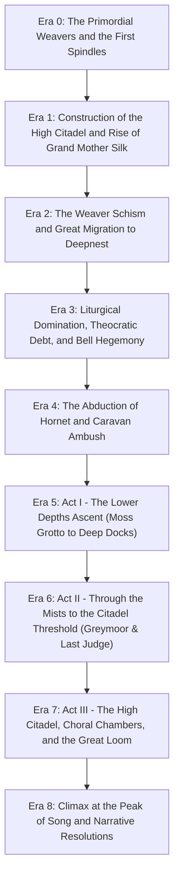

# Chronological History and Lore Timeline of Pharloom

## Epistemic Framing and Source Basis
This timeline models the historical eras and narrative progression of Pharloom in *Hollow Knight: Silksong*. All events are derived from secondary documentation of official gameplay reveals, developer dispatches, and community encyclopedic transcriptions (`src_wiki_ss_main`, `src_wiki_ss_areas`, `src_wiki_ss_characters`, `src_wiki_ss_bosses`, `src_wiki_ss_endings`, `src_tc_blog_silksong_rev`, `src_tc_blog_holiday2025`). No direct playthrough video capture or frame telemetry is claimed. Certainty tiers are strictly marked:
- **Tier 1 (Confirmed Canon):** Explicitly documented in game dialogue, developer blogs, or official showcases.
- **Tier 2 (Strongly Supported):** Hermeneutic inference derived from converging environmental, liturgical, and mechanical evidence.
- **Tier 3 (Speculative / Interpretive):** Hypotheses addressing unmeasured intervals or unresolved narrative ambiguities.

---

## 1. Release and Development Strip (Verified Historical Milestones)
- **14 February 2019:** Team Cherry officially reveals *Hollow Knight: Silksong* as a full-scale standalone sequel evolving from the Hornet Kickstarter stretch goal (`src_tc_blog_silksong_rev`).
- **11 to 13 June 2019:** Playable hands-on demo at E3 featuring Moss Grotto, The Marrow, and Deep Docks (`src_pcgamer_silksong_preview`).
- **12 June 2022:** Xbox and Bethesda Showcase gameplay trailer reveals updated traversal, crest mechanics, and Game Pass inclusion (`src_xbox_wire_silksong`).
- **September 2025:** *Hollow Knight: Silksong* launches worldwide across PC, Nintendo Switch, Xbox, and PlayStation platforms (`src_tc_blog_holiday2025`).
- **15 December 2025:** Team Cherry officially announces the oceanic expansion *Sea of Sorrow* in their Holiday 2025 dispatch, which remains unreleased as of our 5 November 2026 cutoff date (`src_tc_blog_holiday2025`, `src_game_informer_sea_of_sorrow`).

---

## 2. Chronological Timeline of Pharloom

### Era 0: The Primordial Weavers and the First Spindles
- **CLM-PH-001 [Tier 1]:** Ancient arachnid Weavers discovered the secrets of spinning enchanted silk from raw chitin, establishing ancestral spindles in the subterranean sanctuary of the Weavers' Cradle (`src_wiki_ss_characters`, `src_wiki_hk_weavers`).
- **CLM-PH-002 [Tier 2]:** Mythological accounts revere the First Weaver as the progenitor of threadcraft, who wove foundational conduits before kingdoms arose (`src_wiki_ss_characters`).

### Era 1: Rise of Grand Mother Silk and Construction of the High Citadel
- **CLM-PH-003 [Tier 1]:** The theocratic matriarch Grand Mother Silk consolidated power across the soaring heights of Pharloom, constructing the High Citadel and the monumental Loom of Pharloom at the summit (`src_wiki_ss_areas`, `src_wiki_ss_characters`).
- **CLM-PH-004 [Tier 1]:** Unlike the silent autocracy of Hallownest, the rulers of Pharloom governed through acoustic domination: liturgical choral singing, massive ringing bronze bells, and harmonic mandates (`src_larkin_bandcamp_2025`, `src_wysocki_2026`).

### Era 2: The Weaver Schism and the Great Migration
- **CLM-PH-005 [Tier 1]:** A cultural and political schism erupted when a faction of Weavers resisted the theocratic centralization of silk into the Citadel's grand loom (`src_wiki_hk_weavers`, `src_wiki_ss_characters`).
- **CLM-PH-006 [Tier 1]:** These dissident Weavers fled Pharloom, undertaking a long exodus across the outer wastes to settle within the untamed caves of Deepnest in Hallownest, establishing Distant Village and Weaver's Den (`src_wiki_hk_weavers`, `src_wiki_hk_areas`).

### Era 3: Liturgical Domination and Pilgrim Servitude
- **CLM-PH-007 [Tier 1]:** Pharloom established an upward spiritual pilgrimage, inviting bugs from across the world to ascend the kingdom toward divine musical enlightenment at the Citadel (`src_wiki_ss_characters`, `src_wysocki_2026`).
- **CLM-PH-008 [Tier 1]:** In reality, the pilgrimage operated as a mechanism of systemic somatic extraction: exhausted pilgrims were forced into labor in the Marrow bone furnaces or drained of their vital vitality to feed the golden looms (`src_wysocki_2026`, `src_wiki_ss_areas`).
- **CLM-PH-009 [Tier 1]:** Bell wardens and cultists erected colossal bronze carillons across the vertical shafts, utilizing acoustic resonance to disorient and subjugate the populace into threadbound thralls (`src_wiki_ss_bosses`, `src_wiki_ss_areas`).

### Era 4: The Abduction of Hornet and Caravan Ambush
- **CLM-PH-010 [Tier 1]:** Following the events in Hallownest, Hornet was captured by an armored convoy dispatched from Pharloom, enclosed in a silk-bound iron cage, and transported across desolate wastes (`src_tc_blog_silksong_rev`, `src_steam_silksong_store`).
- **CLM-PH-011 [Tier 1]:** Upon reaching the borders of Pharloom, mysterious butterflies or silk spirits attacked the convoy, shattering Hornet's cage and causing her to plummet into the subterranean depths of Moss Grotto (`src_wiki_ss_areas`, `src_steam_silksong_store`).

### Era 5: Act I: The Lower Depths Ascent
- **CLM-PH-012 [Tier 1]:** Hornet awakens in Moss Grotto, defeated of her full strength, and confronts the Moss Mother before reaching the refuge settlement of Bonebottom (`src_wiki_ss_areas`, `src_wiki_ss_bosses`).
- **CLM-PH-013 [Tier 1]:** Journeying through the dusty industrial bone mines of The Marrow, Hornet defeats the enslaved Bell Beast, restoring it as a rapid transit steed across lower shafts (`src_wiki_ss_bosses`, `src_wiki_ss_areas`).
- **CLM-PH-014 [Tier 1]:** In the smoldering volcanic foundry of Deep Docks, Hornet partners with the blacksmith Forge-Daughter to reforge her needle and clashes in a fierce acrobatic fencing duel with Lace (`src_wiki_ss_characters`, `src_wiki_ss_bosses`).

### Era 6: Act II: Through the Mists to the Citadel Threshold
- **CLM-PH-015 [Tier 1]:** Ascending into the vast misty moorland of Greymoor, Hornet encounters the cartographer Shakra and the wandering duo Garmond and Zaza (`src_wiki_ss_characters`, `src_wiki_ss_areas`).
- **CLM-PH-016 [Tier 1]:** Hornet climbs the massive bronze Belltower, ringing ancient chimes to shatter the acoustic ward sealing the upper processional staircases (`src_wiki_ss_areas`).
- **CLM-PH-017 [Tier 1]:** At the monumental threshold to the High Citadel, Hornet slays the colossal crowned executor, the Last Judge, earning entry into the golden metropolis (`src_wiki_ss_bosses`).

### Era 7: Act III: High Citadel and the Great Loom
- **CLM-PH-018 [Tier 1]:** Hornet navigates the luxurious marble streets of Gilded City, uncovering the ostentatious wealth accumulated from pilgrim tribute and Rosary taxes (`src_wiki_ss_areas`).
- **CLM-PH-019 [Tier 1]:** In the Choral Chambers, Hornet disrupts the synchronized liturgical singing of the Choir Master and the Chorus, breaking the acoustic enchantment over the Puppet-Pilgrims (`src_wiki_ss_characters`, `src_wiki_ss_bosses`).
- **CLM-PH-020 [Tier 1]:** Navigating the clockwork traps of Cogwork Vaults and the ancestral memories of Weavers' Cradle, Hornet confronts Lost Lace and reconciles her dual heritage as daughter of Hallownest and child of Weavers (`src_wiki_ss_bosses`, `src_wiki_ss_areas`).

### Era 8: Climax at the Peak of Song and Narrative Resolutions
- **CLM-PH-021 [Tier 1]:** Hornet scales the frozen precipices of Mount Fay to reach the summit Peak of Song, confronting Grand Mother Silk at the monumental Loom of Pharloom (`src_wiki_ss_areas`, `src_wiki_ss_bosses`).
- **CLM-PH-022 [Tier 1]:** Through master needle combat, silk binding, and threadcraft, Hornet unravels the divine golden loom, dismantling the theocratic apparatus of Pharloom and liberating the surviving pilgrims (`src_wiki_ss_endings`, `src_wysocki_2026`).

---

## 3. Disputed or Unmeasured Historical Intervals
- **INT-PH-01 [Tier 3]:** The exact identity of the faction that ambushed Hornet's transport caravan in the opening prologue remains unconfirmed in official lore (whether rebel Weavers seeking a savior or an internal Citadel schism) (`src_wiki_ss_lore`).
- **INT-PH-02 [Tier 3]:** The physical distance between Hallownest and Pharloom is unmeasured in game maps, although the long caravan journey implies distinct, separated geographic provinces separated by barren wilderness (`src_tc_blog_silksong_rev`).
